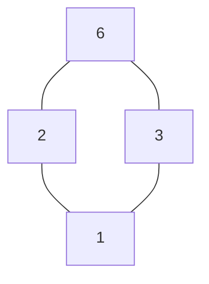
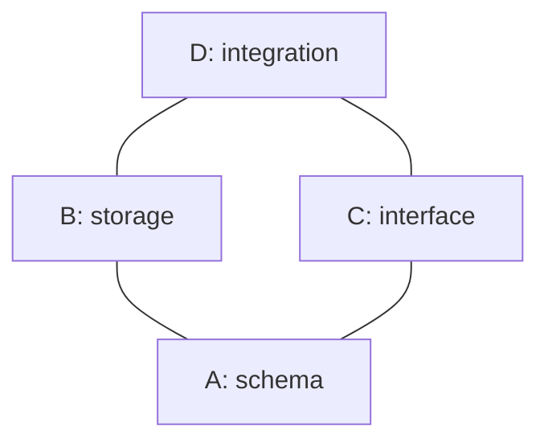

# Mathematics for Computer Scientists: Foundations to Mastery

## A cumulative course from arithmetic literacy to advanced computational mathematics

### Scope, assumptions, and typesetting

This work develops the mathematics required for undergraduate and early postgraduate computer science. It assumes only the ability to perform elementary addition, subtraction, multiplication, and division, together with an informal acquaintance with fractions. It does not assume fluency in algebra, mathematical notation, proof, sets, functions, graphs, calculus, probability, or linear algebra. Those subjects are constructed in dependency order.

Mathematical expressions are typeset using LaTeX/MathJax notation. An expression between single dollar signs is inline mathematics: for example, `$2+3=5$` renders as $2+3=5$. Every symbol is defined when first introduced and is accompanied by a spoken reading. Later chapters may use a symbol freely only after its definition has entered the cumulative notation ledger.

The mandatory trunk is linear: every trunk chapter presupposes the preceding trunk. The specialist branches presuppose the complete trunk and may then be read independently except where a branch states an additional dependency.

---

# Contents and dependency map

## Part I — Mandatory trunk

1. **Mathematical Language, Arithmetic Structure, and Proof-Oriented Thinking.** Mathematical objects and representations; expression grammar; equality; natural numbers, integers, rational numbers, decimals, powers, roots, algebraic expressions, equations, inequalities, indexed notation, sums, products, definitions, claims, proof, specifications, invariants, and algorithms.
2. **Propositional Logic, Predicate Logic, and Proof.** Depends on Chapter 1. Truth-functional logic, quantification, formal consequence, proof methods, induction, well-ordering, structural induction, invariants, and proof failure.
3. **Sets, Relations, Functions, and Infinity.** Depends on Chapters 1–2. Sets and set operations, tuples, relations, equivalence and order, functions, cardinality, countability, Cantor's diagonal argument, and the power-set theorem.
4. **Combinatorics and Counting.** Depends on Chapters 1–3. Counting principles, permutations, combinations, binomial coefficients, pigeonhole arguments, inclusion–exclusion, recurrence modelling, and introductory generating functions.
5. **Number Theory.** Depends on Chapters 1–4. Divisibility, the division algorithm, congruence, Euclid's algorithm, Bézout identities, primes, unique factorisation, modular inverses, Fermat's and Euler's theorems, and the Chinese remainder theorem.
6. **Graph Theory.** Depends on Chapters 1–5. Graphs, digraphs, paths, connectivity, trees, representations, traversal, shortest paths, spanning trees, matching, planarity, and colouring.
7. **Linear Algebra.** Depends on Chapters 1–6. Vectors, vector spaces, linear maps, matrices, systems, elimination, determinants, bases, eigenstructure, orthogonality, least squares, and singular-value decomposition.
8. **Calculus and Analysis for Computation.** Depends on Chapters 1–7. Real-number structure, limits, continuity, differentiation, integration, multivariable calculus, Taylor approximation, numerical error, and elementary continuous optimisation.
9. **Recurrence Relations and Generating Functions.** Depends on Chapters 1–8. Linear recurrences, characteristic roots, substitution, recursion trees, the Master Theorem, formal power series, and coefficient extraction.
10. **Asymptotic Analysis and Algorithmic Complexity.** Depends on Chapters 1–9. Formal asymptotic relations, growth classes, limit methods, canonical algorithm analyses, amortisation, and limits of asymptotic notation.
11. **Probability Theory.** Depends on Chapters 1–10. Sample spaces, conditional probability, independence, random variables, distributions, expectation, variance, covariance, concentration, the laws of large numbers, and the central limit theorem.
12. **Statistics and Inference.** Depends on Chapters 1–11. Sampling, estimators, likelihood, bias and variance, confidence procedures, hypothesis testing, regression, model criticism, and misuse of statistics.
13. **Logic and Computation.** Depends on Chapters 1–12. Boolean algebra, formal languages, automata, grammars, Turing machines, computability, undecidability, and the halting problem.
14. **Abstract Algebra for Computing.** Depends on Chapters 1–13. Groups, rings, fields, quotient structures, finite fields, polynomial arithmetic, and their computational uses.
15. **Optimisation.** Depends on Chapters 1–14. Optimisation models, convexity, gradient methods, constraints, Lagrange multipliers, KKT conditions, linear programming, duality, and numerical considerations.
16. **Capstone: The Mathematical Architecture of Computer Science.** Depends on Chapters 1–15. A synthesis of the mathematical dependencies of algorithms, cryptography, machine learning, verification, graphics, data systems, and computation theory.

## Part II — Optional specialist branches

17. **Mathematics for Machine Learning.** Requires Chapters 1–16, especially 7, 8, 11, 12, and 15. Matrix calculus, multivariate chain rules, optimisation landscapes, information theory, learning theory, and neural-network linear algebra.
18. **Cryptography.** Requires Chapters 1–16, especially 2, 5, 10, 13, and 14. Computational hardness, number-theoretic constructions, symmetric and asymmetric systems, hashes, Diffie–Hellman, RSA, elliptic curves, and security definitions.
19. **Theoretical Computer Science and Complexity Theory.** Requires Chapters 1–16, especially 2, 3, 6, 9, 10, and 13. Reductions; P, NP, and NP-completeness; Cook–Levin; space complexity; randomisation; PSPACE; and the polynomial hierarchy.
20. **Computer Graphics and Computational Geometry.** Requires Chapters 1–16, especially 6–8 and 15. Affine and projective geometry, homogeneous coordinates, rotations, quaternions, intersection tests, hulls, curves, splines, rasterisation, and numerical robustness.
21. **Quantum Computing.** Requires Chapters 1–16, especially 2, 7, 11, 13, and 14. Complex vector spaces, tensor products, unitary evolution, measurement, circuits, entanglement, Deutsch–Jozsa, and Grover search.
22. **Formal Methods and Program Verification.** Requires Chapters 1–16, especially 2, 3, 6, 9, 10, and 13. Hoare logic, invariants, termination, weakest preconditions, temporal logic, model checking, type theory, and Curry–Howard.

---

# Part I — Mandatory Trunk

# Chapter 1 — Mathematical Language, Arithmetic Structure, and Proof-Oriented Thinking

## 1.0 Purpose and dependency boundary

This chapter supplies the mathematical language that later chapters require. The order is deliberate. A proof about a set is unintelligible if equality is unclear; an equation cannot be manipulated reliably if the grammar of expressions is unclear; summation notation cannot be read if indices and variable scope are unclear. Accordingly, no familiarity with algebra is presumed.

The chapter begins with objects, inscriptions, and meanings. It then reconstructs elementary arithmetic as a system governed by laws rather than as a collection of remembered procedures. Integers, fractions, decimals, powers, roots, equations, inequalities, indexed families, sums, products, and recursive descriptions follow. Only after these foundations are available does the chapter introduce definitions, claims, counterexamples, proofs, specifications, invariants, and algorithms.

### Symbols already available

The reader is assumed to recognise the decimal digits $0,1,2,3,4,5,6,7,8,9$ and the four elementary operation signs below. Their meanings will nevertheless be sharpened.

| Symbol | Read aloud | Initial meaning |
|---|---|---|
| $+$ | “plus” | addition |
| $-$ | “minus” | subtraction; later also a sign denoting an additive inverse |
| $\times$ | “times” or “multiplied by” | multiplication |
| $\div$ | “divided by” | division |

The symbols $=$, $\ne$, $<$, $\leq$, $>$, and $\geq$ are introduced formally below. Until then, they should not be treated as understood merely because they look familiar.

## 1.1 Mathematics is not merely calculation

An **arithmetic calculation** starts with specified numbers and operations and produces a number. For example,

$$27+15=42$$

records a calculation. Read the display aloud as “twenty-seven plus fifteen equals forty-two”. The displayed line also makes a claim: that the expression on the left and the expression on the right have the same value.

Mathematics includes calculation but extends beyond it. It studies objects, patterns, relations, transformations, and the consequences of precisely stated assumptions. Compare these three tasks:

1. Calculate $8+6$.
2. Decide whether every sum of two even whole numbers is even.
3. Explain why the answer to the second task holds for every pair of even whole numbers, not merely for the pairs already tested.

The first task asks for a value. The second asks for the truth of a general statement. The third asks for a **proof**: a finite argument whose steps establish that conclusion from agreed definitions and earlier results.

### Worked example 1.1 — Calculation, experiment, and proof have different force

Suppose we inspect the following sums:

| First number | Second number | Sum |
|---:|---:|---:|
| $2$ | $4$ | $6$ |
| $8$ | $10$ | $18$ |
| $26$ | $100$ | $126$ |

Every displayed input is even, and every displayed output is even. This is **evidence** for the general claim, but it is not a proof. There are infinitely many even numbers, so no finite table can list every pair. A proof must use what being even means. Later in this chapter we will define an even integer as an integer equal to twice another integer. If two even integers have the forms $2a$ and $2b$, their sum is

$$2a+2b=2(a+b),$$

which is twice an integer and is therefore even. The letters $a$ and $b$ do not name two specially selected numbers; they stand for arbitrary integers. The argument covers all cases at once because it works from the definition.

This example uses elementary algebra before algebra has been developed. It is a **flagged preview**: its purpose is to distinguish empirical checking from proof. Sections 1.10–1.19 will justify every manipulation used in it.

## 1.2 Mathematical objects, representations, and interpretations

A **mathematical object** is an entity considered within a mathematical theory. Numbers, ordered lists, functions, graphs, and sets will all become mathematical objects in this book. An object is not identical to every physical or written representation of it.

The whole number five may be represented by the decimal inscription $5$, the Roman numeral V, five tally marks, or five illuminated pixels arranged as a die face. These are distinct marks or configurations that can denote the same number. This distinction between an object and its representation matters in computing. The integer five may be written for a human as `5`, stored in a computer as a binary bit pattern, transmitted as a character code, or represented internally as part of a larger runtime object. Those encodings are not the abstract integer itself.

An **inscription** is a written or displayed mark. A **symbol** is an inscription used according to a convention. A **denotation** is the object to which an expression refers. An **interpretation** assigns meanings to otherwise formal symbols. These distinctions prevent three common confusions:

- a mark is not automatically meaningful;
- different marks can denote the same object;
- the same mark can have different meanings in different contexts.

### Worked example 1.2 — Several representations of one value

Consider:

$$10,\qquad \text{ten},\qquad 2\times5,\qquad 13-3.$$

These four expressions are not identical strings of marks. Under the ordinary interpretation of decimal arithmetic, however, each has the value ten. Equality concerns the denoted values, not visual similarity.

In Python, the expressions below likewise produce values that compare equal:

```python
10
2 * 5
13 - 3
```

Python syntax uses `*` for multiplication. The program is a computational representation of operations; running it can confirm particular cases, but the program does not by itself prove a general mathematical statement.

> **Common misconception — “The symbol is the thing.”** The written digit `5` is not the number five in the same sense that the written word `tree` is not a tree. Mathematical reasoning operates through representations, but correctness requires tracking what those representations denote.

## 1.3 Expressions, values, and evaluation

An **expression** is a well-formed arrangement of symbols that denotes a value or object. “Well-formed” means that the arrangement obeys the grammar of the notation being used. In elementary arithmetic, $2+3$ is an expression. The sequence $+2)3$ is not a well-formed arithmetic expression under the usual grammar.

To **evaluate** an expression is to determine the value it denotes. Evaluation is not the same as rewriting marks arbitrarily. Each rewriting step must preserve value under a valid arithmetic law.

Consider

$$4\times(3+2).$$

The parentheses, read “open parenthesis” and “close parenthesis”, group $3+2$ as a subexpression. Evaluating that subexpression first gives

$$4\times(3+2)=4\times5=20.$$

The expression contains a hierarchy:

```text
          multiplication
          /            \
         4           addition
                     /        \
                    3          2
```

This is a **parse tree**: a diagram that records how an expression is assembled from smaller expressions. Its leaves are the numerals $4$, $3$, and $2$; its internal nodes are operations. A computer language processor similarly parses source text into a structural representation before evaluating or compiling it.

### 1.3.1 Operators and operands

An **operator** denotes an operation. In $7+5$, the plus sign is a binary operator: **binary** here means “taking two inputs”. The inputs $7$ and $5$ are its **operands**. In the expression $-4$, the minus sign is unary: **unary** means “taking one input”. It denotes the additive inverse of $4$, developed in Section 1.17.

The same visible symbol may therefore have different grammatical roles. In $9-4$, minus is a binary subtraction operator. In $-4$, minus is a unary operator. The surrounding expression determines the role.

### 1.3.2 Why an order-of-operations convention is necessary

An expression is a compact description of a tree of operations. If every operation were surrounded by parentheses, the tree would always be explicit, but ordinary writing would become cumbersome. A precedence convention allows some parentheses to be omitted without making the intended tree ambiguous.

Without such a convention, $2+3\times4$ could mean either

$$2+(3\times4)=2+12=14$$

or

$$(2+3)\times4=5\times4=20.$$

The two readings have different values. Conventional arithmetic assigns multiplication higher **precedence** than addition, so the unparenthesised expression receives the first reading. “Higher precedence” means that the multiplication forms a subexpression before the addition does. It does not mean multiplication is performed earlier in physical time, nor that multiplication is mathematically more important.

### 1.3.3 BODMAS and BIDMAS are reading aids, not complete algorithms

In Britain, the mnemonics **BODMAS** and **BIDMAS** are commonly expanded as follows:

| Letter | BODMAS term | BIDMAS term | Structural meaning |
|---|---|---|---|
| B | brackets | brackets | evaluate explicitly grouped subexpressions |
| O/I | orders | indices | powers and roots |
| D | division | division | same precedence level as multiplication |
| M | multiplication | multiplication | same precedence level as division |
| A | addition | addition | same precedence level as subtraction |
| S | subtraction | subtraction | same precedence level as addition |

The mnemonic is frequently misread. It does **not** mean that every division in an expression must be performed before every multiplication. Division and multiplication occupy the same precedence level and are conventionally grouped from left to right when no parentheses decide otherwise. Likewise, addition and subtraction share a level.

For example,

$$24\div6\times2$$

is parsed from left to right:

$$(24\div6)\times2=4\times2=8.$$

It is not parsed as $24\div(6\times2)=2$. Similarly,

$$10-3+2=(10-3)+2=9,$$

not $10-(3+2)=5$.

Subtraction can also be understood as addition of an inverse, and division as multiplication by a reciprocal once those concepts have been introduced. That deeper account explains why the paired operations share precedence. At this point, left-to-right parsing is the working convention.

### 1.3.4 A reliable evaluation procedure

For an arithmetic expression containing the operations currently available:

1. **Expose the grouping.** Locate the innermost parentheses. A fraction bar and a radical sign also group what lies under them.
2. **Resolve powers and roots** within the current group.
3. **Resolve multiplication and division from left to right.** Treat adjacent multiplication, such as $3x$, as multiplication at this level.
4. **Resolve addition and subtraction from left to right.**
5. **Check the domain.** Confirm that no divisor is zero and that every operation is defined for the number system being used.
6. **Check plausibility.** Estimate the size or sign so that a transcription error is less likely to survive.

This is an evaluation procedure, not a licence to rewrite algebraic expressions without regard to laws. When variables are present, an operation may be impossible to evaluate numerically, although the expression can still be simplified by valid identities.

### Worked example 1.3A — A complete BODMAS trace

Evaluate

$$18-2\times(3+4)^2\div7.$$

The innermost grouped expression is $3+4$, giving

$$18-2\times7^2\div7.$$

The power is evaluated next:

$$18-2\times49\div7.$$

Multiplication and division share a level and are processed from left to right:

$$18-98\div7=18-14.$$

Finally,

$$18-14=4.$$

An equally valid simplification could notice $49\div7=7$ before multiplying by $2$, but that rearrangement requires the associativity of multiplication and the interpretation of division as multiplication by a reciprocal. The direct trace above relies only on the stated parsing procedure.

### Worked example 1.3B — Fraction bars create groups

Evaluate

$$\frac{6+2\times5}{4-2}.$$

The entire expression $6+2\times5$ is the numerator; the entire expression $4-2$ is the denominator. Evaluate within each group:

$$\frac{6+10}{2}=\frac{16}{2}=8.$$

Reading the expression aloud as “six plus two times five, all over four minus two” exposes the grouping. Writing it linearly without parentheses as `6 + 2 * 5 / 4 - 2` would express a different parse.

### 1.3.5 Parentheses can change meaning or merely confirm it

In $2+(3\times4)$, the parentheses confirm the conventional parse of $2+3\times4$. In $(2+3)\times4$, they override it. Redundant parentheses can improve readability, but excessive nesting can obscure structure. The objective is not to minimise punctuation; it is to make the operation tree recoverable without guesswork.

> **Common misconception — “BODMAS tells me which calculation happened first in reality.”** It tells a reader how an inscription is grouped. The same value may be computed by a different but algebraically equivalent order when valid laws and domain conditions justify it.

## 1.4 Statements and truth values

A **statement**, also called a **proposition**, is a declarative sentence that has a truth value. A **truth value** is one of the two classifications true and false. The sentence “$2+3$ has value $5$” is true. The sentence “$2+3$ has value $9$” is false.

An expression is not automatically a statement. The expression $2+3$ denotes a number but does not assert anything. Adding an equality sign and another expression produces the statement

$$2+3=5.$$

A question such as “Is $2+3=5$?” and a command such as “Add two and three” are not propositions because they do not themselves assert a truth-evaluable claim.

Open sentences containing unspecified variables require care. The formula

$$x+1=5$$

is true for one value of $x$ and false for others. Until a value is assigned to $x$ or a quantifier specifies which values are intended, the formula is not a closed proposition. Quantifiers are formally developed in Chapter 2; for now, “for every” and “there exists” retain their ordinary controlled meanings.

### Worked example 1.3 — Classifying symbolic forms

| Form | Classification | Reason |
|---|---|---|
| $8-3$ | expression | denotes the value $5$ but asserts nothing |
| $8-3=5$ | true statement | both sides denote the same value |
| $8-3=4$ | false statement | the sides denote different values |
| $x-3=5$ | open sentence | truth depends on the unspecified $x$ |
| “Calculate $8-3$” | command | requests an action |

The classification concerns grammatical and semantic roles. A false statement is still a statement; falsity does not make it meaningless.

## 1.5 Equality

The symbol $=$ is read “equals”, “is equal to”, or, when clarity requires, “has the same value as”. The statement

$$A=B$$

asserts that the expressions $A$ and $B$ denote the same mathematical object. Here $A$ and $B$ are placeholders for expressions, not literal numbers introduced into the number system.

Equality obeys three fundamental laws.

1. **Reflexivity:** every object equals itself, so $A=A$.
2. **Symmetry:** if $A=B$, then $B=A$.
3. **Transitivity:** if $A=B$ and $B=C$, then $A=C$.

These laws are stated with “if … then …”. Such conditional language receives a precise logical analysis in Chapter 2. At present, it means that whenever the conditions before “then” hold, the conclusion after “then” must hold.

### 1.5.1 Substitution of equals

Equality licenses **substitution**: an occurrence of an object may be replaced by an equal object in a context for which the relevant operation is defined. If $3+2=5$, then

$$4\times(3+2)=4\times5.$$

The surrounding multiplication receives the same numerical input after replacement, so its output is unchanged.

Substitution is the foundation of equation manipulation and program reasoning. If a specification establishes that two expressions are equal, either may replace the other without changing the denoted value. The qualification about defined operations matters: a rewrite must not introduce an expression such as division by zero.

### 1.5.2 Equality is not a command

In mathematics, $x=5$ states an equality. It does not mean “change $x$ to contain five”. Some programming languages use the single equals character for assignment, an instruction that binds or stores a value. Python writes:

```python
x = 5
```

This is an assignment statement in Python, not a mathematical equation. Python uses `==` to test value equality:

```python
x == 5
```

The visual similarity is historical convention, not identity of meaning.

> **Common misconception — “An equals sign means ‘the answer comes next’.”** In school calculations, $=$ is sometimes used as punctuation before an answer. Its mathematical meaning is stronger and symmetric. A chain such as $3+4=7\times2=14$ is false because it asserts, by transitivity, that $3+4=14$.

## 1.6 Numerals and positional decimal notation

A **number** is a mathematical object. A **numeral** is a written representation of a number. The decimal system uses ten digits and position to represent non-negative whole numbers.

In the numeral $4{,}307$, position determines place value:

$$4{,}307=4\times1000+3\times100+0\times10+7\times1.$$

The comma is a thousands separator in this book; it does not change the value. Each movement one place left multiplies the place value by ten. Using powers, introduced formally in Section 1.31, the place values can later be written as $10^3,10^2,10^1,10^0$.

Leading zeroes do not change the represented integer: $007$ and $7$ denote the same number, although some data formats treat digit strings as text and preserve leading zeroes. This is another example of the difference between an abstract value and a representation.

### Worked example 1.4 — Decomposing and reconstructing a numeral

The numeral $52{,}041$ decomposes as

$$5\times10{,}000+2\times1{,}000+0\times100+4\times10+1.$$

Conversely, the value of

$$7\times1{,}000+9\times10+6$$

is represented by $7{,}096$. The missing hundreds contribution is zero, so a zero digit is required as a positional placeholder.

Computers frequently use positional systems with bases other than ten. Binary representation uses two digits, but its rigorous treatment belongs to the companion computing volume. The mathematical principle is the same: a digit's contribution depends on both its value and position.

## 1.7 Variables, constants, parameters, and indices

A **variable** is a symbol whose permitted value is not fixed once and for all by the current expression. A letter such as $x$ is often used, but the letter itself carries no inherent mathematical meaning. Its meaning comes from a declaration, definition, or surrounding scope.

A **constant** is an object treated as fixed in the context under discussion. The numeral $5$ denotes a fixed number. A named symbol can also serve as a constant after definition.

A **parameter** is a value treated as fixed during one analysis while remaining selectable between analyses. For example, in $x+a$, $x$ may be the varying input and $a$ may be a parameter controlling which expression in a family is being studied.

An **index** identifies a position or member in an indexed family. In $a_3$, read “a sub three”, the smaller lowered $3$ is a **subscript** and identifies the third indexed item according to a convention that must be stated. It does not normally mean multiplication.

### 1.7.1 Scope and declaration

The **scope** of a symbol is the region in which a particular meaning or binding applies. Reusing a letter outside that region need not reuse the same value. Mathematics becomes ambiguous when scope is implicit and several readings are possible.

Compare:

- “Let $n$ be a whole number. Consider $n+1$.” Here the declaration gives $n$ a permitted kind.
- “For every whole number $n$, $n+1>n$.” Here “for every” binds $n$ throughout the following claim.
- “There exists a whole number $n$ such that $n+1=5$.” Here “there exists” claims at least one suitable value.

The symbols for “for every” and “there exists” are postponed until Chapter 2 so that the concepts precede the notation.

### Worked example 1.5 — Substitution into an expression

Let the expression be

$$3x+2.$$

Adjacent writing $3x$ is conventional shorthand for $3\times x$. If $x=4$, substitution gives

$$3x+2=3\times4+2=12+2=14.$$

The substitution replaces occurrences of $x$ governed by that assignment. It does not replace the letter inside unrelated prose or a differently scoped use.

> **Common misconception — “A variable is an unknown number.”** A variable may represent an unknown, an arbitrary value, a changing input, a bound placeholder, or a parameter. “Unknown” is only one role.

## 1.8 Natural numbers and zero

The **natural numbers** are the non-negative whole numbers

$$0,1,2,3,4,\ldots$$

The dots $\ldots$, read “and so on”, indicate continuation according to the evident successor pattern. Dots are not a proof and should be avoided when the continuation rule is not uniquely determined.

This book uses the symbol $\mathbb N$ for the collection of natural numbers and includes zero:

$$\mathbb N=\{0,1,2,3,\ldots\}.$$

Read $\mathbb N$ as “the natural numbers”. The braces are read “the set containing”; sets are treated informally here and formally in Chapter 3. Some books exclude zero from $\mathbb N$, so a careful author states the convention.

The number obtained after a natural number $n$ is its **successor**, written here as $n+1$. Zero is the additive identity because adding it leaves every natural number unchanged:

$$n+0=n.$$

The word **identity** means an element that leaves other elements unchanged under a specified operation. Identity is operation-dependent: zero is the identity for addition, whereas one is the identity for multiplication.

### 1.8.1 Closure

A collection is **closed under** an operation if applying the operation to permitted inputs from the collection always produces an output in the collection. The natural numbers are closed under addition and multiplication. They are not closed under subtraction because $3-5$ is not a natural number. This failure motivates the integers in Section 1.16.

Closure never means that an object is physically sealed. It is a statement about possible outputs of an operation.

## 1.9 Addition and multiplication as operations

An **operation** associates permitted input values with an output value. Addition on natural numbers takes two natural numbers and produces their sum. Multiplication takes two natural numbers and produces their product.

Multiplication may initially be interpreted as repeated addition when the multiplier is a natural number:

$$4\times3=3+3+3+3=12.$$

This model is useful but incomplete. Later, multiplication will apply to negative numbers, fractions, real numbers, matrices, and other objects for which literal repeated addition is insufficient or misleading. The laws developed below survive those generalisations when their hypotheses are satisfied.

Addition can model combination, displacement, or accumulation. If a log contains $12$ events and receives $5$ more, the new count is $12+5$. If a position is represented by $-2$ and a displacement of $7$ is applied, the new position is $-2+7=5$. The same operation participates in different models; the surrounding quantities determine the interpretation.

Multiplication can model equal groups, rectangular arrangement, scaling, or combinations of independent choices. Three groups of five objects contain $3\times5$ objects. A rectangle with side lengths $3$ and $5$ has area $3\times5$ square units. Scaling a length by factor three multiplies it by three. These uses share algebraic laws while answering different questions.

### 1.9.1 Binary operations and input order

A binary operation receives an ordered pair of inputs. Addition happens to produce the same result after its inputs are exchanged, but not every operation does. Subtraction provides a counterexample:

$$8-3=5,\qquad 3-8=-5.$$

The comma between the displayed equations separates statements. The negative result will be formalised later.

The word **binary** counts inputs, not digits. A binary operation can act on decimal integers, fractions, matrices, or other objects. This meaning is distinct from the binary numeral system used by computers.

## 1.10 Commutativity

A binary operation is **commutative** when exchanging its two inputs never changes the output. Addition and multiplication of natural numbers satisfy

$$a+b=b+a$$

and

$$a\times b=b\times a.$$

Read the first formula as “a plus b equals b plus a”. The letters $a$ and $b$ stand for arbitrary natural numbers. The formula is not merely an instruction to swap characters; it states a property of the operation.

Subtraction and division are not commutative. A single counterexample is enough to disprove a universal claim:

$$8-3\ne3-8.$$

The symbol $\ne$ is read “is not equal to”. It asserts that the two expressions denote different objects.

Commutativity is useful when input roles are interchangeable. Combining a collection of three objects with a collection of five gives the same total whichever collection is named first. By contrast, “subtract the second value from the first” assigns different roles, so exchanging inputs changes the result.

The law must be established separately for each operation and domain. Matrix multiplication later will generally fail to commute even though ordinary numerical multiplication commutes. Familiar notation does not transfer every law automatically to a new kind of object.

### Worked example 1.6 — Using commutativity without changing structure

To evaluate $27+98+3$, commutativity permits exchanging $98$ and $3$:

$$27+98+3=27+3+98.$$

This exchange alone does not specify grouping. Associativity, introduced next, permits $27$ and $3$ to be grouped and evaluated first.

## 1.11 Associativity

A binary operation is **associative** when changing the grouping of three inputs does not change the output. Addition and multiplication of natural numbers satisfy

$$(a+b)+c=a+(b+c)$$

and

$$(a\times b)\times c=a\times(b\times c).$$

Associativity changes parentheses while preserving the order of the operands. Commutativity exchanges operands. These are separate laws.

Using both laws,

$$27+98+3=(27+3)+98=30+98=128.$$

Subtraction is not associative:

$$(10-3)-2=5,$$

whereas

$$10-(3-2)=9.$$

Therefore, parentheses in a subtraction expression can change its value.

Associativity matters whenever many values are reduced by repeated use of one operation. To add $a+b+c+d$, a program must perform binary additions in some grouping. Associativity guarantees that exact arithmetic produces the same result for every grouping, so an implementation may choose a convenient evaluation tree.

This freedom has limits in computing. Fixed-precision arithmetic can overflow, and floating-point addition is not perfectly associative because intermediate rounding depends on grouping. The algebraic law concerns exact numbers; its use in a machine model requires checking that the implementation preserves the relevant assumptions.

### Worked example 1.6A — Grouping a reduction

For

$$1+2+3+4,$$

left grouping gives

$$((1+2)+3)+4=10,$$

while balanced grouping gives

$$(1+2)+(3+4)=3+7=10.$$

Associativity proves the results agree for arbitrary addends. It does not assert that both evaluation strategies take the same time or use the same intermediate storage.

> **Common misconception — “Associative means the order does not matter.”** Associativity concerns grouping; commutativity concerns order. An operation may have one property without the other.

## 1.12 Distributivity

Multiplication is **distributive over addition**. For arbitrary natural numbers $a$, $b$, and $c$,

$$a\times(b+c)=a\times b+a\times c.$$

Read this as “a times the quantity b plus c equals a times b plus a times c”. The parentheses after $a\times$ matter: $a$ multiplies the entire sum.

The law explains why multiplication can be decomposed into smaller products. For example,

$$7\times13=7\times(10+3)=7\times10+7\times3=70+21=91.$$

The reverse direction is equally valid because equality is symmetric:

$$a\times b+a\times c=a\times(b+c).$$

Using distributivity from left to right is often called **expanding**; using it from right to left is a form of **factorisation**.

### Worked example 1.7 — Identifying the common factor

Consider

$$6\times17+6\times3.$$

Both terms contain multiplication by $6$. Factoring gives

$$6\times17+6\times3=6\times(17+3)=6\times20=120.$$

A **term**, in this additive context, is a component separated at the outermost level by addition or subtraction. A **factor** is a component of a multiplication. Thus $6\times17$ is a term in the original sum, while $6$ and $17$ are factors of that term.

### 1.12.1 Why distributivity matters in computing

Compiler optimisations and algebra systems rewrite expressions using laws such as distributivity. The rewrites can affect speed and numerical behaviour even when they are algebraically valid. For exact integers, $a(b+c)=ab+ac$ preserves value. For finite-precision floating-point approximations, rounding can make two mathematically equivalent forms produce slightly different machine results. Floating-point arithmetic will be treated only after the real-number and approximation foundations are established.

### 1.12.2 Area model for distributivity

Imagine a rectangle of height $a$ and total width $b+c$. Its area is $a(b+c)$. Splitting it vertically into widths $b$ and $c$ creates areas $ab$ and $ac$, whose sum is $ab+ac$. Both calculations describe the same total area:

$$a(b+c)=ab+ac.$$

The diagrammatic model explains the law for non-negative lengths. The algebraic law extends to negative and abstract quantities where literal area is unavailable; its formal status does not depend on the picture.

### Worked example 1.7A — Factoring repeated computation

Suppose two tasks each require the same setup cost $s$, followed by costs $a$ and $b$. Written separately, the total is

$$(s+a)+(s+b)=2s+a+b.$$

If instead $a$ and $b$ are alternative contributions both scaled by the same batch count $n$, the expression $na+nb$ factorises as $n(a+b)$. The factorised form shows that $a+b$ may be computed once and then scaled, while the expanded form shows each contribution. Algebraic equivalence can reveal different implementation strategies.

## 1.13 Identity elements

For a specified operation, an **identity element** leaves every permitted input unchanged.

Zero is the additive identity:

$$a+0=0+a=a.$$

One is the multiplicative identity:

$$a\times1=1\times a=a.$$

The chained equality $a+0=0+a=a$ asserts that all three expressions denote the same object. Every adjacent equality must be valid.

An operation need not have an identity, and the identity depends on the operation and domain. The word is therefore incomplete without context: one should ask “identity for which operation on which objects?”

### Theorem 1.1 — Uniqueness of an identity

**Statement.** If a binary operation has an identity element, that identity is unique.

**Proof.** Suppose $e$ and $f$ are both identities for the same operation, written temporarily as $\star$. Because $e$ is an identity, $e\star f=f$. Because $f$ is an identity, $e\star f=e$. Both $e$ and $f$ therefore equal the same value $e\star f$, so $e=f$. Hence two distinct identity elements cannot exist. $\square$

The small square $\square$ marks the end of a proof. It is read “end of proof” and carries no argumentative force of its own.

This proof uses an arbitrary operation symbol $\star$, read “star”. The symbol has no fixed arithmetic meaning here; it is a placeholder allowing the argument to apply to any binary operation with the stated property.

## 1.14 Inverse operations and undoing

An **inverse operation** reverses the effect of another operation when the required inputs and outputs are defined. Subtraction reverses addition in the sense that

$$(a+b)-b=a.$$

Division reverses multiplication when the divisor is non-zero:

$$(a\times b)\div b=a\qquad\text{when }b\ne0.$$

The words “when $b\ne0$” are a **condition**. Omitting it would produce a false or undefined formula. Mathematical statements must state restrictions that make every expression meaningful.

The word **inverse** is overloaded. It may describe an inverse operation, an inverse element, an inverse function, or an inverse matrix. Each use will be defined separately. They share a common structural idea—reversal—but are not interchangeable.

Undoing is conditional. Adding $b$ can always be undone in the integers by adding $-b$. Multiplying by $b$ can be undone in the rationals only when $b\ne0$, because zero destroys information: every input multiplied by zero produces the same output zero. An operation that maps several inputs to one result cannot be uniquely reversed from that result without extra information.

### Worked example 1.7B — Reconstructing an input

Suppose an unknown input is multiplied by $5$ and then increased by $3$, producing $28$. Reversing the operations in reverse order gives

$$28-3=25$$

and then

$$25\div5=5.$$

The order matters. Dividing $28$ by $5$ before undoing the addition would not reverse the original process. Equation solving formalises this reversal while applying every operation symmetrically to both sides.

## 1.15 Division and its restrictions

For suitable numbers $a$ and non-zero $b$, the quotient $a\div b$ is the number that, when multiplied by $b$, gives $a$. Symbolically, if

$$a\div b=q,$$

then

$$b\times q=a.$$

The letter $q$ conventionally suggests “quotient”, but the argument would remain valid with another declared letter.

### 1.15.1 Why division by zero is undefined

Suppose $a\div0=q$ were defined by the ordinary inverse relation. It would require

$$0\times q=a.$$

For every number $q$, multiplication by zero gives zero. If $a\ne0$, no $q$ can satisfy the requirement. If $a=0$, every $q$ satisfies $0\times q=0$, so there is no unique quotient. In neither case does division by zero select one value consistently. Therefore $a\div0$ is undefined in ordinary arithmetic.

“Undefined” does not mean “an extremely large number”, and it does not mean “zero”. It means that the operation, under the stated definition, assigns no value to that input.

### 1.15.2 Exact division and remainder

Within the natural numbers, division may fail to have a natural-number result: $7\div2$ is not a natural number. One may instead record a quotient and remainder, or enlarge the number system to include fractions. The first route is formalised by the division algorithm in Chapter 5; the second begins in Section 1.23.

## 1.16 Integers and the number line

The natural numbers are not closed under subtraction. To make differences such as $3-5$ meaningful within a number system, we introduce the **integers**:

$$\ldots,-3,-2,-1,0,1,2,3,\ldots$$

The symbol $\mathbb Z$ denotes the collection of integers. It is read “the integers”. The letter derives from the German word *Zahlen*, meaning numbers.

A **number line** places integers at equally spaced positions. Positions to the right represent greater numbers; positions to the left represent smaller numbers.

```text
←─────|─────|─────|─────|─────|─────|─────→
     -3    -2    -1     0     1     2     3
```

This diagram is schematic. The exact mathematical content is the ordering and equal spacing, not the physical length of marks on a screen.

Movement right by $b$ units models adding a positive $b$; movement left by $b$ units models subtracting $b$. Starting at $3$ and moving five units left ends at $-2$, so

$$3-5=-2.$$

### 1.16.1 Order symbols

The symbol $<$ is read “is less than”; $>$ is read “is greater than”. Thus

$$-3<1$$

means “negative three is less than one”. The symbols $\leq$ and $\geq$ are read “is less than or equal to” and “is greater than or equal to”. They include equality as a permitted case:

$$4\leq4$$

is true, whereas $4<4$ is false.

The direction of the symbol can be remembered by reading the statement in order, not by relying on a visual mnemonic. The statement $2<7$ and the reversed statement $7>2$ express the same comparison.

## 1.17 Additive inverses and unary minus

For an integer $a$, its **additive inverse** is the integer that sums with $a$ to give the additive identity zero. It is denoted $-a$ and read “negative a” or “the additive inverse of a”:

$$a+(-a)=0.$$

The minus sign in $-a$ is unary: it acts on one operand. In $a-b$, it is binary subtraction. These roles are related because subtraction can be defined as addition of an additive inverse:

$$a-b=a+(-b).$$

The additive inverse of a negative number is positive. Since $-5+5=0$, the additive inverse of $-5$ is $5$:

$$-(-5)=5.$$

This is not a rule that “two minus signs magically become plus”. It follows from the uniqueness of the additive inverse.

### Theorem 1.2 — Additive inverses are unique

**Statement.** Every integer has at most one additive inverse.

**Proof.** Let $b$ and $c$ both be additive inverses of $a$. Then $a+b=0$ and $a+c=0$. We calculate

$$b=b+0=b+(a+c)=(b+a)+c=0+c=c.$$

The first and last rewrites use the additive identity. The middle regrouping uses associativity, and $b+a=0$ follows from commutativity together with $a+b=0$. Hence $b=c$. $\square$

## 1.18 Sign laws derived from arithmetic structure

Rules involving negative signs should be consequences of the arithmetic laws, not isolated chants.

### Theorem 1.3 — Multiplication by zero

**Statement.** For every integer $a$, $a\times0=0$.

**Proof.** Since $0+0=0$, distributivity gives

$$a\times0=a\times(0+0)=a\times0+a\times0.$$

Add the additive inverse of $a\times0$ to both sides. The left becomes zero; on the right, one copy cancels and one remains. Thus $0=a\times0$, and symmetry gives $a\times0=0$. $\square$

The phrase “add the same value to both sides” abbreviates a substitution-preserving argument: if two values are equal, applying the same addition operation to each yields equal results.

### Theorem 1.4 — A positive times a negative

**Statement.** For all integers $a$ and $b$,

$$a\times(-b)=-(a\times b).$$

**Proof.** The products $a\times b$ and $a\times(-b)$ sum to zero:

$$a\times b+a\times(-b)=a\times(b+(-b))=a\times0=0.$$

Therefore $a\times(-b)$ is the additive inverse of $a\times b$. By uniqueness of additive inverses,

$$a\times(-b)=-(a\times b).\qquad\square$$

### Theorem 1.5 — A negative times a negative

**Statement.** For all integers $a$ and $b$,

$$(-a)\times(-b)=a\times b.$$

**Proof.** Apply Theorem 1.4 with $-a$ in place of $a$:

$$(-a)\times(-b)=-((-a)\times b).$$

Applying the same theorem, or commutativity followed by it, gives $(-a)\times b=-(a\times b)$. Hence

$$(-a)\times(-b)=-(-(a\times b))=a\times b.$$

The final equality uses the fact that the additive inverse of an additive inverse is the original number. $\square$

The familiar sign table is therefore a summary of proved consequences:

| First factor | Second factor | Product sign |
|---|---|---|
| positive | positive | positive |
| positive | negative | negative |
| negative | positive | negative |
| negative | negative | positive |

### 1.18.1 Why subtraction changes direction

The expression $a-b$ means $a+(-b)$. On a number line, adding $b$ moves a position by the directed displacement represented by $b$. Adding $-b$ applies the opposite displacement. Thus subtracting a positive value moves left, while subtracting a negative value moves right.

For example,

$$5-(-3)=5+3=8.$$

The two adjacent minus signs have different roles. The outer sign denotes subtraction; the inner sign is part of the operand $-3$. Rewriting subtraction as addition of an inverse reveals the structure. The result is not obtained by a free-standing rule that adjacent marks may always be replaced by plus.

### 1.18.2 Why a negative times a negative must be positive

The formal proof above can be interpreted as a consistency requirement. Multiplication must remain distributive when negative integers are introduced. Because $b+(-b)=0$, multiplying the entire zero sum by $-a$ must still give zero:

$$(-a)b+(-a)(-b)=(-a)(b+(-b))=(-a)0=0.$$

The first term $(-a)b$ is $-(ab)$. For the two terms to sum to zero, the second must be its additive inverse, namely $ab$. Therefore

$$(-a)(-b)=ab.$$

If one arbitrarily declared the product negative instead, distributivity would fail. For example, if $(-2)(-3)$ were $-6$, then

$$(-2)(3+(-3))$$

would equal $(-2)0=0$, while distributing would give $(-2)3+(-2)(-3)=-6-6=-12$. The arithmetic system would contradict itself.

### 1.18.3 A debt model and its limitation

A signed quantity can sometimes represent change: positive for adding or receiving, negative for removing or owing. Multiplying $-3$ by $2$ can represent two changes of negative three, totalling negative six. Interpreting multiplication by $-1$ as reversing a directed change, $(-1)(-3)$ reverses a decrease of three and therefore produces an increase of three.

This is a model, not the proof. Everyday phrases such as “removing a debt” can illustrate sign reversal, but they can also become ambiguous about time, ownership, or cash flow. The algebraic justification is the preservation of distributivity and inverse laws.

### Worked example 1.8A — Sign and grouping audit

Evaluate

$$-4-(-2)(-3).$$

The product contains two negative factors and is positive:

$$(-2)(-3)=6.$$

The remaining subtraction gives

$$-4-6=-10.$$

It would be incorrect to count three visible minus signs and apply a memorised parity rule to the whole expression. Sign rules apply inside the parsed multiplication; the outer subtraction is a different operation.

## 1.19 Absolute value as distance

The **absolute value** of an integer $a$, written $|a|$ and read “the absolute value of a”, is its distance from zero on the number line. Distance is non-negative, so

$$|5|=5,\qquad |-5|=5,\qquad |0|=0.$$

Using cases, the definition is

$$
|a|=
\begin{cases}
a, & \text{if } a\geq0,\\
-a, & \text{if } a<0.
\end{cases}
$$

Read this as follows: “the absolute value of a equals a if a is greater than or equal to zero, and equals negative a if a is less than zero”. The braces indicate a **piecewise definition**, in which different rules apply under mutually exclusive conditions.

Absolute value does not mean “remove the minus sign”. For a symbolic value $a$, one does not know which case applies without information about its sign. If $a=-7$, then $|a|=-a=7$; if $a=7$, then $|a|=a=7$.

### 1.19.1 Distance between integers

The distance between integers $a$ and $b$ is

$$|a-b|.$$

For example, the distance between $-3$ and $5$ is

$$|-3-5|=|-8|=8.$$

Reversing the order gives the same distance:

$$|5-(-3)|=|8|=8.$$

This symmetry is one reason absolute value is fundamental in error measurement and algorithm analysis.

### Theorem 1.6 — Non-negativity of absolute value

**Statement.** For every integer $a$, $|a|\geq0$, and $|a|=0$ exactly when $a=0$.

**Proof.** If $a\geq0$, the definition gives $|a|=a\geq0$. If $a<0$, then its additive inverse $-a$ lies to the right of zero, so $-a>0$ and $|a|=-a>0$. Thus absolute value is always non-negative. The first case yields zero only when $a=0$, while the second case yields a strictly positive value. Therefore $|a|=0$ exactly when $a=0$. $\square$

## 1.20 Inequalities and order-preserving operations

An **inequality** is a statement that compares values using an order relation such as $<$ or $\leq$. An operation is **order-preserving** under stated conditions if applying it to both sides of a true inequality preserves the inequality's direction.

For integers $a$, $b$, and $c$, if $a<b$, then

$$a+c<b+c.$$

Adding the same integer translates both points by the same distance on the number line and does not change which lies to the left.

If $c>0$, multiplication by $c$ preserves order:

$$a<b\quad\Longrightarrow\quad ac<bc.$$

The long arrow $\Longrightarrow$ is read “implies”. It is introduced here only as a compact reading aid; Chapter 2 defines implication formally.

If $c<0$, multiplication reverses order:

$$a<b\quad\Longrightarrow\quad ac>bc.$$

### Worked example 1.8 — Why multiplication by a negative reverses an inequality

Begin with the true inequality

$$2<5.$$

Multiplying both sides by $-3$ gives $-6$ and $-15$. On the number line, $-6$ lies to the right of $-15$, so

$$-6>-15.$$

The direction must reverse. This is not a typographical ritual. Negation reflects positions through zero: points farther right before reflection become farther left afterwards.

### Theorem 1.7 — Order reversal under negation

**Statement.** If $a<b$, then $-a>-b$.

**Proof.** Add $-a-b$ to both sides of $a<b$. Order preservation under addition gives

$$a+(-a-b)<b+(-a-b).$$

Using associativity and additive inverses, the left side simplifies to $-b$ and the right side to $-a$. Hence $-b<-a$, which is equivalently $-a>-b$. $\square$

> **Common misconception — “Whenever a minus sign appears, flip the inequality.”** Reversal is required when both sides are multiplied or divided by a negative quantity. Merely adding or subtracting a value, including a negative value, does not reverse the order.

## 1.21 Why the integers are not enough

The integers are closed under addition, subtraction, and multiplication, but not under division. There is no integer $q$ satisfying

$$2q=1.$$

Yet the problem “divide one object into two equal parts” has a coherent answer. We therefore extend the number system. An extension should retain the earlier arithmetic rather than contradict it: integers must continue to add and multiply as before, while new objects supply quotients that were previously absent.

A **fractional expression** has the form

$$\frac{a}{b},$$

read “a over b” or “a divided by b”, where $a$ is the **numerator** and $b$ is the **denominator**. The horizontal line is a division bar and also groups the complete numerator and denominator. Thus

$$\frac{a+1}{b-2}$$

means $(a+1)\div(b-2)$, not $a+1\div b-2$.

The denominator must be non-zero. The reason is structural, not typographical: $a/b$ is intended to be a value $q$ satisfying $bq=a$, and multiplication by zero cannot select a unique such value.

### 1.21.1 Three complementary models of a fraction

A fraction can be understood through several compatible models.

1. **Part–whole model.** The fraction $3/4$ describes three equal parts when a whole is partitioned into four equal parts.
2. **Quotient model.** The fraction $3/4$ is the result of dividing $3$ by $4$.
3. **Ratio model.** The fraction $3/4$ compares two quantities multiplicatively: the first is three fourths of the second.

No one model is sufficient for every application. The part–whole model becomes awkward for improper fractions such as $7/4$; the quotient and ratio models handle them without difficulty.

> **Common misconception — “The denominator counts all visible pieces.”** It counts the number of equal parts into which one whole is divided. Unequal pieces do not define ordinary fractions of a whole by merely counting them.

## 1.22 Equivalent fractions and the need for an equality rule

The inscriptions

$$\frac12,\qquad \frac24,\qquad \frac{50}{100}$$

represent the same rational value. A representation by a numerator–denominator pair is therefore not unique. Multiplying both entries by the same non-zero integer preserves the quotient:

$$\frac{a}{b}=\frac{ka}{kb}\qquad(k\ne0).$$

The parenthetical condition is read “where k is not equal to zero”. If $k=0$, the alleged new denominator would be zero.

To avoid relying on pictures, equality of fractions is defined by **cross-products**:

$$\frac{a}{b}=\frac{c}{d}\quad\text{exactly when}\quad ad=bc,$$

where $b\ne0$ and $d\ne0$. For example,

$$\frac{6}{8}=\frac{9}{12}$$

because $6\times12=72$ and $8\times9=72$.

The phrase **exactly when** states both directions: equal fractions have equal cross-products, and equal cross-products imply equal fractions. Chapter 2 will formalise this as a biconditional.

### 1.22.1 Fractions as equivalence classes: a flagged preview

Formally, a rational number can be constructed from integer pairs $(a,b)$ with $b\ne0$. The pair $(a,b)$ represents $a/b$. We declare $(a,b)$ equivalent to $(c,d)$ when $ad=bc$. A rational number is then an entire class of mutually equivalent pairs, not one privileged inscription.

This construction uses the terms **ordered pair**, **relation**, **equivalence relation**, and **equivalence class** before their formal development in Chapter 3. The minimal working meaning is this: an ordered pair records a first and second entry; an equivalence relation is a rule for deciding which representations count as the same value; an equivalence class collects all representations declared equivalent.

This viewpoint explains why cancelling a common factor does not alter a rational number. It changes the representative pair, not the represented value.

## 1.23 Rational numbers and canonical form

A **rational number** is a number representable as $a/b$, where $a$ and $b$ are integers and $b\ne0$. The collection of rational numbers is denoted by $\mathbb Q$, read “the rationals”. The letter recalls “quotient”.

Every integer is rational because

$$n=\frac n1.$$

Thus the number systems encountered so far are nested:

$$\mathbb N\subseteq\mathbb Z\subseteq\mathbb Q.$$

The symbol $\subseteq$ is read “is a subset of” or here “is contained in”. This is a flagged preview of Chapter 3: it means every member of the collection on the left is also a member of the collection on the right.

A fraction is in **lowest terms** when its numerator and denominator share no positive integer factor greater than one. A common convention also requires a positive denominator. Under these conventions, every rational number has one canonical fractional representation. The term **canonical** means selected by an agreed rule from many equivalent representations.

For example,

$$\frac{-18}{24}=\frac{-3}{4},$$

after dividing numerator and denominator by $6$. The number $6$ is their greatest common divisor, a concept developed rigorously in Chapter 5.

> **Common misconception — “A fraction is always between zero and one.”** Proper positive fractions such as $3/4$ lie there. Rational numbers also include zero, negative fractions, integers, and improper fractions such as $11/4$.

## 1.24 Addition and subtraction of rational numbers

Fractions with a common denominator count parts of the same size:

$$\frac ab+\frac cb=\frac{a+c}{b}.$$

For different denominators, the parts must first be expressed in a shared unit. The general rule is

$$\frac ab+\frac cd=\frac{ad+bc}{bd},$$

where $b\ne0$ and $d\ne0$.

### Derivation of the addition rule

Rewrite both fractions with the common denominator $bd$:

$$\frac ab=\frac{ad}{bd},\qquad \frac cd=\frac{bc}{bd}.$$

Adding equal-sized parts gives

$$\frac{ad}{bd}+\frac{bc}{bd}=\frac{ad+bc}{bd}.$$

The formula is therefore derived from equivalent representations; it is not an arbitrary instruction to “cross-multiply”.

The denominator names the unit-sized part. Adding $1/2$ and $1/3$ directly as $2/5$ would combine one half-unit and one third-unit as though they were identical pieces. Converting both to sixths gives a shared unit:

$$\frac12=\frac36,\qquad \frac13=\frac26,$$

so

$$\frac12+\frac13=\frac56.$$

### 1.24.1 Choosing a common denominator

Any non-zero common multiple of the denominators works. Their product $bd$ is always available, but the **least common denominator** can reduce arithmetic. For $1/6+1/4$, the product denominator is $24$, while the least positive common multiple is $12$:

$$\frac16+\frac14=\frac2{12}+\frac3{12}=\frac5{12}.$$

Chapter 5 develops greatest common divisors and least common multiples systematically. Until then, listing small multiples is a valid method for modest denominators.

### 1.24.2 Addition procedure

1. Check that every denominator is non-zero.
2. Choose a common denominator.
3. Multiply numerator and denominator of each fraction by the factor needed to reach it.
4. Add or subtract numerators while retaining the common denominator.
5. Reduce the result if numerator and denominator share a factor.
6. Estimate the size to catch implausible answers.

For example, $5/12+7/18$ is slightly less than $1/2+1/2=1$, so the result $29/36$ is plausible; a result larger than two would signal an error.

### Worked example 1.9 — Adding fractions and reducing the result

Compute $5/12+7/18$. The product $12\times18=216$ is a valid common denominator, but a smaller one reduces work. Both denominators divide $36$:

$$\frac5{12}=\frac{15}{36},\qquad \frac7{18}=\frac{14}{36}.$$

Hence

$$\frac5{12}+\frac7{18}=\frac{15+14}{36}=\frac{29}{36}.$$

The numerator $29$ shares no factor greater than one with $36$, so the result is already in lowest terms.

Subtraction follows by adding an additive inverse:

$$\frac ab-\frac cd=\frac{ad-bc}{bd}.$$

## 1.25 Multiplication and division of rational numbers

Multiplication is defined by

$$\frac ab\times\frac cd=\frac{ac}{bd}.$$

This definition is compatible with fraction equivalence. If one input is replaced by an equivalent fraction, the resulting product remains equivalent. Establishing this independence from representation is called proving that an operation is **well-defined**. Chapter 3 will formalise this obligation for quotient constructions.

Multiplying by a fraction can represent taking a fraction of a quantity. Three quarters of two thirds is

$$\frac34\times\frac23=\frac6{12}=\frac12.$$

A rectangular area model gives the same relationship: shade two thirds in one direction and three quarters in the other; the overlap covers six of twelve equal cells.

A non-zero rational number $a/b$ has the **multiplicative inverse** or **reciprocal** $b/a$:

$$\frac ab\times\frac ba=1,$$

provided both $a$ and $b$ are non-zero. Zero has no reciprocal because no number multiplied by zero gives one.

Division by a non-zero fraction is multiplication by its reciprocal:

$$\frac ab\div\frac cd=\frac ab\times\frac dc=\frac{ad}{bc},$$

with $b,c,d\ne0$.

This rule answers “how many divisor-sized groups fit into the dividend?” For example,

$$2\div\frac14=8$$

because eight quarter-units make two wholes. Multiplication by the reciprocal gives the same result: $2\times4=8$.

### 1.25.1 Why dividing by a small positive number increases magnitude

Division is not always a size-reducing operation. Dividing by $1/2$ asks how many halves fit into the quantity; there are twice as many halves as wholes. More generally, for positive $x$ and $0<y<1$, the reciprocal $1/y$ is greater than one, so $x/y=x(1/y)>x$.

### Worked example 1.10 — Division and domain conditions

Consider

$$\frac{14}{15}\div\frac{7}{10}.$$

The divisor is non-zero, so its reciprocal exists:

$$\frac{14}{15}\times\frac{10}{7}.$$

Before multiplying, cancel factors using equivalent fractions: $14/7=2$ and $10/15=2/3$. Therefore

$$\frac{14}{15}\times\frac{10}{7}=\frac{2\times2}{3}=\frac43.$$

Cancellation is justified because numerator and denominator of the overall product are divided by equal non-zero factors. It is not permission to remove visually similar terms across addition.

> **Common misconception — “Cancel anything appearing above and below.”** Cancellation applies to common factors of a product. In $(a+b)/a$, the denominator $a$ is not a factor of the complete numerator unless $a+b$ has first been factored accordingly.

## 1.26 Ratios, rates, and proportions

A **ratio** compares two quantities multiplicatively: it answers how much of one quantity corresponds to a specified amount of another. The ratio of $a$ to $b$ may be written $a:b$ or $a/b$, provided $b\ne0$ when the ratio is interpreted as a quotient and provided the order of the compared quantities is stated.

Suppose a mixture contains $2$ litres of concentrate and $3$ litres of water. The concentrate-to-water ratio is

$$2:3.$$

This does not say there are only five litres in every mixture. It describes a pattern: for every two equal units of concentrate, there are three of water. The mixtures $2:3$, $4:6$, and $10:15$ have the same composition because both components have been scaled by the same positive factor.

Reversing the order changes the question. The water-to-concentrate ratio is $3:2$, not $2:3$. A ratio must therefore name its quantities in order.

### 1.26.1 Part-to-part and part-to-whole comparisons

In the mixture above, concentrate-to-water is $2:3$, a part-to-part ratio. Concentrate-to-total-mixture is

$$2:(2+3)=2:5.$$

These ratios are not interchangeable. The fraction of the mixture that is concentrate is $2/5$, not $2/3$. Many percentage errors arise from selecting the wrong whole.

### 1.26.2 Scaling preserves a ratio

To **scale** a pair of quantities by a factor $k$ is to multiply each by $k$. When $k>0$,

$$a:b=ka:kb.$$

Scaling changes absolute size while preserving relative composition. A map at scale $1:50{,}000$ states that one unit on the map corresponds to $50{,}000$ of the same units in the represented terrain. Thus $2$ centimetres on the map corresponds to $100{,}000$ centimetres, or $1$ kilometre, in reality.

The model assumes the scale is uniform. A schematic transport map may deliberately distort distance, so measuring its printed length would not recover geographic distance.

### 1.26.3 Rates compare unlike units

A **rate** is a ratio between quantities with potentially different units, such as metres per second or requests per minute. If a program processes $600$ records in $15$ seconds, its average processing rate is

$$\frac{600\ \text{records}}{15\ \text{seconds}}=40\ \text{records per second}.$$

Units participate in the reasoning. The reciprocal rate is $1/40$ second per record. These values answer different questions despite containing the same numerical relationship.

The word **average** matters. Forty records per second does not imply exactly forty were processed in each one-second interval. It states total records divided by total elapsed time.

A **proportion** asserts equality of two ratios:

$$\frac ab=\frac cd.$$

With non-zero denominators, this is equivalent to $ad=bc$. Solving a proportion must preserve its domain conditions.

### 1.26.4 Direct proportionality

Two quantities $y$ and $x$ are **directly proportional** when there is a fixed constant $k$ such that

$$y=kx.$$

The value $k$ is the **constant of proportionality**. Doubling $x$ then doubles $y$; multiplying $x$ by any factor multiplies $y$ by the same factor.

Direct proportionality is a model requiring evidence or an assumption. Many real systems contain a fixed overhead:

$$y=kx+c.$$

When $c\ne0$, the relationship is linear in the broader algebraic sense but not directly proportional, because $y/x$ is not constant and $x=0$ does not give $y=0$.

### Worked example 1.11 — Scaling with units

Suppose $3$ identical data blocks occupy $18$ megabytes. Under the stated assumption of proportional scaling, the rate is

$$\frac{18\ \text{MB}}{3\ \text{blocks}}=6\ \text{MB per block}.$$

Seven blocks then occupy

$$7\ \text{blocks}\times6\ \frac{\text{MB}}{\text{block}}=42\ \text{MB}.$$

The block units cancel formally in the ratio, leaving megabytes. The calculation is valid only if fixed overhead, compression effects, and other non-proportional behaviour are absent or intentionally ignored.

### Worked example 1.11A — Sharing in a ratio

Divide £140 between two projects in the ratio $3:4$. The ratio contains $3+4=7$ equal shares. Each share is

$$£140\div7=£20.$$

The projects receive

$$3\times£20=£60$$

and

$$4\times£20=£80.$$

The check is twofold: £60 + £80 = £140, and $60:80$ reduces to $3:4$. Dividing £140 by $3$ and by $4$ separately would not allocate one common whole.

### Worked example 1.11B — Detecting non-proportional scaling

A cloud service charges £5 fixed plus £2 per hour. One hour costs £7; two hours cost £9. The cost does not double when time doubles, so cost is not directly proportional to time. The model is

$$C=2h+5,$$

where $h$ is hours and $C$ is cost in pounds. The coefficient $2$ is a rate; the constant $5$ is fixed overhead.

> **Common misconception — “A ratio $2:3$ means the two quantities total five.”** It means their amounts are in the relative form $2k$ and $3k$ for some scale $k$. They total $5k$, whose actual value depends on context.

## 1.27 Decimal fractions and place value to the right of the point

A **decimal representation** extends positional notation to positions right of a decimal point. In

$$12.375,$$

the digits represent

$$12+\frac3{10}+\frac7{100}+\frac5{1000}.$$

The first position right of the point is tenths, the second hundredths, and the third thousandths. A terminating decimal is therefore a rational number whose denominator can be expressed as a power of ten.

Moving a digit one place left multiplies its contribution by ten; moving it one place right divides its contribution by ten. In $4.04$, the first $4$ contributes four units while the second contributes four hundredths. Identical digit shapes need not represent equal contributions because position is part of the notation.

### 1.27.1 Comparing decimals

Decimals can be compared by aligning place values and appending trailing zeroes:

$$0.7=0.700,qquad 0.065=0.065.$$

At the tenths place, seven tenths exceeds zero tenths, so $0.7>0.065$. Comparing digit strings by length or treating the digits after the point as an isolated whole number gives unreliable results.

Trailing zeroes do not change the rational value:

$$2.5=2.50=2.500.$$

They may nevertheless convey measurement precision in applied contexts. Mathematical equality of values does not erase every pragmatic distinction between representations.

### 1.27.2 Converting a terminating decimal to a fraction

The decimal $0.072$ has three digits after the point, so

$$0.072=\frac{72}{1000}=\frac9{125}.$$

The first equality follows from place value; the second reduces the fraction by dividing numerator and denominator by $8$.

## 1.28 Repeating decimals and exact rational values

Not every rational number has a terminating decimal representation. Long division gives

$$\frac13=0.3333\ldots$$

where the threes continue without end. A bar denotes repetition:

$$0.\overline3=0.3333\ldots.$$

Read $0.\overline3$ as “zero point three recurring”. This is an exact representation, not a rounded approximation.

### Theorem 1.8 — A simple repeating decimal is rational

**Statement.** The number $0.\overline3$ equals $1/3$.

**Proof.** Let $x=0.3333\ldots$. Multiplying by ten shifts the decimal representation one place:

$$10x=3.3333\ldots.$$

Subtract the first equality from the second:

$$10x-x=3.3333\ldots-0.3333\ldots=3.$$

Thus $9x=3$, so $x=3/9=1/3$. $\square$

This algebra can be made rigorous through limits of finite decimal approximations; limits are not yet available, so the repeating notation is presently defined as the exact rational solving the displayed shift equation. Chapter 8 will reconcile this definition with infinite sequences and limits.

### Theorem 1.9 — Termination criterion for reduced fractions

**Statement.** A rational number $a/b$ in lowest terms has a terminating decimal representation exactly when the positive denominator $b$ has no prime factors other than $2$ and $5$.

**Justification preview.** A decimal terminating after $k$ places has denominator $10^k=2^k5^k$, so its reduced denominator can contain only factors $2$ and $5$. Conversely, if $b=2^m5^n$, multiplying numerator and denominator by enough twos or fives makes the denominator a power of ten. A full proof relies on prime factorisation, established in Chapter 5; this is therefore a clearly flagged forward dependency rather than an unproved theorem silently used later.

## 1.29 Approximation, rounding, and error

An **exact value** denotes the intended mathematical object without deliberate replacement. An **approximation** replaces it with a nearby value for convenience, measurement, storage, or computation. The symbol $\approx$ is read “is approximately equal to”. For example,

$$\frac13\approx0.333.$$

The right side is not equal to $1/3$; it differs by $1/3000$.

If an exact value is $x$ and an approximation is $\widehat{x}$, read “x hat”, the **absolute error** is

$$|x-\widehat{x}|.$$

When $x\ne0$, the **relative error** is

$$\frac{|x-\widehat{x}|}{|x|}.$$

Relative error measures error in proportion to the magnitude of the exact value. It is undefined at $x=0$ under this formula.

### Worked example 1.12 — Absolute and relative error

Approximate $2/3$ by $0.67=67/100$. The absolute error is

$$\left|\frac23-\frac{67}{100}\right|
=\left|\frac{200-201}{300}\right|
=\frac1{300}.$$

The relative error is

$$\frac{1/300}{2/3}=\frac1{300}\times\frac32=\frac1{200}=0.005.$$

Thus the approximation has relative error $0.005$, equivalently one half of one per cent.

### 1.29.1 Rounding is a specified operation

To round to $k$ decimal places is to choose a nearby multiple of $10^{-k}$ according to a tie-breaking rule. Different systems use different rules for exact halfway cases. “Round half away from zero” and “round half to even” can disagree. A mathematical or software specification must state which is intended.

Python's binary floating-point values introduce a second issue: a decimal such as `2.675` may not be stored exactly, so apparent tie cases can differ from their printed decimal form. This phenomenon is mentioned only to prevent surprise; its full explanation requires binary representation and numerical analysis.

> **Common misconception — “A displayed decimal is the stored value.”** A display is a representation chosen by formatting rules. A program may store an exact integer, an exact rational object, a binary floating-point approximation, or text that merely looks numeric.

## 1.30 Percentages and multiplicative change

The symbol $\%$ is read “per cent” and means “per hundred”:

$$p\%=\frac{p}{100}.$$

Thus $17\%=17/100=0.17$. A percentage is a rational scaling factor, not an independent kind of number.

Increasing a value $x$ by $p$ per cent gives

$$x+\frac{p}{100}x=x\left(1+\frac p{100}\right).$$

Decreasing it by $p$ per cent gives

$$x\left(1-\frac p{100}\right).$$

Successive percentage changes multiply; they do not generally add. Increasing by $20\%$ and then decreasing by $20\%$ multiplies by

$$1.20\times0.80=0.96,$$

leaving $96\%$ of the original value, a net decrease of $4\%$.

### 1.30.1 Percentage of, percentage points, and relative change

The phrase “$p\%$ of $x$” means $(p/100)x$. A **percentage-point change** instead subtracts two percentages directly. If an error rate falls from $8\%$ to $5\%$, it falls by three percentage points. Relative to the original rate, the reduction is

$$\frac{8-5}{8}=\frac38=37.5\%.$$

“Three per cent”, “three percentage points”, and “a 37.5 per cent reduction” are different statements.

### 1.30.2 Scaling factors unify percentage calculations

An increase of $p\%$ corresponds to the scale factor $1+p/100$. A decrease corresponds to $1-p/100$. This formulation makes repeated changes and reverse calculations systematic.

If a quantity changes from $x$ to $y$, its multiplicative change factor is $y/x$ when $x\ne0$. The relative change is

$$\frac{y-x}{x},$$

and multiplying by $100$ expresses it as a percentage. Relative percentage change from a zero baseline is undefined under this formula.

### Worked example 1.12A — Compound scaling

A dataset grows by $10\%$ in each of three months. Repeated growth multiplies the initial size $S$ by $1.1$ three times:

$$S(1.1)^3=1.331S.$$

The total increase is $33.1\%$, not $30\%$. Addition of percentages would be valid only if every month's percentage were taken against the original unchanged baseline.

### Worked example 1.12B — Finding an original value

After a $25\%$ increase, a storage allocation is $500$ GB. If the original allocation is $S$, then

$$1.25S=500.$$

Therefore

$$S=500\div1.25=400\ \text{GB}.$$

Subtracting $25\%$ of $500$ would give $375$ GB and would use the wrong baseline. Reversing a scale requires division by its factor, not subtraction of the same displayed percentage.

This matters in performance reports. A program becoming $20\%$ faster and later $20\%$ slower does not automatically return to its original running time, especially because “faster” may refer to rate while “slower” refers to duration. Units and the measured quantity must be stated.

## 1.31 Powers as repeated multiplication

For a positive integer $n$, the **power** $a^n$, read “a to the power n”, is defined by

$$a^n=\underbrace{a\times a\times\cdots\times a}_{n\text{ factors}}.$$

The value $a$ is the **base** and $n$ is the **exponent**. For example,

$$2^5=2\times2\times2\times2\times2=32.$$

An exponent is not a multiplier: $2^5$ is not $2\times5$.

Powers describe repeated scaling. In computing, $2^n$ counts the binary strings of length $n$: each of $n$ positions has two choices, and the multiplication principle will formalise this in Chapter 4.

### 1.31.1 Why powers are useful

Repeated multiplication appears whenever a quantity is scaled by the same factor repeatedly.

- If a population doubles once, it is multiplied by $2$; after $n$ doublings, it is multiplied by $2^n$.
- If each level of a complete binary decision process creates two continuations, level $n$ can contain $2^n$ paths.
- A square with side length $s$ has area $s^2$ because its two independent dimensions contribute $s\times s$.
- A cube with side length $s$ has volume $s^3=s\times s\times s$.

The same notation therefore describes geometric dimension, repeated growth, and combinatorial branching. The common structure is repeated multiplication, not a superficial similarity between applications.

### Worked example 1.13A — Repeated doubling versus repeated addition

Suppose a storage quantity begins at $3$ units and doubles after each stage. After four stages it is

$$3\times2^4=3\times16=48.$$

Adding two at each stage would instead give $3+4\times2=11$. Exponential growth repeats multiplication; linear growth repeats addition. This distinction later separates algorithms whose work grows like $n$ from those growing like $2^n$.

### 1.31.2 Zero exponent

For non-zero $a$, define

$$a^0=1.$$

This definition preserves the quotient law. Since $a^m/a^m=1$ for $a\ne0$, and subtracting exponents should give $a^{m-m}=a^0$, consistency requires $a^0=1$.

The expression $0^0$ is left undefined in elementary arithmetic because competing extensions favour different conventions. Some combinatorial and programming contexts deliberately define it as one. Any such convention must be local and explicit.

## 1.32 Exponent laws derived

For integers $m,n\geq0$, repeated multiplication gives

$$a^ma^n=a^{m+n}.$$

The left side contains $m$ factors of $a$ followed by $n$ factors, hence $m+n$ factors altogether.

Similarly,

$$(a^m)^n=a^{mn},$$

because $n$ groups, each containing $m$ factors, contain $mn$ factors. For products,

$$(ab)^n=a^nb^n,$$

using associativity and commutativity to regroup all $a$ factors and all $b$ factors.

For $a\ne0$ and $m\geq n$,

$$\frac{a^m}{a^n}=a^{m-n},$$

because $n$ common factors cancel.

The restrictions matter. In the quotient rule, $a\ne0$ is required because the denominator $a^n$ must be non-zero. The repeated-multiplication derivations initially assume non-negative integer exponents; Section 1.33 extends the definition so that the same patterns remain consistent for negative integers.

### 1.32.1 A decision procedure for exponent expressions

When simplifying powers:

1. identify the outermost operations using the parse tree;
2. check whether a product, quotient, or power-of-a-power law actually matches that structure;
3. check that required bases agree;
4. record non-zero conditions before cancelling or using negative exponents;
5. apply one law at a time;
6. verify the result on a simple permitted value when possible.

The laws do not combine exponents across addition. The expression $a^m+a^n$ is a sum of two powers. Unless it can be factorised, it does not become $a^{m+n}$.

### Worked example 1.13 — Applying laws by matching structure

Simplify

$$\frac{3^7\times3^2}{3^4}.$$

The product law combines the numerator:

$$3^7\times3^2=3^{7+2}=3^9.$$

The quotient law then gives

$$\frac{3^9}{3^4}=3^{9-4}=3^5=243.$$

The bases must match for these particular laws. One may not replace $2^3+2^4$ by $2^7$ because the expression is a sum, not a product.

## 1.33 Negative exponents

For non-zero $a$ and positive integer $n$, define

$$a^{-n}=\frac1{a^n}.$$

This preserves the quotient law when the numerator has fewer factors than the denominator:

$$\frac{a^m}{a^n}=a^{m-n}.$$

For example,

$$\frac{2^3}{2^5}=\frac1{2^2}=\frac14=2^{-2}.$$

A negative exponent does not make the value negative. It indicates a reciprocal power. Thus $2^{-3}=1/8$, whereas $-2^3$ is conventionally parsed as $-(2^3)=-8$. Parentheses distinguish

$$(-2)^2=4$$

from

$$-2^2=-(2^2)=-4.$$

This example shows why precedence and parse trees are part of mathematical meaning rather than cosmetic formatting.

### 1.33.1 Why the reciprocal definition is forced by consistency

The product law suggests

$$a^n a^{-n}=a^{n+(-n)}=a^0=1.$$

Therefore $a^{-n}$ must be the multiplicative inverse of $a^n$, namely $1/a^n$, whenever $a\ne0$. Negative exponents extend an existing structural law; they do not introduce an unrelated convention.

### Worked example 1.13B — Scientific scale

The expression $10^{-3}$ equals $1/1000=0.001$. A duration of $5\times10^{-3}$ seconds is five thousandths of a second. Negative powers of ten compactly express small scales, just as positive powers express large scales.

## 1.34 Roots as inverse questions

For a non-negative number $x$, the **principal square root** $\sqrt{x}$ is the non-negative number $r$ satisfying

$$r^2=x.$$

The symbol $\sqrt{\phantom{x}}$ is called the **radical sign**. The expression under it is the **radicand**. Thus $\sqrt9=3$, not both $3$ and $-3$, because the radical denotes the principal, non-negative root.

The equation

$$r^2=9$$

has two integer solutions, $r=3$ and $r=-3$. The solution set of an equation is not the same object as the value of the principal-root expression.

More generally, $\sqrt[n]{x}$ is an **nth root**, a value whose nth power is $x$, under domain and convention restrictions. Odd roots of negative real numbers exist; even roots of negative numbers require an extension to complex numbers, postponed until the Quantum Computing branch.

### 1.34.1 Why roots occur

Roots recover a scale from a power. If a square has area $81$ square metres, its non-negative side length is $\sqrt{81}=9$ metres. If a branching process produces $b^n$ outcomes and the number of stages $n$ is known, an nth root can recover the branching factor $b$ under suitable restrictions.

Units expose the reversal: squaring metres produces square metres; taking the square root of an area returns a length. The principal-root convention selects one value when a non-negative magnitude such as length is intended.

### 1.34.2 Simplifying perfect-square factors

If a non-negative radicand contains a perfect-square factor, multiplication of roots allows simplification under appropriate real-number conditions:

$$\sqrt{72}=\sqrt{36\times2}=\sqrt{36}\sqrt2=6\sqrt2.$$

This uses a valid product property for non-negative real numbers. It must not be confused with the false additive claim $\sqrt{a+b}=\sqrt a+\sqrt b$.

### Worked example 1.14 — A common invalid root law

It is generally false that

$$\sqrt{a+b}=\sqrt a+\sqrt b.$$

One counterexample suffices: with $a=b=1$,

$$\sqrt{1+1}=\sqrt2,$$

whereas

$$\sqrt1+\sqrt1=2.$$

Since $\sqrt2\ne2$, the proposed universal law is false. Similar-looking notation does not license distributing every operation through every other operation.

## 1.35 Perfect powers and irrationality preview

A **perfect square** is an integer of the form $n^2$ for an integer $n$. The first non-negative perfect squares are

$$0,1,4,9,16,25,36,49,64,81,100,\ldots$$

The square root of a non-negative perfect square is an integer. Other square roots need not be rational. A number not rational is called **irrational**.

### Theorem 1.10 — Irrationality of $\sqrt2$ (flagged proof preview)

**Statement.** There do not exist integers $a$ and non-zero $b$ such that $(a/b)^2=2$.

**Proof preview.** Suppose, for contradiction, that $\sqrt2=a/b$ in lowest terms. Squaring gives $a^2=2b^2$, so $a^2$ is even. One proves that if an integer square is even, the integer is even; hence $a=2k$ for some integer $k$. Substitution yields $b^2=2k^2$, so $b$ is also even. Then $a$ and $b$ share the factor two, contradicting the assumption that $a/b$ was in lowest terms. Therefore $\sqrt2$ is irrational. $\square$

This is a flagged preview because contradiction, the meaning of “for some”, and the parity lemma receive formal treatment in Chapter 2. The proof is included to show that irrationality is a theorem about the impossibility of any fractional representation, not a judgement based on a decimal display.

## 1.36 Algebra as structure-preserving generalisation

**Algebra** studies operations and relations using symbols that can stand for general or unspecified values. Its purpose is not to replace numbers with letters for decoration. It exposes structure shared by many calculations.

The arithmetic statement

$$7(10+3)=7\times10+7\times3$$

is one instance of the algebraic identity

$$a(b+c)=ab+ac.$$

The identity summarises infinitely many valid numerical substitutions. Algebra makes such generality manipulable.

An **algebraic expression** is built from values, variables, and permitted operations. An expression has no independent truth value. An **equation** asserts equality between two expressions. Keeping those categories separate is essential.

### 1.36.1 Why algebra is needed for real problems

Arithmetic answers a problem after every relevant quantity is known. Algebra can describe the relationship before the values are known, solve for missing quantities, and show which features of a result depend on which inputs.

Suppose a taxi journey costs a fixed £4 booking charge plus £1.80 per mile. If $m$ denotes miles and $C$ denotes cost in pounds, then

$$C=4+1.8m.$$

This single equation represents every journey governed by the pricing rule. Substituting $m=10$ calculates one cost. Solving $4+1.8m=31$ answers the inverse question: which distance costs £31? Comparing the expression with another provider's expression can locate a break-even distance. The letters make a reusable dependency visible.

Algebra also supports programs. A program input is not known while the program is being written; expressions describe how an output will depend on whatever valid input later arrives.

## 1.37 Terms, factors, coefficients, and degree

Consider the polynomial expression

$$3x^2-5x+7.$$

At its outermost additive level it has the terms $3x^2$, $-5x$, and $7$. In $3x^2$, the numerical factor $3$ is the **coefficient** of $x^2$. The term $7$ is a **constant term** because it contains no variable.

A **monomial** is a product of a numerical coefficient and variables raised to non-negative integer powers. A **polynomial** is a finite sum of monomials. In a one-variable polynomial, the **degree** is the greatest exponent with a non-zero coefficient. Hence $3x^2-5x+7$ has degree two.

The word “term” depends on the outer operation. In $2(x+3)$, the expression $x+3$ contains two additive terms, but the complete expression is a product with factors $2$ and $(x+3)$.

### 1.37.1 Classifying by the outermost operation

The safest method is to ask what operation sits at the root of the parse tree.

- In $3x+5$, the outer operation is addition, so $3x$ and $5$ are terms.
- In $3(x+5)$, the outer operation is multiplication, so $3$ and $(x+5)$ are factors.
- In $(x+1)/(x-2)$, the outer operation is division; the numerator and denominator are themselves compound expressions.
- In $(x+1)^2$, the outer operation is exponentiation; the entire parenthesised sum is the base.

An object can occupy different roles at different depths. In $3x+5$, $3x$ is a term of the sum and also a product whose factors are $3$ and $x$.

### 1.37.2 Coefficients include signs

Rewrite subtraction as addition of an inverse:

$$3x^2-5x+7=3x^2+(-5)x+7.$$

The coefficient of $x$ is therefore $-5$, not $5$. An omitted coefficient of $x$ is $1$, as in $x=1x$; the coefficient of $-x$ is $-1$.

### Worked example 1.15A — Full structural inventory

For

$$-2x^3(x-4)+7,$$

the outermost addition has terms $-2x^3(x-4)$ and $7$. The first term is a product with factors $-2$, $x^3$, and $(x-4)$. Inside $(x-4)$ are the terms $x$ and $-4$. The exponent $3$ applies only to $x$, because the neighbouring factor $(x-4)$ lies outside the power.

### Worked example 1.15 — Parse before classifying

For

$$4x(x+1)+9,$$

the outermost operation is addition, so its two terms are $4x(x+1)$ and $9$. The first term is a product with factors $4$, $x$, and $(x+1)$. Expanding gives

$$4x(x+1)+9=4x^2+4x+9,$$

which exposes three polynomial terms. The two expressions have different syntax but equal values for every permitted $x$.

## 1.38 Like terms and collection

**Like terms** have the same variable part with the same exponents. Their coefficients may be added because distributivity applies:

$$3x+5x=(3+5)x=8x.$$

By contrast, $3x+5x^2$ cannot be combined into one monomial because $x$ and $x^2$ are different factors as functions of $x$.

Like terms are instances of the distributive pattern

$$au+bu=(a+b)u,$$

where the complete common factor $u$ must match. In $3x^2y+5x^2y$, the common variable part is $x^2y$, so the result is $8x^2y$. In $3x^2y+5xy^2$, the variable parts differ and the terms are not like.

### 1.38.1 A step-by-step collection method

1. Rewrite subtraction as signed terms if that makes signs clearer.
2. Identify the outermost additive terms.
3. For each term, separate its numerical coefficient from its complete variable part.
4. Group only terms with identical variable parts.
5. Add their coefficients using distributivity.
6. Leave unlike groups as separate terms.
7. Substitute a simple value to check equivalence if desired.

### Worked example 1.16 — Simplifying with justified rewrites

Simplify

$$4x+3-2x+7.$$

Treat subtraction as addition of an inverse, then use commutativity and associativity:

$$4x+(-2x)+3+7.$$

Apply distributivity to the variable terms:

$$(4-2)x+10=2x+10.$$

The result is **equivalent** to the original expression: both produce the same value for every permitted $x$. The symbol $\equiv$ is sometimes used for identity, but this book will continue to write ordinary equality while stating that the equality holds for all permitted inputs; $\equiv$ will be reserved and defined carefully when modular congruence appears in Chapter 5.

## 1.39 Expansion

To **expand** an expression is to use distributivity to remove selected grouped products. For example,

$$3(2x-5)=6x-15.$$

With two grouped sums, every term in the first factor multiplies every term in the second:

$$(a+b)(c+d)=ac+ad+bc+bd.$$

This follows by applying distributivity twice:

$$(a+b)(c+d)=a(c+d)+b(c+d)=ac+ad+bc+bd.$$

Expansion solves the problem created by a multiplication whose operand is a sum. Distributivity states that multiplying a whole sum is equivalent to multiplying every term of the sum and then adding the products. No term may be omitted, and the sign of every term must be retained.

### 1.39.1 Expanding one grouped sum

For $k(a+b+c)$, apply distributivity across all three terms:

$$k(a+b+c)=ka+kb+kc.$$

If $k=-2$ and the grouped expression is $x-3$, first recognise $x-3=x+(-3)$:

$$-2(x-3)=(-2)x+(-2)(-3)=-2x+6.$$

The positive six follows from the negative-times-negative law already proved. The instruction “change every sign in the bracket” is merely a shortcut for distributing $-1$; the structural account remains multiplication of each term.

### 1.39.2 Expanding two grouped sums by a grid

For a learner who finds compressed symbolic distribution difficult, a multiplication grid exposes every pair:

| $\times$ | $c$ | $d$ |
|---|---:|---:|
| $a$ | $ac$ | $ad$ |
| $b$ | $bc$ | $bd$ |

Adding the four cells gives $(a+b)(c+d)=ac+ad+bc+bd$. The grid is a representation of two applications of distributivity, not a separate rule.

### 1.39.3 Expansion algorithm

1. Identify the factors at the outermost product.
2. List the additive terms inside each grouped factor, including their signs.
3. Multiply every term in one factor by every term in the other.
4. Write the resulting products as an additive expression.
5. simplify each product using sign and exponent laws;
6. collect like terms;
7. verify by substituting at least one convenient value, while remembering that testing is not proof.

### Worked example 1.17 — Expanding a product of binomials

Expand $(x+3)(x-2)$. Treat $x-2$ as $x+(-2)$:

$$
\begin{aligned}
(x+3)(x-2)
&=x(x-2)+3(x-2)\\
&=x^2-2x+3x-6\\
&=x^2+x-6.
\end{aligned}
$$

The symbol $\begin{aligned}\cdots\end{aligned}$ provides vertically aligned calculation lines. The ampersand in the source controls alignment and is not part of the mathematics. Each equality must hold independently; alignment does not validate a step.

> **Common misconception — “Expanding makes an expression larger in value.”** Expansion changes syntactic form, not value. “Larger” refers only to the number of written terms, and even that need not always increase after simplification.

## 1.40 Factorisation

To **factorise** an expression is to rewrite it as a product. It reverses an appropriate expansion and can expose zeros, divisibility, or repeated computation.

The common-factor pattern is

$$ab+ac=a(b+c).$$

For example,

$$12x^2+18x=6x(2x+3).$$

The factor $6x$ is common to both terms. Expanding the result verifies the equality:

$$6x(2x+3)=12x^2+18x.$$

### 1.40.1 Factoring a greatest common factor

For a polynomial written as a sum of terms:

1. find a numerical factor common to every coefficient;
2. for each variable, find the smallest exponent present in every term;
3. multiply these shared parts to form a common factor;
4. divide each original term by that factor to obtain the terms inside parentheses;
5. expand the proposed result to verify it.

For

$$18x^3y+24x^2y^2-6x^2y,$$

the greatest common numerical factor is $6$. Every term contains at least $x^2$ and at least $y$. The common factor is therefore $6x^2y$. Dividing each term by it gives

$$18x^3y\div6x^2y=3x,$$

$$24x^2y^2\div6x^2y=4y,$$

and

$$-6x^2y\div6x^2y=-1.$$

Hence

$$18x^3y+24x^2y^2-6x^2y=6x^2y(3x+4y-1).$$

### 1.40.2 Why factorisation is useful

Different forms answer different questions.

- The expanded form $x^2-5x+6$ exposes coefficients and supports addition with other polynomials.
- The factorised form $(x-2)(x-3)$ exposes the inputs producing zero.
- Factoring $ab+ac$ as $a(b+c)$ exposes repeated computation and can reduce the number of multiplications.
- Factoring an integer exposes divisibility and supports cancellation in rational expressions.

Factorisation is therefore not cosmetic reversal. It changes which structure is visible while preserving value.

### 1.40.3 Factoring a quadratic by reconstructing expansion

To factor

$$x^2+5x+6,$$

seek numbers $p$ and $q$ such that

$$(x+p)(x+q)=x^2+(p+q)x+pq.$$

Matching coefficients requires

$$p+q=5\qquad\text{and}\qquad pq=6.$$

The integers $2$ and $3$ satisfy both conditions, so

$$x^2+5x+6=(x+2)(x+3).$$

This method is not guesswork once the expansion pattern is understood: it reverses the relationships between the factor entries and the polynomial coefficients.

Another important pattern is the **difference of squares**:

$$a^2-b^2=(a-b)(a+b).$$

Verification by expansion gives

$$(a-b)(a+b)=a^2+ab-ab-b^2=a^2-b^2.$$

### Worked example 1.18 — Factorisation exposes solutions

The equation

$$x^2-5x+6=0$$

has a left side that factorises:

$$x^2-5x+6=(x-2)(x-3).$$

Therefore the equation becomes

$$(x-2)(x-3)=0.$$

If a product of integers or rational numbers is zero, at least one factor is zero. Hence $x-2=0$ or $x-3=0$, giving $x=2$ or $x=3$. The zero-product property will be stated and proved in the equation-solving unit; this example is a flagged preview of why factorisation is computationally useful.

## 1.41 Equations and solution sets

An **equation** is a statement asserting that two expressions have equal values. An equation containing a variable may be true for some permitted values and false for others. A **solution** is a permitted value that makes the equation true after substitution. The **solution set** is the collection of all solutions within a stated domain.

Equations are useful because many problems state that two independently described quantities must coincide. One expression may describe cost from a pricing rule and another the available budget; one may describe distance travelled and another distance remaining; one may describe required storage and another capacity. Solving locates the inputs at which the descriptions agree.

### 1.41.1 From a situation to an equation

Translating a problem requires four deliberate choices:

1. identify the unknown quantity and give it a symbol with units;
2. express each relevant quantity in terms of that symbol;
3. identify the relationship asserted by the situation;
4. state domain restrictions imposed by meaning.

Suppose a service charges £12 per month plus £0.04 per processed request. A user has a £20 monthly budget. Let $r$ be the number of requests. Total cost is

$$12+0.04r.$$

The budget boundary occurs when cost equals £20:

$$12+0.04r=20.$$

Solving gives $0.04r=8$ and $r=200$. Since requests are counted, the meaningful domain is the non-negative integers. The equation identifies the exact boundary; the practical statement “remain within budget” is the inequality $12+0.04r\leq20$.

### 1.41.2 Equations describe constraints, not causes

The equality $d=vt$ relates distance $d$, constant speed $v$, and time $t$ under a simplified model. It does not claim that writing the equation causes motion, nor does it include acceleration, stops, or measurement error. Any of the three variables can be solved for when the other two are known and the necessary divisor is non-zero:

$$d=vt,\qquad v=\frac dt,\qquad t=\frac dv.$$

Each rearrangement answers a different question. The model's assumptions must travel with the formula.

Domain matters. Over the integers, $2x=1$ has no solution. Over the rational numbers, it has the solution $x=1/2$. An equation without a declared or inferable domain is incomplete whenever different domains produce different solution sets.

To **solve** an equation is to determine its entire solution set, not merely to find one value that works. A candidate value can be **verified** by substitution, but verifying one candidate does not establish that no other solutions exist.

### Worked example 1.19 — Solution, non-solution, and completeness

Consider

$$x^2=9$$

over the integers. Substitution shows that $3$ is a solution because $3^2=9$. It also shows that $-3$ is a solution because $(-3)^2=9$. To prove completeness, observe that

$$x^2-9=0$$

factorises as

$$(x-3)(x+3)=0.$$

The zero-product property implies $x-3=0$ or $x+3=0$, so $x=3$ or $x=-3$. The solution set is therefore $\{-3,3\}$. Writing only $x=3$ would find a solution but would not solve the equation.

## 1.42 Equivalent equations and reversible transformations

Two equations are **equivalent over a domain** when they have the same solution set in that domain. A solving step is safest when it is reversible: every solution before the step is a solution afterwards, and every solution afterwards was already a solution before it.

If equal expressions receive the same defined operation, equality is preserved. This justifies:

- adding the same expression to both sides;
- subtracting the same expression from both sides;
- multiplying both sides by the same expression;
- dividing both sides by the same expression only when it is known to be non-zero.

For example,

$$3x+5=20$$

is equivalent to $3x=15$ after adding $-5$ to both sides, and equivalent to $x=5$ after dividing both sides by the non-zero number $3$.

The phrase “move the five to the other side and change its sign” is an unreliable mnemonic. Nothing moves. The justified operation is addition of $-5$ to both sides, followed by simplification.

### 1.42.1 The balance model and its limits

An equation can be pictured as a balanced scale: equal values occupy the two pans. Adding equal weights to both pans or removing equal weights preserves balance. Multiplying both loads by the same positive count also preserves equality.

The model helps explain symmetric operations, but it has limits. Negative numbers are not literal negative weights; variables may denote non-physical objects; squaring both sides has no simple scale action; and dividing by a variable requires a non-zero condition. The formal foundation remains substitution of equal values into the same defined operation.

### 1.42.2 A disciplined solving protocol

For an elementary equation:

1. state the domain and restrictions;
2. simplify each side separately where valid;
3. choose a reversible operation that reduces the occurrence or complexity of the unknown;
4. apply it to both complete sides;
5. write the resulting equation on a new line and name the operation;
6. repeat until the variable is isolated or the equation is classified;
7. verify candidates in the original equation;
8. report the entire solution set with units when applicable.

The objective is not literally to place a letter alone at any cost. It is to transform the constraint into a form whose satisfying values are visible while preserving or carefully tracking its solution set.

### Theorem 1.11 — Addition preserves equation solutions

**Statement.** Let $L(x)$, $R(x)$, and $C(x)$ be expressions defined for every $x$ in a domain $D$. The equations

$$L(x)=R(x)$$

and

$$L(x)+C(x)=R(x)+C(x)$$

have the same solutions in $D$.

**Proof.** If $x$ solves the first equation, substitution gives equal values for $L(x)$ and $R(x)$; adding the same defined value $C(x)$ preserves equality, so $x$ solves the second. Conversely, if $x$ solves the second, adding the additive inverse $-C(x)$ to both sides simplifies back to $L(x)=R(x)$. Therefore each solution set is contained in the other, so they are equal. $\square$

## 1.43 Lost solutions, extraneous solutions, and domain restrictions

Not every familiar-looking transformation is reversible. A non-reversible step may lose valid solutions or introduce **extraneous solutions**—values satisfying a transformed equation but not the original.

### Losing a solution by division

From

$$x(x-1)=0,$$

dividing both sides by $x$ produces $x-1=0$. This loses the solution $x=0$, because division by $x$ was not defined when $x=0$. The safe method uses the zero-product property and considers both factors.

### Introducing an extraneous solution by squaring

From $x=2$, squaring gives $x^2=4$, whose solutions are $2$ and $-2$. Squaring preserves every original solution but is not reversible over the integers or rationals. Therefore solutions obtained after squaring must be checked in the original equation.

### Changing the domain by clearing denominators

The equation

$$\frac{x+1}{x-2}=3$$

is defined only when $x\ne2$. Multiplying by $x-2$ gives $x+1=3(x-2)$, but the restriction $x\ne2$ must remain attached to the problem. Algebraic simplification cannot make an originally undefined input valid.

> **Common misconception — “Doing the same thing to both sides is always legal.”** It preserves truth only when the operation is defined, and equivalence only when the step is reversible on the stated domain or when discarded cases are handled separately.

## 1.44 Linear equations in one variable

A **linear expression** in $x$ has the form $ax+b$, where $a$ and $b$ do not depend on $x$. A **linear equation** can be rearranged into

$$ax+b=0.$$

If $a\ne0$, it has the unique rational solution

$$x=-\frac ba.$$

If $a=0$, the equation becomes $b=0$. When $b=0$, every domain value is a solution; when $b\ne0$, there are no solutions. These boundary cases are part of the classification, not optional curiosities.

### 1.44.1 What “linear” represents

The expression $ax+b$ combines a variable contribution $ax$ with a fixed offset $b$. If $x$ increases by one unit, $ax+b$ changes by the constant amount $a$. This constant-change property is the practical signature of a linear relationship in one variable.

Examples include a fixed subscription fee plus a constant price per unit, a temperature conversion, and memory containing a fixed header plus equally sized records. They cease to be linear models when the per-unit contribution changes with quantity, when discounts introduce thresholds, or when interactions create terms such as $x^2$.

### Worked example 1.20A — Break-even analysis

Provider A charges £10 fixed plus £2 per unit. Provider B charges £4 fixed plus £3 per unit. Let $u$ be a non-negative number of units. Their costs are

$$A(u)=10+2u$$

and

$$B(u)=4+3u.$$

The break-even point satisfies

$$10+2u=4+3u.$$

Subtract $2u$ from both sides:

$$10=4+u.$$

Subtract $4$:

$$u=6.$$

At six units, both cost £22. For fewer than six units, B's lower fixed fee dominates; for more than six, A's lower per-unit rate dominates. The equation finds equality, while inequalities compare the regions around it.

### Worked example 1.20B — Units detect an invalid equation

If $t$ denotes hours and a service processes $50$ jobs per hour with a start-up backlog of $20$ jobs, the number processed after $t$ hours under the simplified model is

$$50\frac{\text{jobs}}{\text{hour}}t\ \text{hours}=50t\ \text{jobs}.$$

Adding the backlog gives a total workload relationship in jobs. An expression such as $50+t$ would add jobs per hour to hours and is dimensionally incoherent. Algebraic form alone does not guarantee a meaningful model.

### Worked example 1.20 — Solving while recording equivalence

Solve $4(2x-3)+5=3x+18$ over $\mathbb Q$:

$$
\begin{aligned}
4(2x-3)+5&=3x+18\\
8x-12+5&=3x+18 &&\text{distributivity}\\
8x-7&=3x+18 &&\text{collect constants}\\
5x-7&=18 &&\text{subtract }3x\text{ from both sides}\\
5x&=25 &&\text{add }7\text{ to both sides}\\
x&=5 &&\text{divide by }5.
\end{aligned}
$$

Every step is reversible, so the final equation has exactly the original solution set. Substitution verifies: the left side is $4(10-3)+5=33$, and the right side is $15+18=33$.

## 1.45 Inequalities and their solution sets

An inequality with a variable also has a solution set. Solving it means finding all domain values for which the comparison is true.

Addition of the same value to both sides preserves order. Multiplication or division by a positive value preserves order. Multiplication or division by a negative value reverses order.

### Worked example 1.21 — Solving a linear inequality

Solve

$$3-2x\leq11$$

over the rationals. Subtract $3$ from both sides:

$$-2x\leq8.$$

Divide by $-2$ and reverse the comparison:

$$x\geq-4.$$

The answer describes infinitely many values. A check should include values on both sides of the boundary: $x=-4$ gives equality and is included; $x=0$ works; $x=-5$ gives $13\leq11$, which is false.

### 1.45.1 Chained inequalities

The notation

$$a<x\leq b$$

abbreviates two simultaneous requirements: $a<x$ and $x\leq b$. Operations must be applied consistently to all three parts. Multiplying the chain by a negative reverses both comparisons and usually requires reordering the display.

For example,

$$-2<x\leq3$$

multiplied by $-1$ becomes

$$2>-x\geq-3,$$

which is conventionally reordered as

$$-3\leq-x<2.$$

## 1.46 Intervals and boundary notation

An **interval** is a collection of ordered numerical values lying between boundaries. Interval notation compresses inequalities:

| Inequality | Interval notation | Boundary meaning |
|---|---|---|
| $a<x<b$ | $(a,b)$ | neither endpoint included |
| $a\leq x\leq b$ | $[a,b]$ | both endpoints included |
| $a<x\leq b$ | $(a,b]$ | left excluded, right included |
| $a\leq x<b$ | $[a,b)$ | left included, right excluded |

Parentheses here denote excluded interval endpoints, not arithmetic grouping. Square brackets denote included endpoints. This is an example of overloaded punctuation whose role is determined by context.

The infinity symbol $\infty$, read “infinity”, may indicate an unbounded direction:

$$x\geq-4\quad\text{corresponds to}\quad[-4,\infty).$$

Infinity is not an endpoint value and is never included, so the infinity side always uses a parenthesis. Chapter 3 treats infinite cardinality; Chapter 8 treats limits involving unbounded growth. Here $\infty$ means only “continues without a finite bound”.

## 1.47 Indexed families

An **indexed family** is a collection of objects labelled by indices. If the objects are $a_1,a_2,\ldots,a_n$, the letter $a$ names the family and the subscript selects a member. The symbol $a_i$ is read “a sub i”.

An index is not an exponent. Compare $a_3$, the member labelled $3$, with $a^3$, the cube of $a$.

Indexing conventions must be declared. Mathematics often starts finite lists at $1$; many programming languages start array indices at $0$. Neither convention is inherently correct. An off-by-one error occurs when a calculation silently changes conventions.

### Worked example 1.22 — Translating between one-based and zero-based indexing

Suppose a mathematical sequence is $a_1,a_2,a_3,a_4$ while a Python list stores the same values as `values[0]` through `values[3]`. The correspondence is

$$a_i=\texttt{values}[i-1]$$

for $1\leq i\leq4$. Conversely, `values[j]` corresponds to $a_{j+1}$ for $0\leq j<4$.

The inequalities are part of the translation. Without them, the formula appears to permit indices for which the list access is invalid.

## 1.48 Sequences

A **sequence** is an ordered family indexed by consecutive integers. A finite sequence may be written

$$(a_1,a_2,\ldots,a_n).$$

An infinite sequence may be written

$$(a_0,a_1,a_2,\ldots).$$

Parentheses here describe an ordered sequence rather than arithmetic grouping. Chapter 3 will define a sequence formally as a function whose domain is an index set of integers.

A sequence may be given by an **explicit formula**, which computes a term directly from its index. For

$$a_n=2n+1\qquad(n\geq0),$$

the first terms are $1,3,5,7,\ldots$.

Alternatively, it may be given **recursively**, with initial values and a rule deriving later values from earlier ones. Recursive definitions appear in Section 1.50.

## 1.49 Summation and product notation

Repeated addition is abbreviated by the Greek capital sigma $\sum$, read “sum”. The notation

$$\sum_{i=m}^{n} a_i$$

is read “the sum from i equals m to n of a sub i” and means

$$a_m+a_{m+1}+\cdots+a_n.$$

Its components are:

| Component | Meaning |
|---|---|
| $i$ | bound index variable |
| $m$ | lower bound, the first index |
| $n$ | upper bound, the final index |
| $a_i$ | summand, the expression added at each index |

The index $i$ is **bound** within the summation. Renaming it consistently does not change the value:

$$\sum_{i=1}^{4}i^2=\sum_{j=1}^{4}j^2=1+4+9+16=30.$$

The Greek capital pi $\prod$, read “product”, abbreviates repeated multiplication:

$$\prod_{i=m}^{n}a_i=a_m a_{m+1}\cdots a_n.$$

### Worked example 1.23 — Expanding before evaluating

Evaluate

$$\sum_{k=0}^{3}(2k+1).$$

The index assumes $0,1,2,3$. Substitution produces

$$(2\times0+1)+(2\times1+1)+(2\times2+1)+(2\times3+1),$$

so the sum is

$$1+3+5+7=16.$$

Writing the expanded terms is the safest first step while learning the notation.

## 1.50 Empty sums, empty products, and recursive definitions

When a summation's lower bound exceeds its upper bound, it has no terms. The **empty sum** is defined as zero:

$$\sum_{i=1}^{0}a_i=0.$$

The **empty product** is defined as one:

$$\prod_{i=1}^{0}a_i=1.$$

These conventions preserve identity laws. Appending no terms to a sum should change it by the additive identity zero; appending no factors to a product should change it by the multiplicative identity one. The conventions also allow general formulas to cover boundary cases without exceptions.

A **recursive definition** specifies one or more base values and a rule constructing later values. For example, the factorial sequence is defined by

$$0!=1,$$

and, for $n\geq1$,

$$n!=n(n-1)!.$$

The exclamation mark is read “factorial”. The definition gives $1!=1$, $2!=2$, $3!=6$, and so forth. The base case prevents endless descent. A recursive rule without a reachable base case does not determine finite values by this procedure.

### Worked example 1.24 — Unfolding a recursive definition

Using the factorial definition,

$$
\begin{aligned}
5!&=5\times4!\\
&=5\times4\times3!\\
&=5\times4\times3\times2!\\
&=5\times4\times3\times2\times1!\\
&=5\times4\times3\times2\times1\times0!\\
&=120.
\end{aligned}
$$

This trace calculates one value. Chapter 2 will use induction to prove properties for every recursively generated value.

## 1.51 Definitions

A mathematical **definition** fixes the meaning of a term or symbol within a discourse. It is not true or false in the same manner as a theorem; it establishes a convention from which truth-evaluable statements can be formed.

A good definition must be precise enough to determine whether proposed objects satisfy it. It should avoid circularity: defining “even” as “not odd” and “odd” as “not even” distinguishes two labels only if an independent account establishes the underlying classes.

Definitions are biconditional in use. If an integer is even, the definition permits us to write it as twice an integer. If an integer is twice an integer, the definition permits us to conclude it is even.

**Definition 1.1 — Even integer.** An integer $n$ is even exactly when there exists an integer $k$ such that $n=2k$.

**Definition 1.2 — Odd integer.** An integer $n$ is odd exactly when there exists an integer $k$ such that $n=2k+1$.

The variable $k$ is local to each definition. It is a witness whose existence establishes membership in the defined class.

### Worked example 1.25 — Applying a definition in both directions

The integer $-14$ is even because $-14=2(-7)$ and $-7$ is an integer. Conversely, if $n$ is even, then the definition supplies an integer $k$ with $n=2k$. One may not assume additional properties of $k$ unless they are proved or stated.

## 1.52 Universal and existential claims

A **universal claim** states that a property holds for every object in a specified domain. An **existential claim** states that at least one object in the domain has the property.

The sentence “every integer has an additive inverse” is universal. To prove it, one begins with an arbitrary integer and constructs or identifies its inverse. The sentence “there exists an integer whose square is $49$” is existential. It can be proved by the witness $7$; the witness $-7$ works as well.

Examples have asymmetric logical power:

- one example can prove an existential claim;
- no finite list of examples proves an unrestricted universal claim over an infinite domain;
- one counterexample disproves a universal claim.

Chapter 2 introduces the symbols $\forall$ (“for every”) and $\exists$ (“there exists”) only after these meanings are secure.

## 1.53 Examples, witnesses, and counterexamples

An **example** is an object satisfying stated conditions. A **witness** is an example presented to establish existence. A **counterexample** satisfies the hypothesis of a universal implication but violates its conclusion.

Consider the conjecture “every prime number is odd”. The integer $2$ is prime but is not odd, so it is a counterexample. The statement is false even though every larger prime tested may be odd.

A proposed counterexample must meet all hypotheses. The number $9$ cannot refute “every prime greater than two is odd” because $9$ is not prime. Counterexample checking therefore has two obligations:

1. verify that the object lies in the claimed domain and satisfies the hypotheses;
2. verify that it violates the conclusion.

### Worked example 1.26 — Refuting an algebraic law

Claim: for all non-negative rational numbers $a$ and $b$, $\sqrt{a+b}=\sqrt a+\sqrt b$.

Choose $a=b=1$. Both satisfy the domain restriction. The left side is $\sqrt2$, whereas the right side is $2$. Since their squares are $2$ and $4$, respectively, the values are unequal. The pair $(1,1)$ is therefore a valid counterexample.

## 1.54 Conjectures, theorems, lemmas, and corollaries

A **conjecture** is a statement proposed as true but not yet established. A **theorem** is a statement proved from accepted definitions, assumptions, axioms, and earlier results. A **lemma** is a theorem presented chiefly to support another theorem. A **corollary** follows with comparatively little additional argument from a theorem.

These labels describe expository roles, not absolute importance. A famous result may historically retain the word “lemma”, and a corollary can be mathematically significant.

Every theorem statement should separate:

- the domain of its objects;
- its hypotheses, which are assumed for the theorem;
- its conclusion, which must follow;
- any boundary or non-zero conditions.

### Theorem 1.12 — The sum of two even integers is even

**Statement.** If $m$ and $n$ are even integers, then $m+n$ is even.

**Proof.** Because $m$ is even, Definition 1.1 gives an integer $a$ such that $m=2a$. Because $n$ is even, it gives an integer $b$ such that $n=2b$. Therefore

$$m+n=2a+2b=2(a+b).$$

Integers are closed under addition, so $a+b$ is an integer. Hence $m+n$ is twice an integer and is even by Definition 1.1. $\square$

The proof does not infer the conclusion from several numerical examples. It transforms arbitrary objects satisfying the hypotheses into the form required by the definition of the conclusion.

## 1.55 Axioms and inference

An **axiom** is a statement adopted without proof within a formal system. An **inference rule** specifies a permitted transition from statements to a conclusion. Proof cannot begin from nothing: a theory requires primitive terms, formation rules, axioms, and accepted inference rules.

The word “axiom” does not mean “obviously true in every imaginable setting”. Different theories may adopt different axioms. Their results are conditional: if the axioms and inference rules are accepted, the proved conclusions follow.

A familiar inference pattern is:

1. if $P$ holds, then $Q$ holds;
2. $P$ holds;
3. therefore $Q$ holds.

Here $P$ and $Q$ stand for statements. This pattern is traditionally called *modus ponens*. Chapter 2 gives it a formal syntactic and semantic treatment.

Mathematical practice usually suppresses foundational detail once a shared background is established. Rigour does not require restating every axiom in every proof; it requires that omitted steps be recoverable in principle and that no invalid inference is hidden.

## 1.56 Proof versus experiment

A **proof** establishes a claim for its entire stated domain. An **experiment** evaluates selected cases. Experiments are indispensable for discovering patterns, finding counterexamples, testing implementations, and checking arithmetic, but they do not replace proof of a universal mathematical claim.

### Worked example 1.27 — A computational experiment and its limit

The following Python program checks that the sum of two even integers is even for a finite range:

```python
for a in range(-100, 101):
    for b in range(-100, 101):
        if a % 2 == 0 and b % 2 == 0:
            assert (a + b) % 2 == 0
```

The expression `a % 2` is the remainder after division by two. The program examines $201^2$ input pairs. Successful completion is evidence that the program and conjecture agree on those cases. It cannot inspect every integer pair because there are infinitely many. Theorem 1.12 supplies the general proof.

Conversely, a failing assertion can reveal a counterexample, but one must still check whether the code implements the intended definition and whether machine arithmetic matches the mathematical domain.

## 1.57 Necessary and sufficient conditions

A condition $P$ is **sufficient** for $Q$ when $P$ guarantees $Q$. It is **necessary** for $Q$ when $Q$ cannot hold without $P$.

For integers, being divisible by four is sufficient for being even. It is not necessary, because $6$ is even but not divisible by four. Being divisible by two is both necessary and sufficient for being even under Definition 1.1.

Language can obscure direction:

- “$P$ only if $Q$” means $Q$ is necessary for $P$;
- “$P$ if $Q$” means $Q$ is sufficient for $P$;
- “$P$ if and only if $Q$” asserts both directions.

### Worked example 1.28 — Reading a software condition

Suppose a system states: “A request is accepted only if its token is valid.” Token validity is necessary for acceptance. It does not say validity is sufficient: the request may also require authorisation, a permitted method, and a well-formed body. Confusing necessity with sufficiency produces security errors as well as proof errors.

## 1.58 Abstraction and models

**Abstraction** retains properties relevant to a purpose while suppressing others. A mathematical **model** is a system of mathematical objects and relations used to represent selected aspects of another system.

A network may be modelled by vertices and edges while ignoring cable colour, building layout, and packet contents. Whether that abstraction is adequate depends on the question. A connectivity model may be useless for latency analysis if edge delays were discarded.

A model has at least three obligations:

1. identify what real or computational entities its objects represent;
2. identify which relationships and operations are preserved;
3. state assumptions and omitted effects that constrain conclusions.

Models are not true or false merely by resemblance. They are more or less adequate for specified purposes. A mathematically correct deduction from a poor model can still be practically misleading.

## 1.59 Specifications, preconditions, and postconditions

A **specification** states required behaviour independently of one implementation. A **precondition** is an assumption required before an operation. A **postcondition** is a property guaranteed afterwards when the precondition holds.

Consider an operation `maximum(values)`.

- Precondition: `values` is a finite, non-empty sequence of mutually comparable numbers.
- Postcondition: the result $m$ is an element of `values`, and every element $x$ of `values` satisfies $x\leq m$.

Both postcondition clauses are necessary. “Every input is at most $m$” alone would permit returning a value larger than every input. “$m$ is an input element” alone would permit returning a non-maximum element.

### Worked example 1.29 — Specification before implementation

```python
def maximum(values: list[int]) -> int:
    if not values:
        raise ValueError("maximum requires a non-empty sequence")
    candidate = values[0]
    for value in values[1:]:
        if value > candidate:
            candidate = value
    return candidate
```

The code exposes how a result is computed; the specification states what makes any implementation correct. Testing selected lists does not prove the postcondition for every permitted list. A proof will require an invariant.

## 1.60 Invariants and variants

An **invariant** is a property preserved through specified state changes. A loop invariant must hold before each iteration, remain true after an iteration when it was true before, and be strong enough to imply the desired postcondition when the loop terminates.

For `maximum`, after processing the first $k$ elements, a suitable invariant is:

> `candidate` is an element among the first $k$ inputs and is at least as large as every one of those $k$ inputs.

Initially, $k=1$ and `candidate` is the first element, so the invariant holds. Each iteration compares the next element and retains the larger value, preserving the invariant for $k+1$. At termination, all elements have been processed, so the invariant gives the postcondition.

A **variant** is a quantity that changes in a well-founded direction towards termination. In a loop traversing a finite list, the number of unprocessed elements decreases by one and cannot decrease below zero. Invariants support partial correctness; variants support termination.

### 1.60.1 A trace is not an invariant proof

A table of variable values for one execution is a **trace**. It can reveal how an invariant behaves and detect errors, but preservation must be shown for an arbitrary iteration satisfying the invariant. One successful trace no more proves a loop correct than one arithmetic example proves a universal theorem.

## 1.61 Algorithms as mathematical objects

An **algorithm** is a finite, unambiguous procedure that transforms permitted inputs into outputs and is intended to terminate after finitely many elementary steps. This definition contains separate obligations:

- the permitted inputs form the algorithm's domain;
- every step must be sufficiently specified;
- the produced output must satisfy a postcondition;
- termination must be justified;
- resource use may also require analysis.

A program is a representation of an algorithm in a programming language, together with implementation details. The same algorithm can have many programs; a program can also fail to implement its intended algorithm because of bugs, finite machine bounds, or unspecified behaviour.

### Worked example 1.30 — Repeated subtraction as an algorithm

For natural numbers $a$ and positive $b$, repeatedly subtract $b$ from $a$ while the remainder candidate is at least $b$. Count the subtractions. At termination, the count is a quotient $q$ and the remaining value is $r$, satisfying

$$a=bq+r,\qquad 0\leq r<b.$$

The invariant is that the original $a$ equals $b$ times the current count plus the current remainder candidate. The variant is the remainder candidate, which decreases by positive $b$. Chapter 5 proves the division algorithm and Chapter 10 analyses running time; here the example connects arithmetic, invariant, and termination language.

## 1.62 Formalisation and trusted bases

To **formalise** mathematics is to represent statements and proofs in an explicitly defined symbolic language with mechanically checkable formation and inference rules. A **proof assistant** is software that checks such derivations relative to a logical foundation and a library of definitions and theorems.

Mechanisation changes where trust is placed. A handwritten proof relies on readers, conventions, and mathematical judgement. A checked proof relies on the formal statement, the foundational rules, and the correctness of a comparatively small checking program and its execution environment. Neither removes the need to confirm that the formal theorem expresses the intended informal claim.

The **trusted computing base** is the collection of components whose correct behaviour must be assumed for a security or correctness claim. Reducing it is valuable because fewer unverified components can invalidate the conclusion.

Formal proof and automated testing are complementary. Proof can cover unbounded input classes relative to a model; testing can expose mismatches between the model and an actual implementation or environment.

## 1.63 How to read and write a mathematical argument

Reading mathematics is an active reconstruction process. For each theorem:

1. identify the domain;
2. rewrite each definition used;
3. separate hypotheses from conclusion;
4. read every symbol aloud;
5. test boundary examples without mistaking them for proof;
6. identify the proof method;
7. justify each transition by a definition, assumption, or prior result;
8. restate the conclusion in the theorem's original language.

A mathematical argument should introduce objects before using them, maintain consistent scope, and distinguish equality from implication. Words such as “therefore”, “because”, and “suppose” should reflect actual logical dependencies.

### Worked example 1.31 — Auditing a short proof

**Claim.** The square of every odd integer is odd.

**Proof.** Let $n$ be an arbitrary odd integer. By Definition 1.2, there exists an integer $k$ such that $n=2k+1$. Then

$$n^2=(2k+1)^2=4k^2+4k+1=2(2k^2+2k)+1.$$

Because integers are closed under addition and multiplication, $2k^2+2k$ is an integer. Thus $n^2$ has the form twice an integer plus one, so it is odd by Definition 1.2. $\square$

The word “arbitrary” permits universal generalisation: no special property of $n$ was used beyond oddness. The proof ends by matching the formal definition of the target property.

## 1.64 Chapter synthesis and dependency audit

This chapter has established the language on which the remainder of the trunk depends. Mathematical expressions have grammar; symbols denote objects only under conventions; equality is a symmetric relation rather than an instruction; algebraic transformations require stated laws and domain conditions. The natural numbers extend to integers to close subtraction and to rational numbers to close non-zero division. Decimal notation represents rational values exactly in terminating or recurring cases and approximately when rounding is introduced. Powers, roots, algebraic expressions, equations, inequalities, indexed families, sums, products, and recursion now have defined syntax and semantics.

The proof-oriented part of the chapter separates definitions from theorems, examples from universal proof, and program traces from correctness arguments. Specifications state obligations; invariants connect local state changes to global correctness; variants support termination. These distinctions will become formal in Chapter 2 rather than being silently replaced.

### Dependency audit for Chapter 2

Chapter 2 may assume the reader can:

- distinguish expressions, statements, and open sentences;
- parse parentheses, precedence, unary operations, and indexed notation;
- read equality, inequalities, fractions, powers, roots, finite sums, and products aloud;
- identify a domain and maintain non-zero restrictions;
- distinguish reversible transformations from implication-only steps;
- use definitions in both directions;
- distinguish universal and existential claims;
- understand witness, counterexample, theorem, proof, axiom, and inference rule;
- distinguish necessary from sufficient conditions;
- read preconditions, postconditions, invariants, and variants.

No formal truth table, quantifier symbol, proof by induction, set-theoretic construction, real-number completeness principle, or asymptotic notation has been assumed. Those concepts remain unavailable until introduced later.

## 1.65 Common misconceptions consolidated

1. **A symbol carries its meaning inherently.** Meaning comes from a convention and scope; the same mark may be overloaded.
2. **The equals sign means “now calculate the answer”.** Equality asserts sameness of denoted objects and is symmetric.
3. **A variable is always an unknown.** Variables can be arbitrary inputs, bound indices, parameters, or unknowns.
4. **Order of operations is a law of nature.** It is a parsing convention; parentheses make structure explicit.
5. **Associativity means order does not matter.** Associativity concerns grouping; commutativity concerns exchange.
6. **Division by zero is infinity.** Ordinary division assigns no value because the inverse requirement fails.
7. **Two negative signs may always be deleted.** Sign rules depend on grammatical structure and follow from inverse laws.
8. **A fraction is one numerator–denominator inscription.** A rational value has many equivalent fractional representations.
9. **Cancellation removes matching visual fragments.** It divides common factors; it does not cancel terms across addition.
10. **A decimal is inherently approximate.** Terminating and recurring decimal notation can be exact; rounding introduces approximation.
11. **A negative exponent means a negative result.** It denotes a reciprocal power.
12. **$\sqrt{x^2}=x$ for every $x$.** The principal root is non-negative, so $\sqrt{x^2}=|x|$.
13. **An algebraic rewrite automatically preserves solutions.** Some operations are not reversible or are undefined at candidate values.
14. **An example proves a general rule.** Examples support discovery; proof establishes universality.
15. **A successful program run proves an algorithm correct.** It supplies evidence for tested executions only.
16. **A model is reality with mathematical labels.** A model deliberately retains some features and omits others.
17. **An invariant is anything that happens to remain unchanged in one trace.** It must be proved initially true and preserved generally.

## 1.66 Progressive exercises

Exercises marked ★ require integration of several sections. A request to “justify” requires the law, definition, or domain condition to be named; an unexplained answer is incomplete.

### 1.66.1 Symbols, grammar, and representations

1. Classify each as expression, closed statement, open sentence, question, or command: $4+7$; $4+7=11$; $x+7=11$; “is $x$ positive?”; “compute $4+7$”.
2. Draw parse trees for $2+3\times4$, $(2+3)\times4$, and $-2^2$. Evaluate each.
3. Insert parentheses into $8-3-2$ to obtain every possible value.
4. Explain why the numeral `0012` and the numeral `12` denote the same integer but may be distinct text strings.
5. In $3x^2-2x+1$, identify every operator, operand, term, factor, coefficient, and exponent.
6. Give two mathematical roles of the minus sign and one programming role of `=` that differs from mathematical equality.
7. Read aloud, without evaluating, $\frac{3x+1}{2y-5}$, $|a-b|$, and $\sum_{i=0}^{n}a_i$.
8. Explain why $a_2$ and $a^2$ cannot be distinguished by pronunciation alone unless “sub” and “squared” are used.
9. Give three different representations of the integer sixteen and state what remains invariant across them.
10. ★ A file contains the characters `10`. List at least three distinct interpretations those characters might have in computing or mathematics.

### 1.66.2 Arithmetic structure

11. Name the law used in each step of $7+19+3=7+3+19=(7+3)+19=29$.
12. Give a counterexample showing subtraction is neither commutative nor associative.
13. Use distributivity to calculate $48\times101$ without a long-multiplication layout.
14. Factor $15x+25y$ by a common integer factor.
15. Prove that a binary operation cannot have two distinct two-sided identities.
16. Prove that the additive inverse of zero is zero.
17. Derive $(-a)b=-(ab)$ from commutativity and Theorem 1.4.
18. Explain why $a\div0$ cannot satisfy the ordinary inverse definition when $a\ne0$ and why $0\div0$ would not be unique.
19. List which of $\mathbb N$, $\mathbb Z$, and $\mathbb Q$ are closed under subtraction and under non-zero division.
20. ★ Determine which arithmetic laws a compiler may use to rewrite exact integer expressions, then explain why machine overflow could invalidate the mathematical model.

### 1.66.3 Integers, order, and absolute value

21. Order $-7,-2,0,3,-10$ from least to greatest.
22. Evaluate $|-9|$, $|4-11|$, and $|-3-8|$.
23. Solve $|x|=5$ over the integers and prove the solution set is complete.
24. Solve $|x|<3$ over the integers by interpreting absolute value as distance.
25. Prove that $|-a|=|a|$ using the piecewise definition.
26. Determine whether $|a+b|=|a|+|b|$ is universal. If not, provide a counterexample.
27. Starting from $-2<5$, add $7$, subtract $9$, multiply by $3$, and multiply by $-2$, recording the valid inequality after each separate operation.
28. Explain why subtracting a negative value does not itself require reversing an inequality.
29. Show that the distance $|a-b|$ equals $|b-a|$.
30. ★ A program reports signed errors $-4,2,-1,5$. Distinguish total signed error from total absolute error and compute both.

### 1.66.4 Fractions, ratios, and decimals

31. Use cross-products to decide whether $14/21$ and $22/33$ represent the same rational number.
32. Reduce $-84/126$ to canonical lowest terms with positive denominator.
33. Compute $5/8+7/12$ and justify the common denominator.
34. Compute $9/14-5/21$.
35. Compute $(15/28)(14/25)$, cancelling only factors and explaining each cancellation.
36. Compute $(8/9)\div(16/27)$ and state every non-zero condition used.
37. Explain precisely why $(a+b)/a$ cannot in general be simplified by cancelling $a$.
38. Convert $0.0375$ to a reduced fraction.
39. Express $5/8$ as a terminating decimal and $2/11$ as a recurring decimal.
40. Use the shift-and-subtract method to convert $0.\overline{27}$ to a fraction.
41. Determine whether the reduced fractions with denominators $24$, $40$, $75$, and $98$ terminate; cite the prime-factor criterion as a forward-dependent theorem.
42. A measurement $9.8$ approximates an exact value $10$. Compute absolute and relative error.
43. Explain the difference between $1/3$, $0.\overline3$, and $0.333$.
44. Increase $250$ by $12\%$, then decrease the result by $12\%$. Explain why the final value differs from $250$.
45. ★ A compression tool changes a file from $800$ MB to $500$ MB. Calculate the percentage decrease. Then calculate the percentage increase needed to return from $500$ MB to $800$ MB and explain why the percentages differ.

### 1.66.5 Powers, roots, and algebra

46. Expand $3^5$ as repeated multiplication.
47. Simplify $2^7\times2^{-3}$ and state the non-zero base condition relevant to negative exponents.
48. Simplify $(x^3)^4/x^5$ for $x\ne0$.
49. Explain the distinct values of $(-3)^2$ and $-3^2$ using parse trees.
50. Evaluate $\sqrt{144}$ and solve $x^2=144$ over the integers; explain why the answers have different forms.
51. Give a counterexample to $\sqrt{a+b}=\sqrt a+\sqrt b$.
52. Prove $(ab)^2=a^2b^2$ from associativity and commutativity.
53. Expand $5(2x-3)-2(x+4)$ and collect like terms.
54. Expand $(x-5)(x+2)$.
55. Factor $18x^2-12x$ completely over the integers.
56. Verify $a^2-b^2=(a-b)(a+b)$ by expansion.
57. Factor $x^2+x-12$ and use the factorisation to solve $x^2+x-12=0$.
58. Explain why $3x+3x^2$ cannot be collected as $6x^3$.
59. Determine the degree and coefficients of $7-2x^3+5x$ after arranging it in descending powers.
60. ★ Explain how exponentiation causes the number of binary strings to grow with length, and list all strings for lengths zero, one, and two. Treat the empty string as one string of length zero.

### 1.66.6 Equations and inequalities

61. Solve $7x-9=40$ over $\mathbb Q$ and verify by substitution.
62. Solve $3(2x+1)=5x-7$ with a reason beside every transformation.
63. Classify the solution set of $0x=0$ and of $0x=5$.
64. Solve $(x-4)(x+1)=0$ using the zero-product property.
65. Show how dividing $x(x-3)=0$ by $x$ loses a solution.
66. Square both sides of $x=4$ and identify the extraneous solution of the resulting equation.
67. Solve $(x+2)/(x-1)=4$, retaining the original domain restriction.
68. Solve $5-3x<17$.
69. Solve $-2\leq3x+1<10$ and express the result as an interval.
70. Translate $(-3,7]$ into a chained inequality.
71. Explain why infinity always receives a parenthesis in interval notation.
72. ★ A program accepts an integer input only when $2\leq x<10$. Translate this requirement into interval notation and into a Python Boolean expression; identify the permitted integers.

### 1.66.7 Indices, sums, products, and recursion

73. For $a_n=3n-2$ with $n\geq1$, calculate $a_1$ through $a_5$.
74. Translate one-based $a_i$ for $1\leq i\leq n$ into zero-based list indexing.
75. Expand and evaluate $\sum_{i=1}^{5}i$.
76. Expand and evaluate $\sum_{k=0}^{4}(2k+1)$.
77. Show that renaming the bound index in a finite sum does not change its value.
78. Expand and evaluate $\prod_{i=1}^{4}i$.
79. Explain why the empty sum is zero and the empty product is one using identity elements.
80. Use the recursive definition of factorial to compute $6!$.
81. Define recursively the sequence $2,5,8,11,\ldots$ and separately give an explicit formula.
82. A sequence is defined by $a_0=2$ and $a_{n+1}=3a_n+1$. Compute $a_1$ through $a_4$.
83. Identify the missing base case or domain problem in the alleged definition $f(n)=nf(n-1)$.
84. ★ Write Python code using only a loop to calculate $\sum_{i=1}^{n}i^2$, and state a loop invariant relating the accumulator to the processed indices.

### 1.66.8 Definitions, claims, and proof

85. Classify each as definition, conjecture, theorem statement, example, or proof step.
86. Write the definition of an even integer without using the word “divisible”.
87. Prove that $0$ is even from Definition 1.1.
88. Prove that the additive inverse of an even integer is even.
89. Prove that the sum of an even integer and an odd integer is odd.
90. Prove that the product of two odd integers is odd.
91. Disprove “the sum of two irrational numbers is irrational” using a counterexample, treating $\sqrt2$ as irrational by Theorem 1.10.
92. Explain why testing one million integers cannot prove that every integer has a property.
93. Give a witness for “there exists a positive integer whose square ends in $25$”.
94. For the claim “every integer divisible by six is divisible by three”, identify the domain, hypothesis, and conclusion.
95. Determine whether divisibility by six is necessary, sufficient, both, or neither for divisibility by three.
96. Translate “access is granted only if authentication succeeds” into necessary/sufficient language.
97. Identify the circularity in “a reliable algorithm is one that always behaves reliably”.
98. ★ Write and prove a theorem stating that the sum of three even integers is even, explicitly invoking closure.

### 1.66.9 Specifications, algorithms, and integration

99. Write a precondition and postcondition for an operation returning the first element of a sequence.
100. Strengthen the inadequate specification “sorting returns a non-decreasing sequence” so that returning an unrelated empty sequence is disallowed.
101. State a loop invariant for summing the first $k$ elements of a finite sequence.
102. State a variant for a loop that repeatedly removes one item from a finite work queue.
103. Explain why a trace of three loop iterations does not prove invariant preservation.
104. Distinguish an algorithm from one Python implementation of it.
105. For repeated subtraction division, show that $a=bq+r$ is preserved after one step that increments $q$ and decreases $r$ by $b$.
106. Identify the modelling assumption in treating network links solely as unweighted edges.
107. Explain how a proof assistant can check a proof while the formalised statement still fails to express the intended requirement.
108. ★ Specify an algorithm that returns the minimum and maximum of a non-empty integer list. Give a joint invariant and a termination variant.
109. ★ A loop doubles a value $n$ times. Express the result using powers, specify valid inputs, and propose an invariant after $k$ iterations.
110. ★ A benchmark reports that an optimisation makes a program “200% faster”. Identify at least two mathematically distinct interpretations and explain what measurements are required to remove ambiguity.

### 1.66.10 Proof-reading and transfer challenges

111. Audit the false chain $1/2+1/3=2/5$ and replace it with a derivation.
112. Audit the alleged proof “$x^2=9$, so taking square roots gives $x=3$”; identify the lost solution.
113. Audit the argument “all tested primes are odd, so all primes are odd”; give the smallest counterexample and classify the reasoning failure.
114. Audit a calculation that changes $2(x+3)$ into $2x+3$ and name the violated law.
115. Find every hidden domain restriction in $1/(x-1)+1/(x+1)$.
116. Explain why simplifying $(x^2-1)/(x-1)$ to $x+1$ produces equal values only under a restriction.
117. Construct two different expressions that agree for integers $0$ through $5$ but disagree at $6$, illustrating why finite testing underdetermines a general rule.
118. ★ A Python list uses indices `0` through `n - 1`. Express the sum of all elements in sigma notation in two ways: one with zero-based mathematical indexing and one with one-based indexing.
119. ★ Model password strings of length $n$ over an alphabet of $a$ symbols. Using only multiplication and powers, explain the count, identify the assumptions, and discuss the empty-password case.
120. ★ Write a one-page dependency explanation connecting equality, substitution, algebraic transformation, invariant preservation, and program correctness. Every arrow in the explanation must state the rule that licenses it.

## 1.67 End-of-chapter mastery criteria

The reader is ready for Chapter 2 only when they can perform all of the following without relying on visual guesswork:

- read every symbol in the cumulative ledger aloud;
- reconstruct the parse of a compound expression;
- state the domain restrictions of fractions, reciprocals, roots, equations, and transformations;
- distinguish equality, approximation, order, and implication;
- justify arithmetic and algebraic rewrites by named laws;
- distinguish a value from its representation;
- expand indexed sums and products, including empty cases;
- state definitions using necessary-and-sufficient language;
- distinguish witness, counterexample, empirical evidence, and proof;
- formulate a basic specification, invariant, and variant;
- explain why finite tests cannot establish unrestricted universal claims.

Failure on a criterion identifies a prerequisite to revisit; it is not repaired by memorising later notation.

## 1.68 Worked-solutions laboratory

This laboratory models the level of justification expected in later chapters. Its purpose is not merely to provide answers. Each solution exposes the classification, domain, structural law, and verification step that a compressed calculation might conceal.

### Laboratory 1 — Parsing versus evaluating

Consider $-2^2+3(4-1)$. Conventional precedence groups it as

$$-(2^2)+3\times(4-1).$$

The unary minus applies after exponentiation; multiplication applies before the outer addition. Evaluation gives

$$-(2^2)+3(4-1)=-4+3\times3=-4+9=5.$$

If the intended base of the power were negative two, parentheses would be necessary:

$$(-2)^2+3(4-1)=4+9=13.$$

The difference is syntactic before it is numerical. A correct evaluator must first determine which operation receives which operands.

### Laboratory 2 — Establishing fraction equality

Decide whether $-21/35$ and $18/(-30)$ represent the same rational number. Both denominators are non-zero. Cross-products are

$$(-21)(-30)=630$$

and

$$35(18)=630.$$

Therefore the fractions are equal. Canonical reduction confirms the result:

$$\frac{-21}{35}=-\frac35,\qquad \frac{18}{-30}=-\frac35.$$

The negative sign may be attached to the numerator, the denominator, or the complete fraction, but the canonical convention places it in the numerator and keeps the denominator positive.

### Laboratory 3 — Auditing cancellation

Compare

$$\frac{6x}{9x}$$

and

$$\frac{6+x}{9+x}.$$

For $x\ne0$, the first expression has a common factor $x$:

$$\frac{6x}{9x}=\frac69\frac xx=\frac23.$$

The restriction $x\ne0$ remains because the original denominator was zero at $x=0$. In the second expression, $x$ is an additive term, not a factor of the complete numerator and denominator. Cancelling it would falsely predict $(6+x)/(9+x)=6/9$. Setting $x=3$ produces $9/12=3/4$, not $2/3$, exposing the error.

### Laboratory 4 — Exact and approximate representations

Let $x=1/7$. Its decimal expansion is recurring:

$$x=0.\overline{142857}.$$

The barred decimal is exact. The finite decimal $0.142857$ is an approximation equal to $142857/1000000$. The absolute error is

$$
\left|\frac17-\frac{142857}{1000000}\right|
=\left|\frac{1000000-999999}{7000000}\right|
=\frac1{7000000}.
$$

The calculation shows that a visually long decimal can still differ from the exact rational. More printed digits usually reduce error under a sensible rounding scheme, but length alone does not establish exactness.

### Laboratory 5 — Percentage baselines

Suppose an algorithm's average duration falls from $80$ ms to $60$ ms. The decrease is $20$ ms, measured relative to the original $80$ ms:

$$\frac{20}{80}=0.25=25\%.$$

Returning from $60$ ms to $80$ ms is an increase of $20$ ms relative to the new baseline $60$ ms:

$$\frac{20}{60}=\frac13=33\frac13\%.$$

The absolute difference is the same, but the reference quantity changes. A percentage without a stated baseline is incomplete.

Performance language introduces an additional distinction. Duration per task is the reciprocal of throughput when work is uniform. Reducing duration by $25\%$ multiplies it by $0.75$, so throughput is multiplied by $1/0.75=4/3$ and rises by $33\frac13\%$. “Twenty-five per cent less time” and “twenty-five per cent more throughput” are not equivalent.

### Laboratory 6 — Exponent structure

Simplify

$$\frac{(2x^3)^2}{4x^{-1}}$$

for $x\ne0$. First apply the power of a product and power of a power:

$$(2x^3)^2=2^2x^{3\times2}=4x^6.$$

Then

$$\frac{4x^6}{4x^{-1}}=x^{6-(-1)}=x^7.$$

The subtraction $6-(-1)=7$ comes from the quotient law. The restriction $x\ne0$ is required both by the original negative exponent and by division. The simplified expression $x^7$ is defined at zero, but that does not retroactively add zero to the original expression's domain.

### Laboratory 7 — Principal roots and equations

The expression $\sqrt{(x-2)^2}$ simplifies to

$$|x-2|,$$

not universally to $x-2$. The square removes sign, and the principal square root returns a non-negative value. If $x=0$, then the original expression is $\sqrt4=2$, whereas $x-2=-2$.

Solving

$$\sqrt{(x-2)^2}=5$$

therefore means solving $|x-2|=5$. The value $x-2$ is either $5$ or $-5$, producing $x=7$ or $x=-3$. Both verify in the original equation.

### Laboratory 8 — Expansion, factorisation, and representation choice

The expressions

$$x^2-6x+8$$

and

$$(x-2)(x-4)$$

are equal for every rational $x$. The expanded form exposes coefficients and degree. The factorised form exposes zeros. Neither is universally “simpler”; usefulness depends on the operation to be performed.

To evaluate at $x=100$, the factorised form gives $98\times96$. To identify solutions of $x^2-6x+8=0$, it immediately yields $x=2$ or $x=4$. To add it to another polynomial, the expanded form may align like terms more clearly. Algebraic manipulation is partly the deliberate selection of a representation that exposes the required structure.

### Laboratory 9 — A complete linear-equation classification

Consider the parameterised equation

$$a x+b=c x+d.$$

Subtracting $cx+b$ from both sides gives

$$(a-c)x=d-b.$$

There are three cases.

1. If $a-c\ne0$, division gives the unique solution $x=(d-b)/(a-c)$.
2. If $a-c=0$ and $d-b=0$, the equation reduces to $0=0$, so every domain value is a solution.
3. If $a-c=0$ and $d-b\ne0$, it reduces to $0=d-b$, a false statement, so there is no solution.

An automatic solver that divides immediately by $a-c$ silently discards the last two cases. Symbolic algorithms must branch on conditions that determine whether an operation is defined.

### Laboratory 10 — Equation transformations as implications

Solve

$$\sqrt{x+6}=x$$

over the rationals for which the radical denotes a real non-negative value. The equation itself implies $x\geq0$, because a principal square root is non-negative. Squaring yields

$$x+6=x^2,$$

or

$$x^2-x-6=0.$$

Factorisation gives

$$(x-3)(x+2)=0,$$

so the transformed equation has candidates $3$ and $-2$. The original sign condition rejects $-2$. Direct substitution confirms $\sqrt9=3$. The solution set is $\{3\}$.

The logical shape is important: original equation implies squared equation; the reverse implication is not automatic. Verification restores equivalence by filtering candidates.

### Laboratory 11 — Inequality case analysis with an unknown sign

Suppose one wishes to multiply $a<b$ by a parameter $c$. There is no single conclusion without knowing the sign of $c$:

$$
\begin{cases}
ac<bc, & c>0,\\
ac=bc, & c=0,\\
ac>bc, & c<0.
\end{cases}
$$

The zero case collapses both sides to zero, so neither strict direction remains true. This example illustrates why symbolic manipulation with parameters often requires case distinctions.

### Laboratory 12 — Bound and free occurrences

In

$$x+\sum_{i=1}^{n}(i+x),$$

the index $i$ is bound by the summation; $x$ and $n$ are free unless an outer declaration binds them. Renaming $i$ to $j$ preserves meaning:

$$x+\sum_{j=1}^{n}(j+x).$$

Renaming it to $x$ would be unsafe because the new binding would capture occurrences that previously referred to the free $x$:

$$x+\sum_{x=1}^{n}(x+x).$$

This is **variable capture**. Chapter 2 treats it formally for quantifiers, and Chapter 13 encounters it in programming-language substitution.

### Laboratory 13 — Deriving a finite-sum identity experimentally and algebraically

For small $n$, calculate

$$S_n=1+2+\cdots+n.$$

The values $1,3,6,10,15$ suggest $S_n=n(n+1)/2$. The table motivates a conjecture but does not prove it. A pairing argument provides a derivation. Write the sum forwards and backwards:

$$
\begin{aligned}
S_n&=1+2+\cdots+(n-1)+n,\\
S_n&=n+(n-1)+\cdots+2+1.
\end{aligned}
$$

Adding corresponding terms gives $n$ copies of $n+1$:

$$2S_n=n(n+1).$$

Therefore

$$S_n=\frac{n(n+1)}2.$$

The ellipses are controlled here by the explicit consecutive-integer pattern. Chapter 2 will prove the identity by induction as a second method.

### Laboratory 14 — Empty cases protect general laws

Let

$$S_n=\sum_{i=1}^{n}a_i.$$

For $n\geq0$, separating the final term should give

$$S_{n+1}=S_n+a_{n+1}.$$

At $n=0$, this becomes

$$S_1=S_0+a_1.$$

Defining $S_0$ as the empty sum zero makes the formula yield $a_1=0+a_1$. Without the empty convention, the recurrence would require a needless exceptional case. Mathematical definitions are often chosen to preserve structural laws at boundaries.

### Laboratory 15 — From recursive definition to loop invariant

The factorial recurrence $n!=n(n-1)!$ suggests an iterative computation:

```python
def factorial(n: int) -> int:
    if n < 0:
        raise ValueError("n must be non-negative")
    product = 1
    for k in range(1, n + 1):
        product *= k
    return product
```

Before the iteration with index $k$, a useful invariant is

$$\texttt{product}=(k-1)!.$$

Initially $k=1$ and `product` is $1=0!$. After multiplication by $k$, the new product is $k!$, so the invariant holds for the next index $k+1$. When the loop finishes after processing $n$, the product is $n!$. The loop bounds and the mathematical indexing must agree; this is where zero-based programming conventions frequently cause errors.

### Laboratory 16 — Specification strength

Suppose a sorting routine has only this postcondition:

> The returned sequence is in non-decreasing order.

An implementation returning the empty sequence would satisfy it for every input. To capture sorting, the specification must also require preservation of elements and multiplicities. One adequate postcondition is:

1. the output has the same length as the input;
2. every value occurs the same number of times in input and output;
3. each output element is no greater than its successor.

The first clause follows from the second for finite sequences if multiplicity is defined carefully, but stating it can aid auditing. Specifications must exclude incorrect behaviours, not merely describe one attractive property.

### Laboratory 17 — Maximum-loop proof obligations

For the `maximum` program of Section 1.59, divide correctness into three claims.

**Initialisation.** Before the loop, `candidate` equals the first element. It is therefore an encountered element and is at least as large as every element in the one-element processed prefix.

**Maintenance.** Assume the invariant holds for the processed prefix. When the next value is greater than `candidate`, replacing the candidate with that value makes it the greatest encountered value. Otherwise retaining the candidate preserves that status. In both cases it remains an encountered element.

**Termination.** The loop processes one previously unprocessed element per iteration. Because the list is finite, the unprocessed count reaches zero. The processed prefix is then the whole list, so the invariant implies the postcondition.

This three-part shape anticipates formal loop proofs in the verification branch.

### Laboratory 18 — Counterexample search as a disciplined method

To test the claim

$$|a+b|=|a|+|b|,$$

inspect sign cases rather than guessing randomly. When $a$ and $b$ have the same sign, equality holds. Opposite signs are therefore the informative case. Taking $a=1$ and $b=-1$ gives

$$|a+b|=0$$

but

$$|a|+|b|=2.$$

This counterexample refutes equality. It also suggests the correct theorem, the triangle inequality

$$|a+b|\leq|a|+|b|,$$

which Chapter 7 will generalise to vector norms. Productive counterexample search studies the structure most likely to stress a claim.

### Laboratory 19 — Finite agreement does not determine a rule

Define

$$f(n)=0$$

and

$$g(n)=n(n-1)(n-2)(n-3)(n-4)(n-5).$$

For each integer $n$ from $0$ through $5$, one factor of $g(n)$ is zero, so $f(n)=g(n)=0$. At $n=6$,

$$f(6)=0,\qquad g(6)=6!=720.$$

No finite list of observed values uniquely determines a function on an infinite domain. Inferring a rule requires assumptions about the permitted class of rules; proof then concerns the selected rule, not the data alone.

### Laboratory 20 — An integrated proof about a program accumulator

Consider a loop intended to compute the sum of the first $n$ odd positive integers:

```python
total = 0
for k in range(n):
    total += 2 * k + 1
```

The mathematical terms are $1,3,\ldots,2n-1$. A strong invariant after $k$ iterations is

$$\texttt{total}=k^2.$$

Initially $k=0$ and `total` is $0=0^2$. Assume the invariant after $k$ iterations. The next added term is $2k+1$, so

$$\texttt{new total}=k^2+2k+1=(k+1)^2.$$

Thus the invariant is preserved. After $n$ iterations, `total` equals $n^2$. The argument simultaneously uses indexing, algebraic expansion, an identity, a program-state model, and an invariant. Chapter 2 will identify its form as mathematical induction.

## 1.69 Symbol-reading and notation audit

Mathematical difficulty is often partly linguistic: an unfamiliar formula is hard to reason about because the reader cannot yet convert it into a stable spoken structure. The following audit should be performed aloud.

| Expression | Disciplined reading | Structural warning |
|---|---|---|
| $-a^2$ | “the negative of a squared” | exponentiation binds before unary minus |
| $(-a)^2$ | “negative a, all squared” | parentheses make $-a$ the base |
| $\frac{a+b}{c-d}$ | “a plus b, all over c minus d” | the bar groups both expressions |
| $|a-b|$ | “the absolute value of a minus b” | bars are not parentheses or cardinality yet |
| $a_i^2$ | “a sub i, squared” | subscript selects; superscript exponentiates |
| $\sum_{i=1}^{n}a_i$ | “the sum from i equals one to n of a sub i” | $i$ is bound inside the sum |
| $\prod_{k=0}^{m}(k+1)$ | “the product from k equals zero to m of k plus one” | parentheses define each factor |
| $a<x\leq b$ | “a is less than x, and x is at most b” | abbreviation of two simultaneous claims |
| $[-4,\infty)$ | “the interval from negative four included to infinity” | infinity is not included |
| $a^{-n}$ | “a to the negative n” | reciprocal power, not negative value |
| $\sqrt[n]{x}$ | “the nth root of x” | index of root is not an exponent on $x$ |
| $P\Longrightarrow Q$ | “P implies Q” | converse is not asserted |

### Overload register

Some notation deliberately carries multiple roles. The reader must resolve the role from grammar and declared context.

| Mark | Roles now encountered | Future roles flagged |
|---|---|---|
| $-$ | subtraction; additive inverse; negative sign | set difference in Chapter 3 |
| $(\ )$ | grouping; sequence display; open interval | function application and ordered pairs in Chapter 3 |
| $[\ ]$ | closed or half-closed interval | matrix entries and list notation in later contexts |
| $|\ |$ | absolute value | set cardinality, determinant, divisibility bars |
| superscript | exponent | transpose labels and iteration labels later |
| subscript | family index | matrix coordinates and parameter labels later |
| $=$ | equality | never assignment in mathematics |

The existence of overload is not a defect when context distinguishes roles reliably. Ambiguity arises when an author fails to supply enough structure or declaration.

## 1.70 Core dependency audit checkpoint

Sections 1.0–1.69 provide the primitive algebraic and linguistic dependencies required by formal logic. They contain no deliberate reliance on set theory, quantifier notation, induction, real analysis, or algorithmic asymptotics. Where later ideas are previewed, the preview is labelled, minimally defined, and not used as a premise for an earlier proof.

The chapter's exercises progress from recognition through calculation, explanation, proof, specification, and transfer. The worked laboratory demonstrates how terse symbolic work expands into auditable reasoning. The cumulative ledgers establish the vocabulary and notation that Chapter 2 may use without redefinition.

## 1.71 Error atlas: diagnosing invalid reasoning

The following cases classify errors by the rule they violate. Diagnosis is more transferable than memorising corrected answers: it identifies what evidence would be required to repair an argument.

### 1.71.1 False equality chains

Consider

$$2+3=5\times4=20.$$

Each equals sign makes the entire chain transitive. The display therefore asserts $2+3=20$, which is false. The writer may have intended a sequence of calculator keystrokes: add two and three, then multiply the result by four. That process should be written

$$(2+3)\times4=5\times4=20.$$

An equality chain records co-denoting expressions, not chronological actions.

### 1.71.2 Applying an operation to only part of one side

From

$$x+7=12,$$

the transformation

$$x=12-7$$

is valid, but “moving the seven” hides its justification. Adding $-7$ to both complete sides gives

$$(x+7)+(-7)=12+(-7),$$

which simplifies to $x=5$. If the left side were $3(x+7)$, subtracting seven from inside the parentheses alone would not apply the same operation to the two sides. Structure must be parsed before a transformation is selected.

### 1.71.3 Dividing by a quantity that may vanish

Suppose

$$ax=ay.$$

One might divide by $a$ and conclude $x=y$. This is valid only when $a\ne0$. If $a=0$, the original equation becomes $0=0$ for every $x$ and $y$, so it contains no information equating them. The correct theorem is cancellation under a non-zero hypothesis:

> If $a,x,y$ are rational numbers, $a\ne0$, and $ax=ay$, then $x=y$.

Omitting $a\ne0$ changes a valid conditional theorem into a false one.

### 1.71.4 Cancelling addends rather than factors

The alleged simplification

$$\frac{x+3}{x}=3$$

is invalid. Division distributes over addition in the different form

$$\frac{x+3}{x}=\frac xx+\frac3x=1+\frac3x$$

for $x\ne0$. There is no common factor $x$ in the numerator $x+3$. The expression could be factored by $x$ only if both terms contained it, as in $(x+3x^2)/x=x(1+3x)/x=1+3x$ for $x\ne0$.

### 1.71.5 Distributing a function without a theorem

The pattern

$$F(a+b)=F(a)+F(b)$$

does not hold for an arbitrary operation or function $F$. It holds only for structures with an additive property proved or assumed. Squaring supplies a counterexample:

$$(a+b)^2=a^2+2ab+b^2,$$

not generally $a^2+b^2$. Square root, absolute value, reciprocal, and exponentiation likewise do not distribute over addition in general. Visual nesting is not evidence of distributivity.

### 1.71.6 Confusing an implication with its converse

The true statement

> If an integer is divisible by four, then it is even

does not establish

> If an integer is even, then it is divisible by four.

The integer $6$ refutes the converse. In program requirements, the same error appears when a necessary condition is treated as sufficient. Direction must be tracked explicitly.

### 1.71.7 Generalising from a diagram

A diagram can suggest a relation while accidentally incorporating properties not stated in the problem. A hand-drawn triangle may look isosceles; a number-line mark may not be to scale; a plotted curve may miss behaviour between samples. Valid reasoning may use a diagram to discover a claim, but the proof must rely on declared mathematical properties.

### 1.71.8 Treating a calculator display as exact

If a calculator displays `0.3333333333` for $1/3$, it has displayed a finite approximation, not converted the exact value into a terminating decimal. Subsequent calculations can accumulate representation and rounding error. The distinction is especially important in equality tests: mathematical equality can be exact even when a machine representation is approximate, and two mathematically equal formulas can round differently.

### 1.71.9 Ignoring units

Adding $5$ seconds to $3$ metres is not defined merely because both coefficients are numbers. Units indicate the kinds of quantities being combined. Multiplication and division transform units:

$$60\ \frac{\text{kilometres}}{\text{hour}}\times2\ \text{hours}=120\ \text{kilometres}.$$

Dimensional mismatch is a powerful error detector, though dimensionally consistent formulas can still be wrong.

### 1.71.10 Assuming termination from repeated progress

A procedure that “gets closer” to a target need not terminate in finitely many steps. Repeatedly halving a positive rational distance produces smaller distances but never literally reaches zero. A termination proof requires a variant in a well-founded domain: a domain with no infinite descending chain under the chosen progress relation. Non-negative integers with strict decrease are the standard elementary example.

### 1.71.11 Confusing implementation behaviour with a mathematical definition

Python's operator `/` produces a floating-point result for ordinary integers, while `//` performs floor division. Mathematical rational division is neither operator by itself in every case. For example, `1 / 3` is stored approximately as a binary floating-point value, whereas the mathematical value $1/3$ is exact. A language operation must be modelled before theorems about abstract arithmetic are transferred to it.

### 1.71.12 Hiding a boundary case inside ellipses

The notation

$$1+2+\cdots+n$$

looks harmless for positive $n$, but what does it mean for $n=0$? Indexed notation resolves the boundary through the empty-sum convention. Whenever dots appear, ask for the starting rule, continuation rule, stopping rule, and empty case. If these cannot be supplied, the notation is underspecified.

## 1.72 Python as an experimental companion, not an oracle

Python can make mathematical objects and transformations observable, but the relationship must be stated precisely. The examples in this section use only the standard library and are experiments rather than substitutes for proof.

### 1.72.1 Exact integer arithmetic

Python integers can grow beyond fixed machine-word bounds subject to available memory. This makes them closer to mathematical integers than fixed-width integer types, but still not identical: a Python computation consumes finite time and storage, while $\mathbb Z$ is an unbounded mathematical domain.

```python
n = 2**100
print(n)
print(n + 1 > n)
```

The program exhibits one large case. The theorem that $n+1>n$ for every integer $n$ rests on the definition of integer order, not Python's successful handling of one value.

### 1.72.2 Exact rational arithmetic

The standard-library class `fractions.Fraction` stores rational numbers as integer numerator–denominator data and normalises them:

```python
from fractions import Fraction

a = Fraction(1, 3)
b = Fraction(1, 6)
print(a + b)            # 1/2
print(Fraction(6, 8))   # 3/4
```

The output reflects exact rational operations. Construction with a zero denominator raises an error because the mathematical object is undefined:

```python
Fraction(1, 0)  # ZeroDivisionError
```

The exception is a program response to an invalid operation; it is not itself the mathematical proof that division by zero is undefined.

### 1.72.3 Floating-point comparison

Binary floating-point cannot exactly represent most decimal fractions. A familiar experiment is:

```python
print(0.1 + 0.2)
print(0.1 + 0.2 == 0.3)
```

The usual result shows a nearby decimal representation and a false equality test. This does not refute $1/10+2/10=3/10$. The Python literals denote nearby binary floating-point values, not exact rational tenths.

For approximate comparisons, one may use `math.isclose`, but its tolerances form part of the specification:

```python
from math import isclose

print(isclose(0.1 + 0.2, 0.3, rel_tol=1e-9, abs_tol=0.0))
```

The function does not decide mathematical equality. It decides whether a particular inequality involving absolute and relative tolerances holds.

### 1.72.4 Enumerating examples and searching for counterexamples

The following function searches a finite integer interval for a counterexample to a proposed identity:

```python
def first_counterexample(start: int, stop: int):
    for a in range(start, stop):
        for b in range(start, stop):
            if abs(a + b) != abs(a) + abs(b):
                return a, b
    return None
```

Finding a returned pair refutes the universal identity because the pair can be verified directly. Returning `None` does not prove the identity: it means only that the selected finite search found no counterexample. This asymmetry mirrors the logic of counterexamples.

### 1.72.5 Tracing an accumulator invariant

```python
def sum_odds(n: int) -> int:
    total = 0
    for k in range(n):
        assert total == k * k
        total += 2 * k + 1
    assert total == n * n
    return total
```

The assertions test the invariant during executed runs. The algebraic calculation

$$k^2+(2k+1)=(k+1)^2$$

proves the maintenance step for arbitrary integer $k$. Code and proof address related but distinct risks: code execution can expose an implementation mismatch, while algebra establishes the general transition under the model.

### 1.72.6 Index translations

Suppose mathematical data are labelled $a_1,\ldots,a_n$ and stored in `values` with Python indices $0,\ldots,n-1$. A program can make the translation explicit:

```python
for i in range(1, len(values) + 1):
    mathematical_a_i = values[i - 1]
```

The range stops before `len(values) + 1`, so $i$ runs from $1$ through $n$. The subscript conversion $i-1$ runs from $0$ through $n-1$. Stating both ranges is part of preventing off-by-one errors.

### 1.72.7 Recursive and iterative factorial

```python
def factorial_recursive(n: int) -> int:
    if n < 0:
        raise ValueError("n must be non-negative")
    if n == 0:
        return 1
    return n * factorial_recursive(n - 1)
```

The `n == 0` branch implements the base case. The recursive call uses the smaller non-negative integer $n-1$, supplying a termination variant. An iterative version represents the same mathematical recurrence through a loop and invariant. Implementation form and mathematical definition should not be conflated.

### 1.72.8 Machine checks for algebraic rewrites

For finitely many values, Python can compare two expressions:

```python
for x in range(-100, 101):
    left = (x + 3) * (x - 2)
    right = x * x + x - 6
    assert left == right
```

The proof remains the distributive derivation

$$(x+3)(x-2)=x^2-2x+3x-6=x^2+x-6.$$

The test is valuable for detecting a transcription or coding error. The proof is valuable because it covers every value in the algebraic domain. In professional work, both are often appropriate.

### 1.72.9 Preconditions as runtime checks

```python
def ratio(a: int, b: int) -> Fraction:
    if b == 0:
        raise ValueError("denominator must be non-zero")
    return Fraction(a, b)
```

The conditional enforces the denominator precondition dynamically. A type annotation `b: int` constrains the intended kind of input but does not express $b\ne0$. Some properties are value-dependent and require runtime validation, richer type systems, or external proof.

### 1.72.10 A miniature specification audit

Consider:

```python
def clamp(x: int, lower: int, upper: int) -> int:
    return min(max(x, lower), upper)
```

A necessary precondition is $\textit{lower}\leq\textit{upper}$. A suitable postcondition for result $r$ is:

$$\textit{lower}\leq r\leq\textit{upper},$$

together with the behavioural clauses:

- if $x<\textit{lower}$, then $r=\textit{lower}$;
- if $\textit{lower}\leq x\leq\textit{upper}$, then $r=x$;
- if $x>\textit{upper}$, then $r=\textit{upper}$.

The range condition alone would permit always returning `lower`. A strong specification distinguishes every relevant region of the input domain.

## 1.73 Concept dependency map within Chapter 1

The chapter's internal dependencies can be summarised as follows:

| Concept | Immediate prerequisites | Later use |
|---|---|---|
| equality | expressions, denotation | substitution, equations, proof |
| arithmetic laws | operations, equality | algebraic transformation |
| integers | naturals, inverse, closure | inequalities, number theory |
| rationals | integers, division, equivalence | probability, algebra, analysis |
| approximation | rationals, absolute value | numerical analysis, statistics |
| powers | multiplication, indices | complexity, combinatorics |
| algebraic expressions | variables, parsing, laws | equations, functions, recurrences |
| solution sets | domains, equality | logic, optimisation |
| indexed notation | variables, scope | sums, sequences, algorithms |
| recursive definitions | indices, base cases | induction, recurrences, computation |
| proof language | statements, definitions | every later theorem |
| specifications | necessary/sufficient conditions | program verification |
| invariants | equality, state models | algorithms, induction, verification |

This table is not a substitute for the preceding exposition. It is a retrieval map: when a later topic becomes difficult, it identifies the most likely prerequisite to revisit.

## 1.74 Foundational proof portfolio

These proofs consolidate the chapter's definitions without using the formal proof machinery of Chapter 2. Each proof is deliberately explicit about its dependencies.

### Proposition 1.13 — Zero times any integer is zero

**Statement.** For every integer $a$, $0\times a=0$.

**Proof.** Theorem 1.3 established $a\times0=0$. Integer multiplication is commutative, so $0\times a=a\times0$. Substitution gives $0\times a=0$. $\square$

This proof is short because it reuses an established theorem. Re-proving the result from distributivity would also be valid but would hide the useful dependency on commutativity.

### Proposition 1.14 — The additive inverse of the additive inverse

**Statement.** For every integer $a$, $-(-a)=a$.

**Proof.** By definition, $-a$ is the value satisfying

$$a+(-a)=0.$$

Commutativity gives

$$(-a)+a=0.$$

Therefore $a$ is an additive inverse of $-a$. Additive inverses are unique by Theorem 1.2, so the object denoted by $-(-a)$ must equal $a$. $\square$

The result follows from uniqueness; “two negatives make a positive” is a mnemonic summary, not the justification.

### Proposition 1.15 — Cancellation for addition

**Statement.** If $a,b,c$ are integers and $a+c=b+c$, then $a=b$.

**Proof.** Add $-c$ to both sides:

$$(a+c)+(-c)=(b+c)+(-c).$$

Associativity and the inverse law give

$$a+(c+(-c))=b+(c+(-c)),$$

so $a+0=b+0$. The additive identity law yields $a=b$. $\square$

The proof explains why adding the same term to two unequal integers cannot make them equal: addition by a fixed integer is reversible.

### Proposition 1.16 — A zero product over the integers

**Statement.** If integers $a$ and $b$ satisfy $ab=0$, then $a=0$ or $b=0$.

**Proof.** If $a=0$, the first alternative already holds. Otherwise $a\ne0$. Viewed as rational numbers, $a$ has reciprocal $1/a$. Multiply both sides of $ab=0$ by $1/a$:

$$\frac1a(ab)=\frac1a0.$$

Associativity and the reciprocal law simplify the left side to $b$, while multiplication by zero makes the right side zero. Hence $b=0$. In all cases, $a=0$ or $b=0$. $\square$

This proof temporarily uses the fact that every non-zero integer is a non-zero rational with a reciprocal. Later abstract algebra will name structures satisfying the zero-product property **integral domains** and will show that the property fails in some other arithmetic systems.

### Proposition 1.17 — Uniqueness of a multiplicative inverse

**Statement.** A non-zero rational number has at most one multiplicative inverse.

**Proof.** Let $b$ and $c$ both be multiplicative inverses of non-zero rational $a$. Then $ab=1$ and $ac=1$. Calculate

$$b=b\times1=b(ac)=(ba)c=1\times c=c.$$

The steps use the multiplicative identity, associativity, commutativity to obtain $ba=ab=1$, and the identity again. Thus $b=c$. $\square$

Uniqueness permits the notation $a^{-1}$ in contexts where multiplicative inverse has been defined; it refers to one determined object rather than an arbitrary choice.

### Proposition 1.18 — A rational sum is rational

**Statement.** If $x$ and $y$ are rational numbers, then $x+y$ is rational.

**Proof.** Since $x$ is rational, there exist integers $a,b$ with $b\ne0$ such that $x=a/b$. Since $y$ is rational, there exist integers $c,d$ with $d\ne0$ such that $y=c/d$. Then

$$x+y=\frac ab+\frac cd=\frac{ad+bc}{bd}.$$

Integer closure under multiplication and addition shows $ad+bc$ and $bd$ are integers. Because $b$ and $d$ are non-zero integers, their product $bd$ is non-zero by Proposition 1.16. Hence $x+y$ is represented as an integer divided by a non-zero integer and is rational by definition. $\square$

Notice the proof obligation attached to the denominator. Merely displaying a quotient is insufficient; its denominator must be shown non-zero.

### Proposition 1.19 — A rational product is rational

**Statement.** If $x$ and $y$ are rational, then $xy$ is rational.

**Proof.** Write $x=a/b$ and $y=c/d$ with integer numerators and non-zero integer denominators. Then

$$xy=\frac{ac}{bd}.$$

The numerator and denominator are integers by closure, and $bd\ne0$ by the zero-product property. Therefore $xy$ is rational. $\square$

Propositions 1.18 and 1.19 say that $\mathbb Q$ is closed under addition and multiplication. Closure is a claim requiring proof; it is not implied merely by giving the number system a name.

### Proposition 1.20 — The square of an integer is non-negative

**Statement.** For every integer $n$, $n^2\geq0$.

**Proof.** There are three order cases. If $n>0$, the product of two positive integers is positive, so $n^2>0$. If $n=0$, then $n^2=0$. If $n<0$, its additive inverse $-n$ is positive. The negative-times-negative law gives $n^2=(-n)^2$, and the latter is positive. Therefore in every case $n^2\geq0$. $\square$

This theorem explains why $x^2=-1$ has no integer or rational solution. The later introduction of complex numbers enlarges the number system by adding solutions while changing the available order structure.

### Proposition 1.21 — Characterisation of distance zero

**Statement.** For integers $a$ and $b$, $|a-b|=0$ exactly when $a=b$.

**Proof.** First suppose $|a-b|=0$. Theorem 1.6 states that an absolute value is zero exactly when its argument is zero, so $a-b=0$. Adding $b$ to both sides gives $a=b$.

Conversely, suppose $a=b$. Substitution gives $a-b=b-b=0$, and therefore $|a-b|=|0|=0$. Both directions have been proved. $\square$

The result connects equality to distance: identical values have zero separation, and zero separation forces identity. This idea generalises to metrics in later mathematics.

### Proposition 1.22 — Scaling absolute value by an integer

**Statement.** For integers $a$ and $b$,

$$|ab|=|a||b|.$$

**Proof.** Consider the signs of $a$ and $b$. If either is zero, both sides are zero. If both have the same non-zero sign, $ab>0$, so $|ab|=ab$ when both are positive and $|ab|=(-a)(-b)=ab$ when both are negative; in both situations $|a||b|=ab$. If the signs differ, $ab<0$, so $|ab|=-(ab)$. Suppose, without loss of the symmetric alternative, that $a>0$ and $b<0$. Then $|a|=a$ and $|b|=-b$, giving $|a||b|=a(-b)=-(ab)$. Hence equality holds in every sign case. $\square$

The phrase “without loss of generality” is used here only because multiplication and the claimed formula are symmetric in $a$ and $b$; exchanging their names covers the omitted opposite-sign arrangement. Chapter 2 will treat such symmetry arguments carefully.

### Proposition 1.23 — Sum of the first $n$ odd positive integers

**Statement.** For every natural number $n$,

$$\sum_{k=0}^{n-1}(2k+1)=n^2,$$

with the $n=0$ case interpreted as an empty sum.

**Proof by algebraic summation, pending induction.** Using distributivity of finite sums,

$$
\sum_{k=0}^{n-1}(2k+1)
=2\sum_{k=0}^{n-1}k+\sum_{k=0}^{n-1}1.
$$

The second sum has $n$ copies of one and therefore equals $n$. The first uses the identity

$$\sum_{k=0}^{n-1}k=\frac{n(n-1)}2,$$

which follows from the pairing argument of Laboratory 13 after shifting the upper bound. Substitution gives

$$2\frac{n(n-1)}2+n=n(n-1)+n=n^2.$$

For $n=0$, both the empty sum and $0^2$ equal zero. $\square$

The proof illustrates dependency tracking: it is valid only after the finite-sum identity has been established. Chapter 2 will provide an independent induction proof that mirrors the loop invariant.

### Proposition 1.24 — Uniqueness of a linear-equation solution

**Statement.** Let $a$ and $b$ be rational numbers with $a\ne0$. The equation $ax=b$ has exactly one rational solution, namely $x=b/a$.

**Proof.** Existence: substituting $x=b/a$ yields

$$a\left(\frac ba\right)=b\left(\frac aa\right)=b.$$

Thus $b/a$ is a solution. Uniqueness: suppose $x$ and $y$ are both solutions. Then $ax=b$ and $ay=b$, so $ax=ay$. Multiplying by the reciprocal $1/a$ gives $x=y$. Hence all solutions are equal to the exhibited one, and the solution is unique. $\square$

Existence and uniqueness are separate obligations. Producing $b/a$ establishes existence; the cancellation argument establishes that there cannot be a second solution.

### Proposition 1.25 — A percentage reversal formula

**Statement.** Let $0<p<100$. After decreasing a positive value by $p\%$, the percentage increase required to restore the original value is

$$\frac{100p}{100-p}\%.$$

**Proof.** Let the original positive value be $x$. Decreasing by $p\%$ gives

$$x\left(1-\frac p{100}\right)=x\frac{100-p}{100}.$$

Let $q\%$ be the required increase. Restoration requires

$$x\frac{100-p}{100}\left(1+\frac q{100}\right)=x.$$

Because $x>0$, divide by $x$. Solving the remaining equation gives

$$1+\frac q{100}=\frac{100}{100-p},$$

so

$$\frac q{100}=\frac{p}{100-p}$$

and therefore $q=100p/(100-p)$. $\square$

For $p=20$, the required increase is $2000/80=25\%$. The formula makes the asymmetric baseline explicit.

### Proposition 1.26 — Correctness skeleton for finite maximum

**Statement.** Given a finite non-empty sequence of mutually comparable numbers, the algorithm of Section 1.59 terminates and returns an element at least as large as every input element.

**Proof.** Let the sequence contain $n\geq1$ elements. Initially, the processed prefix contains the first element and `candidate` equals it, so the invariant holds. Suppose the invariant holds after $k$ elements have been processed, where $1\leq k<n$. The algorithm compares element $k+1$ with `candidate`. If the new element is larger, it becomes the candidate and is at least as large as all earlier elements because it exceeds their previous maximum. Otherwise the old candidate remains at least as large as both the earlier elements and the new element. The invariant therefore holds after $k+1$ elements.

Each iteration increases the processed count by one. Since the count begins at one and is bounded by finite $n$, the loop terminates after $n-1$ iterations. At termination the processed prefix is the entire sequence. The invariant states that `candidate` is an input element at least as large as every input, which is the postcondition. $\square$

The argument informally repeats an induction pattern. Chapter 2 will supply the formal principle that licenses the progression from initial case through arbitrary preservation step to all finite stages.

---

## 1.A Cumulative terminology ledger: Sections 1.0–1.74

| Term | Definition introduced here |
|---|---|
| arithmetic calculation | evaluation of specified numerical operations |
| proof | finite justification establishing a conclusion from definitions, assumptions, and established results |
| mathematical object | entity considered within a mathematical theory |
| representation | inscription, configuration, or encoding used to denote an object |
| expression | well-formed symbolic construction denoting a value or object |
| evaluation | determination of the value denoted by an expression |
| parse tree | hierarchical representation of an expression's grammatical construction |
| operator | symbol or construction denoting an operation |
| operand | input supplied to an operator |
| precedence | parsing convention determining which operators bind more tightly |
| BODMAS/BIDMAS | mnemonic for precedence levels: grouping, powers, multiplication/division, addition/subtraction |
| statement/proposition | declarative sentence possessing a truth value |
| truth value | classification as true or false |
| equality | relation asserting identity of denoted mathematical objects |
| substitution | replacement of an expression by an equal expression in a valid context |
| numeral | written representation of a number |
| variable | symbol whose permitted value is not fixed once and for all in the context |
| parameter | selectable value treated as fixed during a particular analysis |
| index | identifier of a position or member in a family |
| scope | region in which a binding or declared meaning applies |
| natural number | member of $0,1,2,\ldots$ under this book's convention |
| identity element | element leaving inputs unchanged under a specified operation |
| closure | property that an operation on members of a collection always returns a member |
| commutative | unchanged when two operands are exchanged |
| associative | unchanged when the grouping of three operands changes |
| distributive | property relating one operation over another, such as $a(b+c)=ab+ac$ |
| inverse operation | operation that reverses another where defined |
| integer | a whole number, whether negative, zero, or positive |
| additive inverse | value whose sum with the original value is zero |
| absolute value | distance from zero on the number line |
| inequality | statement comparing values by an order relation |
| numerator | upper entry of a fractional expression |
| denominator | non-zero lower entry of a fractional expression |
| rational number | number representable as a quotient of two integers with non-zero denominator |
| equivalent fractions | numerator–denominator pairs representing the same rational number |
| canonical form | representative selected by an agreed uniqueness convention |
| reciprocal | multiplicative inverse of a non-zero number |
| ratio | multiplicative comparison of two quantities |
| rate | ratio between quantities, often with different units |
| proportion | equality of two ratios |
| scale factor | multiplier relating corresponding quantities |
| direct proportionality | relationship $y=kx$ for a fixed constant $k$ |
| constant of proportionality | fixed multiplier $k$ in $y=kx$ |
| decimal representation | positional representation using places to the right of a decimal point |
| repeating decimal | exact decimal representation with an indefinitely repeated digit block |
| approximation | deliberately substituted nearby value |
| absolute error | distance between an exact and approximate value |
| relative error | absolute error divided by the magnitude of the non-zero exact value |
| percentage | ratio per hundred |
| percentage point | arithmetic difference between two percentage values |
| power | repeated multiplication for positive integer exponents, extended by consistent definitions |
| base | repeated factor in a power |
| exponent | value controlling a power operation |
| principal square root | non-negative value whose square is the radicand |
| irrational number | number that cannot be represented as a ratio of integers |
| algebraic expression | expression built from values, variables, and algebraic operations |
| coefficient | numerical factor of a variable term |
| monomial | product of a coefficient and non-negative integer powers of variables |
| polynomial | finite sum of monomials |
| degree | greatest exponent with non-zero coefficient in a one-variable polynomial |
| like terms | terms with identical variable factors and exponents |
| expansion | application of distributivity to expose additive terms |
| factorisation | rewriting of an expression as a product |
| equation | statement asserting equality of two expressions |
| solution | domain value making an equation or inequality true |
| solution set | collection of all solutions in a stated domain |
| equivalent equations | equations with identical solution sets over a domain |
| extraneous solution | solution of a transformed equation that does not solve the original |
| linear equation | equation reducible to $ax+b=0$ |
| interval | ordered collection of values between stated boundaries |
| indexed family | objects identified by index labels |
| sequence | family indexed by consecutive integers |
| summand | expression added for each index of a sum |
| bound variable | placeholder whose scope is controlled by an operator or quantifier |
| empty sum | sum with no terms, defined as zero |
| empty product | product with no factors, defined as one |
| recursive definition | base value or values plus rules deriving later values |
| definition | convention fixing the meaning of a term or symbol |
| universal claim | assertion about every object in a domain |
| existential claim | assertion that at least one domain object has a property |
| witness | object supplied to establish an existential claim |
| counterexample | object satisfying a universal claim's hypotheses but violating its conclusion |
| conjecture | proposed but unproved statement |
| theorem | statement established by proof |
| lemma | theorem used principally to support another theorem |
| corollary | result following with little additional argument from a theorem |
| axiom | statement adopted without proof within a formal system |
| inference rule | permitted transition from premises to conclusion |
| necessary condition | condition without which another claim cannot hold |
| sufficient condition | condition that guarantees another claim |
| abstraction | retention of relevant structure while suppressing other detail |
| model | mathematical representation of selected aspects of a system |
| specification | statement of required behaviour independent of implementation |
| precondition | assumption required before an operation |
| postcondition | property guaranteed afterwards when preconditions hold |
| invariant | property preserved across specified transformations or states |
| variant | well-founded quantity progressing towards termination |
| algorithm | finite unambiguous procedure mapping permitted inputs to outputs |
| formalisation | representation in a language with explicit formation and inference rules |
| trusted computing base | components whose correctness must be assumed for a claim |

## 1.B Cumulative symbol ledger: Sections 1.0–1.74

| Symbol | Read aloud | Role and exact present meaning | Example |
|---|---|---|---|
| $+$ | plus | binary addition operator | $2+3=5$ |
| $-$ | minus; negative; additive inverse | binary subtraction or unary additive-inverse operator, determined by grammar | $7-2$; $-2$ |
| $\times$ | times | multiplication operator | $4\times3=12$ |
| $\div$ | divided by | division operator, undefined for zero divisor | $12\div3=4$ |
| $(\ )$ | open/close parenthesis | explicit grouping or later function arguments | $4\times(3+2)$ |
| $=$ | equals | equality of denoted objects | $3+2=5$ |
| $\ne$ | is not equal to | denial of equality | $2\ne3$ |
| $<$ | is less than | strict numerical order | $-1<2$ |
| $>$ | is greater than | reversed strict numerical order | $2>-1$ |
| $\leq$ | is less than or equal to | non-strict numerical order | $2\leq2$ |
| $\geq$ | is greater than or equal to | reversed non-strict numerical order | $2\geq2$ |
| $\mathbb N$ | the natural numbers | $\{0,1,2,\ldots\}$ in this work | $3$ is a natural number |
| $\mathbb Z$ | the integers | negative whole numbers, zero, and positive whole numbers | $-3$ is an integer |
| $\{\ \}$ | braces; the set containing | informal collection notation pending Chapter 3 | $\{0,1,2,\ldots\}$ |
| $\ldots$ | and so on | continuation under an explicitly identifiable pattern | $0,1,2,\ldots$ |
| $a_i$ | a sub i | member of an indexed family; full treatment deferred | $a_3$ |
| $|a|$ | absolute value of a | distance of $a$ from zero | $|-5|=5$ |
| $\begin{cases}\cdots\end{cases}$ | cases | definition by mutually distinguished conditions | definition of $|a|$ |
| $\Longrightarrow$ | implies | flagged preview of conditional consequence | $a<b\Longrightarrow -a>-b$ |
| $\square$ | end of proof | typographical proof terminator | appears after a completed proof |
| $\frac ab$ | a over b | quotient of $a$ by non-zero $b$; the bar groups numerator and denominator | $\frac34$ |
| $a:b$ | ratio of a to b | ratio notation, with meaning and units stated by context | $3:4$ |
| $\mathbb Q$ | the rational numbers | numbers representable as integer quotients with non-zero denominator | $\frac23$ is rational |
| $\subseteq$ | is a subset of; is contained in | flagged set-containment notation | $\mathbb Z\subseteq\mathbb Q$ |
| $\overline{d}$ | d recurring | repeated decimal digit or block | $0.\overline3$ |
| $\approx$ | is approximately equal to | closeness without exact equality | $\frac13\approx0.333$ |
| $\widehat{x}$ | x hat | notation for an approximation or estimate of $x$ | $\widehat{x}=0.67$ |
| $\%$ | per cent | division by one hundred | $17\%=0.17$ |
| $a^n$ | a to the power n | power with base $a$ and exponent $n$ | $2^5=32$ |
| $\sqrt{x}$ | square root of x | principal non-negative square root | $\sqrt9=3$ |
| $\sqrt[n]{x}$ | nth root of x | value whose nth power is $x$, subject to domain conventions | $\sqrt[3]{8}=2$ |
| $(a,b)$ | open interval from a to b | values strictly between $a$ and $b$ in interval context | $(0,1)$ means $0<x<1$ |
| $[a,b]$ | closed interval from a to b | values from $a$ through $b$, including both endpoints | $[0,1]$ |
| $\infty$ | infinity | unbounded direction in present interval use, not a numerical endpoint | $[0,\infty)$ |
| $\sum_{i=m}^{n}$ | sum from i equals m to n | finite indexed addition operator | $\sum_{i=1}^{3}i=6$ |
| $\prod_{i=m}^{n}$ | product from i equals m to n | finite indexed multiplication operator | $\prod_{i=1}^{3}i=6$ |
| $n!$ | n factorial | recursively defined product down to $1$, with $0!=1$ | $4!=24$ |
| $\forall$ | for every | reserved for formal introduction in Chapter 2 | not yet used in formal prose |
| $\exists$ | there exists | reserved for formal introduction in Chapter 2 | not yet used in formal prose |

## Chapter 1 references guiding the reconstruction

The exposition and dependency design are informed by standard treatments including Richard Hammack, *Book of Proof*; Daniel J. Velleman, *How to Prove It*; Kenneth H. Rosen, *Discrete Mathematics and Its Applications*; Eric Lehman, F. Thomson Leighton, and Albert R. Meyer, *Mathematics for Computer Science*; Ronald L. Graham, Donald E. Knuth, and Oren Patashnik, *Concrete Mathematics*; Gilbert Strang, *Introduction to Linear Algebra*; Sheldon Ross, *A First Course in Probability*; and Michael Sipser, *Introduction to the Theory of Computation*. These sources guide terminology and scope; the present text is independently written and follows its own zero-prerequisite order.

---

# Chapter 2 — Propositional Logic, Predicate Logic, and Proof

## 2.0 Purpose, prerequisites, and notation boundary

Logic studies forms of reasoning: how complex claims are built, what makes them true under an interpretation, and which conclusions necessarily follow from which premises. Computer science uses logic to specify programs, design digital circuits, query databases, verify systems, describe security policies, and establish limits of computation.

This chapter presupposes Chapter 1 in full. In particular, the reader must distinguish expressions from statements, understand variables and scope, read equality and inequalities, and recognise definitions, universal claims, witnesses, counterexamples, and proofs. No set theory is presumed beyond Chapter 1's informal language of a collection. Formal sets arrive in Chapter 3.

The chapter first studies **propositional logic**, in which whole statements are treated as indivisible units or combined by truth-functional connectives. It then opens statements internally through predicates and quantifiers. Proof techniques follow only after their logical shapes are available.

### Symbols introduced in this chapter

| Symbol | Read aloud | Provisional role |
|---|---|---|
| $\top$ | true | truth constant |
| $\bot$ | false | falsity constant |
| $\neg P$ | not P | negation |
| $P\land Q$ | P and Q | conjunction |
| $P\lor Q$ | P or Q | inclusive disjunction |
| $P\to Q$ | if P, then Q | material implication |
| $P\leftrightarrow Q$ | P if and only if Q | biconditional |
| $\forall x$ | for every x | universal quantifier |
| $\exists x$ | there exists an x | existential quantifier |
| $\models$ | semantically entails | truth preservation in every relevant interpretation |
| $\vdash$ | syntactically derives | existence of a derivation in a stated proof system |

Every role is developed before the symbol is used as a premise for later reasoning.

## 2.1 Propositions and truth values

A **proposition** is a declarative statement that is either true or false under a fixed interpretation. The truth values are denoted $\top$ and $\bot$, read “true” and “false”. The symbols name truth values; they are not the letters T and F used as arbitrary variables.

Examples of propositions include:

- “$7$ is an odd integer”, which is true under Chapter 1's definition;
- “$2+2=5$”, which is false;
- “The file exists”, once a particular file, filesystem state, and time are fixed.

The last example shows that a proposition need not have a timeless truth value. Its interpretation may include a state of the world. Logic requires the state to be fixed while evaluating the statement.

Questions, commands, and incomplete predicates are not propositions. “Delete the file” is a command. “Does the file exist?” is a question. “$x>3$” depends on an unspecified $x$ and is therefore an open formula rather than a closed proposition.

### 2.1.1 Truth versus knowledge

A proposition can have a truth value even when a particular person or program does not know it. Truth is not identical to provability, belief, database availability, or successful computation. Later sections distinguish:

- whether a formula is true in an interpretation;
- whether it follows from premises in every interpretation;
- whether a formal proof system can derive it;
- whether an algorithm can decide it.

Conflating these questions makes both mathematics and software specifications unreliable.

### Worked example 2.1 — Classifying sentences

| Sentence | Proposition? | Reason |
|---|---|---|
| “$10<12$” | yes | declarative and true |
| “$10>12$” | yes | declarative and false |
| “Calculate $10+12$” | no | command |
| “$n$ is even” | not yet | depends on free variable $n$ |
| “Every integer $n$ with $n=2k$ for some integer $k$ is even” | yes | variables are governed by the stated claim |

False statements remain propositions. “Proposition” is a grammatical-semantic category, not a synonym for “true assertion”.

## 2.2 Atomic propositions and propositional variables

An **atomic proposition** is treated as having no internal logical structure at the current level of analysis. A **propositional variable** such as $P$, $Q$, or $R$ stands for an entire proposition.

Let

$$P:\ \text{“the user is authenticated”}$$

and

$$Q:\ \text{“the user may read the file”.}$$

The colon here means “is assigned the following explanatory reading”; it is not a ratio. Once declared, $P$ and $Q$ can be combined without repeatedly writing their English sentences.

Atomicity is relative. “The user is authenticated” may later be analysed into claims about credentials, signatures, and time. Propositional logic deliberately suppresses that internal structure so it can study how complete claims combine.

### 2.2.1 Object language and metalanguage

The **object language** is the formal language being studied, containing formulas such as $P\to Q$. The **metalanguage** is the language used to explain and reason about those formulas, such as the English sentence “$P\to Q$ is false when $P$ is true and $Q$ is false.”

Quotation marks, descriptive prose, and phrases such as “the formula” help prevent a formula from being confused with a statement about that formula. This distinction becomes essential when discussing proof systems and programs that manipulate formulas as data.

## 2.3 Formula formation and parse trees

A **well-formed formula**, abbreviated **formula**, is constructed recursively:

1. every propositional variable is a formula;
2. $\top$ and $\bot$ are formulas;
3. if $P$ is a formula, then $\neg P$ is a formula;
4. if $P$ and $Q$ are formulas, then $(P\land Q)$, $(P\lor Q)$, $(P\to Q)$, and $(P\leftrightarrow Q)$ are formulas;
5. nothing else is a propositional formula unless generated by these rules.

This is a recursive definition: variables and constants are base cases; connective clauses construct larger formulas. Parentheses record the construction tree.

For

$$\neg(P\land Q)\to R,$$

the conventional parse is

$$(\neg(P\land Q))\to R.$$

The main connective—the root operation—is $\to$. Its left subformula is $\neg(P\land Q)$ and its right subformula is $R$. Within the left subformula, negation applies to the conjunction $P\land Q$.

### 2.3.1 Precedence convention

When parentheses are omitted, this book uses the precedence order

$$\neg\quad\text{then}\quad\land\quad\text{then}\quad\lor\quad\text{then}\quad\to\quad\text{then}\quad\leftrightarrow.$$

Thus $\neg P\lor Q\land R$ parses as $(\neg P)\lor(Q\land R)$. Implication is conventionally right-associative:

$$P\to Q\to R$$

means $P\to(Q\to R)$. Because conventions vary, important formulas should retain clarifying parentheses.

## 2.4 Valuations and truth-functional meaning

A **valuation** assigns one truth value to every atomic propositional variable under consideration. The truth value of a compound formula is then determined recursively from the values of its immediate subformulas.

The phrase **truth-functional** means that a compound's truth value depends only on the truth values of its component formulas, not on their subject matter. Propositional logic therefore treats “the server is running” and “seven is prime” identically if both receive $\top$ under the current valuation.

If variables are $P$ and $Q$, there are four possible valuations:

| $P$ | $Q$ |
|---|---|
| $\top$ | $\top$ |
| $\top$ | $\bot$ |
| $\bot$ | $\top$ |
| $\bot$ | $\bot$ |

Each variable independently has two possible values, so two variables give $2\times2=2^2=4$ rows. Three variables give $2^3=8$ rows. This uses Chapter 1's power notation; Chapter 4 will formalise the counting principle.

## 2.5 Negation

The **negation** $\neg P$, read “not P”, is true exactly when $P$ is false.

| $P$ | $\neg P$ |
|---|---|
| $\top$ | $\bot$ |
| $\bot$ | $\top$ |

Negation reverses a truth value. It does not merely insert the English word “not” anywhere convenient. The negation of “every request succeeded” is “not every request succeeded”, which is equivalent to “at least one request did not succeed”; it is not “every request failed”. Quantifiers will make this distinction formal.

### Worked example 2.2 — Negating comparisons

For an ordered number $x$, the negation of $x<5$ is $x\geq5$, because every permitted $x$ lies either below five or at least five. The negation of $x=5$ is $x\ne5$.

The result depends on the available order laws. One should not transform a predicate's negation by visual symbol changes unless the corresponding logical equivalence has been established.

## 2.6 Conjunction

The **conjunction** $P\land Q$, read “P and Q”, is true exactly when both conjuncts are true.

| $P$ | $Q$ | $P\land Q$ |
|---|---|---|
| $\top$ | $\top$ | $\top$ |
| $\top$ | $\bot$ | $\bot$ |
| $\bot$ | $\top$ | $\bot$ |
| $\bot$ | $\bot$ | $\bot$ |

The component formulas are called **conjuncts**. Logical conjunction is symmetric: $P\land Q$ and $Q\land P$ always have the same truth value.

In a software requirement, “the token is valid and the account is active” requires both conditions. Passing one does not partially make the conjunction true.

Natural-language “and” sometimes conveys temporal order or causation—“the process crashed and the log was written”—but $\land$ records only joint truth. If order matters, it must be represented separately.

## 2.7 Disjunction

The **inclusive disjunction** $P\lor Q$, read “P or Q”, is true when at least one disjunct is true, including when both are true.

| $P$ | $Q$ | $P\lor Q$ |
|---|---|---|
| $\top$ | $\top$ | $\top$ |
| $\top$ | $\bot$ | $\top$ |
| $\bot$ | $\top$ | $\top$ |
| $\bot$ | $\bot$ | $\bot$ |

An **exclusive or** is true when exactly one input is true. It is often abbreviated XOR and can be expressed as

$$(P\lor Q)\land\neg(P\land Q).$$

English “or” is context-sensitive. “You may submit a passport or driving licence” may allow both documents; “the bit is zero or one” normally excludes both at once. Formalisation must decide which relation the requirement intends.

### Worked example 2.3 — Inclusive versus exclusive access choices

Let $P$ mean “the user supplied a hardware key” and $Q$ mean “the user supplied a recovery code”. A policy accepting either or both is $P\lor Q$. A policy requiring exactly one is XOR. Under $P=\top$ and $Q=\top$, the inclusive policy accepts while the exclusive policy rejects. One word in informal prose can therefore conceal materially different behaviour.

## 2.8 Material implication

The **material implication** $P\to Q$, read “if P, then Q”, is false exactly when $P$ is true and $Q$ is false. It is true in the other three cases.

| $P$ | $Q$ | $P\to Q$ |
|---|---|---|
| $\top$ | $\top$ | $\top$ |
| $\top$ | $\bot$ | $\bot$ |
| $\bot$ | $\top$ | $\top$ |
| $\bot$ | $\bot$ | $\top$ |

$P$ is the **antecedent** and $Q$ the **consequent**. The connective encodes the requirement that no case may occur in which the antecedent holds but the consequent fails.

### 2.8.1 Why false antecedents make the implication true

Suppose a specification says:

> If a request is accepted, then it has a valid token.

A rejected request does not violate this rule, whether or not its token is valid. The rule constrains accepted requests only. Therefore both rows with false antecedent count as satisfying the implication. This is called **vacuous truth**.

Vacuous truth does not claim a causal link or provide evidence for the consequent. It records absence of a counterexample to the conditional requirement.

### 2.8.2 Necessary and sufficient language revisited

In $P\to Q$, $P$ is sufficient for $Q$, and $Q$ is necessary for $P$. The wording “P only if Q” means $P\to Q$. The wording “P if Q” means $Q\to P$.

### Worked example 2.4 — Requirement direction

“Access is granted only if authentication succeeds” becomes

$$A\to S,$$

where $A$ means access is granted and $S$ means authentication succeeds. It does not say successful authentication guarantees access; authorisation may impose further conditions. Translating it as $S\to A$ would reverse necessity and sufficiency.

> **Common misconception — “If P then Q” asserts that P causes Q.** Material implication is a truth condition. Causation, time, explanation, and relevance require additional structure.

## 2.9 Converse, inverse, and contrapositive

Given $P\to Q$:

- its **converse** is $Q\to P$;
- its **inverse** is $\neg P\to\neg Q$;
- its **contrapositive** is $\neg Q\to\neg P$.

The original implication and contrapositive always agree in truth value. The converse and inverse always agree with each other, but need not agree with the original.

### Worked example 2.5 — Divisibility

Let $P$ mean “an integer is divisible by four” and $Q$ mean “it is even”. The original $P\to Q$ is true. Its contrapositive says that a non-even integer is not divisible by four and is also true. The converse says every even integer is divisible by four and is refuted by $6$. The inverse says every integer not divisible by four is odd and is likewise refuted by $6$.

Truth-table comparison later proves the equivalence generally; this example exposes the directions concretely.

## 2.10 Biconditional

The **biconditional** $P\leftrightarrow Q$, read “P if and only if Q”, is true when $P$ and $Q$ have the same truth value.

| $P$ | $Q$ | $P\leftrightarrow Q$ |
|---|---|---|
| $\top$ | $\top$ | $\top$ |
| $\top$ | $\bot$ | $\bot$ |
| $\bot$ | $\top$ | $\bot$ |
| $\bot$ | $\bot$ | $\top$ |

It combines two implications:

$$P\leftrightarrow Q\quad\text{means}\quad(P\to Q)\land(Q\to P).$$

The phrase “if and only if” is often abbreviated “iff”. A definition commonly has biconditional force. Chapter 1's definition of even integer permits reasoning from evenness to the form $2k$ and from that form back to evenness.

## 2.11 Constructing truth tables systematically

A truth table evaluates a formula under every valuation of its atomic variables. For $n$ variables there are $2^n$ rows. A reliable construction procedure is:

1. identify all distinct propositional variables;
2. enumerate every valuation without duplication;
3. parse the formula and create a column for each non-trivial subformula;
4. evaluate columns from smaller subformulas outward;
5. use the final column to classify the complete formula.

### Worked example 2.6 — Contraposition

Evaluate $(P\to Q)\leftrightarrow(\neg Q\to\neg P)$:

| $P$ | $Q$ | $P\to Q$ | $\neg Q$ | $\neg P$ | $\neg Q\to\neg P$ | complete formula |
|---|---|---|---|---|---|---|
| $\top$ | $\top$ | $\top$ | $\bot$ | $\bot$ | $\top$ | $\top$ |
| $\top$ | $\bot$ | $\bot$ | $\top$ | $\bot$ | $\bot$ | $\top$ |
| $\bot$ | $\top$ | $\top$ | $\bot$ | $\top$ | $\top$ | $\top$ |
| $\bot$ | $\bot$ | $\top$ | $\top$ | $\top$ | $\top$ | $\top$ |

The final column is true on every row, establishing truth-functional equivalence between an implication and its contrapositive.

## 2.12 Tautology, contradiction, and contingency

A formula is a **tautology** when it is true under every valuation. It is a **contradiction** when false under every valuation. It is **contingent** when true under some valuations and false under others.

The formula $P\lor\neg P$ is a tautology, called excluded middle in classical logic. The formula $P\land\neg P$ is a contradiction. The atomic formula $P$ is contingent because valuations may assign it either truth value.

These classifications concern form, not whether an atomic sentence happens to be true in the present world. A tautology remains true after any truth values are assigned to its atoms.

### 2.12.1 Validity is not usefulness

A tautology supplies no restriction on a system state: every state satisfies it. This can expose weak specifications. The condition `authenticated or not authenticated` is always true under two-valued classical logic and therefore cannot protect a resource.

## 2.13 Satisfiability and models

A formula is **satisfiable** when at least one valuation makes it true. Such a valuation is a **model** of the formula at the propositional level. It is **unsatisfiable** when no valuation makes it true.

Every tautology is satisfiable, but a satisfiable formula need not be a tautology. Every contradiction is unsatisfiable. The formula $P\land Q$ is satisfiable because the valuation $P=Q=\top$ makes it true, but it is not true under every valuation.

For several formulas considered together, a valuation is a model when it makes all of them true. The formulas

$$P\to Q,\qquad P,\qquad\neg Q$$

are jointly unsatisfiable: the last two fix $P=\top$ and $Q=\bot$, precisely the row that falsifies the implication.

### 2.13.1 SAT as a computational problem

The **Boolean satisfiability problem**, or SAT, asks whether a propositional formula has a satisfying valuation. A direct algorithm can enumerate all $2^n$ valuations for $n$ variables and evaluate the formula on each. This is correct but grows rapidly. Chapter 10 will formalise growth rates, and the complexity branch will study SAT's central role in NP-completeness.

The present logical distinction is prior to complexity: satisfiable describes existence of a model; an algorithm searches for one.

## 2.14 Logical equivalence

Formulas $P$ and $Q$ are **logically equivalent** when they have the same truth value under every valuation. The notation

$$P\equiv Q$$

is read “P is logically equivalent to Q” in this chapter. This use is distinct from numerical equality and from modular congruence in Chapter 5.

Logical equivalence licenses replacement inside larger truth-functional formulas because the replacement preserves truth under every valuation.

### Fundamental equivalences

For arbitrary formulas $P,Q,R$:

| Name | Equivalence |
|---|---|
| double negation | $\neg\neg P\equiv P$ |
| commutativity | $P\land Q\equiv Q\land P$; $P\lor Q\equiv Q\lor P$ |
| associativity | $(P\land Q)\land R\equiv P\land(Q\land R)$, and similarly for $\lor$ |
| distributivity | $P\land(Q\lor R)\equiv(P\land Q)\lor(P\land R)$ |
| alternate distributivity | $P\lor(Q\land R)\equiv(P\lor Q)\land(P\lor R)$ |
| De Morgan | $\neg(P\land Q)\equiv\neg P\lor\neg Q$ |
| De Morgan | $\neg(P\lor Q)\equiv\neg P\land\neg Q$ |
| implication | $P\to Q\equiv\neg P\lor Q$ |
| contraposition | $P\to Q\equiv\neg Q\to\neg P$ |

The identical names “commutativity”, “associativity”, and “distributivity” indicate shared algebraic shapes with Chapter 1. They do not mean arithmetic and logic are the same objects.

### Worked example 2.7 — Deriving an implication negation

Using implication elimination and De Morgan's law:

$$
\begin{aligned}
\neg(P\to Q)
&\equiv\neg(\neg P\lor Q)\\
&\equiv\neg\neg P\land\neg Q\\
&\equiv P\land\neg Q.
\end{aligned}
$$

Thus denying “if P then Q” asserts the counterexample pattern: P holds and Q fails.

## 2.15 De Morgan's laws as requirement transformations

De Morgan's laws explain how negation crosses conjunction and disjunction. The negation of “P and Q” is “not P or not Q”; only one failed conjunct is required to make the conjunction false. The negation of “P or Q” is “not P and not Q”; both disjuncts must fail.

Suppose a request is accepted when

$$V\land A,$$

where $V$ means token valid and $A$ means account active. Rejection under the exact complementary policy is

$$\neg(V\land A)\equiv\neg V\lor\neg A.$$

By contrast, $\neg V\land\neg A$ rejects only when both checks fail and omits cases in which exactly one fails.

### Worked example 2.8 — Negating an interval condition

The condition $0\leq x\land x\leq10$ says $x$ lies in the closed interval $[0,10]$. Its negation is

$$x<0\lor x>10.$$

The connective changes from conjunction to disjunction, and each comparison is negated. This pattern later generalises to quantified statements.

## 2.16 Normal forms

A **literal** is an atomic proposition or its negation. A formula is in **conjunctive normal form** (CNF) when it is a conjunction of clauses, each clause being a disjunction of literals. It is in **disjunctive normal form** (DNF) when it is a disjunction of terms, each term being a conjunction of literals.

Examples:

$$ (P\lor\neg Q)\land(R\lor Q) $$

is CNF, while

$$ (P\land Q)\lor(\neg P\land R) $$

is DNF.

Normal forms exist because any finite truth table can be converted systematically. For DNF, create one conjunction describing each true row and disjoin those conjunctions. For CNF, create one disjunction excluding each false row and conjoin them.

### Worked example 2.9 — DNF from a truth condition

Exclusive or is true on exactly two rows: $P=\top,Q=\bot$ and $P=\bot,Q=\top$. The corresponding row terms are

$$P\land\neg Q$$

and

$$\neg P\land Q.$$

Their disjunction is the DNF

$$(P\land\neg Q)\lor(\neg P\land Q).$$

Normalisation can enlarge formulas substantially. Its value is a uniform structural form used by circuit design, automated reasoning, and SAT solvers, not guaranteed brevity.

## 2.17 Semantic consequence

Let $\Gamma$ denote a collection of premise formulas and let $Q$ be a conclusion. The notation

$$\Gamma\models Q$$

is read “Gamma semantically entails Q”. It means that every valuation making all formulas in $\Gamma$ true also makes $Q$ true.

The Greek letter $\Gamma$, read “Gamma”, is merely a conventional name for the premise collection. The symbol $\models$ describes truth preservation across all valuations; it is not an instruction to run a program.

For finitely many premises $P_1,\ldots,P_n$,

$$P_1,\ldots,P_n\models Q$$

exactly when

$$(P_1\land\cdots\land P_n)\to Q$$

is a tautology.

### Worked example 2.10 — Testing validity by countermodel search

Does $P\to Q,Q\models P$ hold? Seek a valuation making both premises true and the conclusion false. Let $P=\bot$ and $Q=\top$. Then $P\to Q$ is true, $Q$ is true, but $P$ is false. This valuation is a **countermodel**, so the entailment fails. The invalid pattern is affirming the consequent.

For a valid example, $P\to Q,P\models Q$. Any valuation satisfying $P$ sets it true; satisfying $P\to Q$ then forbids $Q$ from being false. Hence every joint model of the premises satisfies $Q$.

## 2.18 Validity, soundness, and argument form

An **argument** consists of premises and a proposed conclusion. It is **valid** when the conclusion is semantically entailed by the premises. Validity concerns form and truth preservation, not whether the premises are actually true.

An argument is **sound** when it is valid and all its premises are true under the intended interpretation. A valid argument with a false premise may have any truth-valued conclusion without being sound.

Example:

1. If all programs terminate, then this program terminates.
2. All programs terminate.
3. Therefore this program terminates.

The form is valid, but the second premise is false, so the argument is unsound. Logic prevents the conclusion from outrunning the premises; it does not automatically certify those premises.

### 2.18.1 Common invalid forms

**Affirming the consequent:**

$$P\to Q,\quad Q,\quad\therefore P.$$

**Denying the antecedent:**

$$P\to Q,\quad\neg P,\quad\therefore\neg Q.$$

The symbol $\therefore$ is read “therefore”. Both patterns are invalid because a true consequent may have another sufficient cause, and the failure of one sufficient condition does not force the consequent to fail.

### Worked example 2.11 — Diagnosing a program argument

“If the database is unavailable, the request fails. The database is available. Therefore the request does not fail.” This denies the antecedent. The request may fail for authentication, validation, network, or application reasons. A countermodel assigns database-unavailable false and request-fails true; the implication remains true while the proposed conclusion is false.

## 2.19 From semantic consequence to written derivation

Semantic consequence asks whether every interpretation satisfying the premises also satisfies the conclusion. A **formal derivation** approaches reasoning syntactically: it begins with premise formulas and produces further formulas by explicitly stated inference rules.

A line in a derivation requires two things:

1. a formula being asserted;
2. a justification naming the premises or earlier lines and the rule applied.

The notation

$$\Gamma\vdash Q$$

is read “Q is derivable from Gamma”. It means that a derivation of $Q$ from premises $\Gamma$ exists in the chosen proof system. The symbol $\vdash$ concerns permitted symbolic steps; $\models$ concerns truth under interpretations. A well-designed proof system should be **sound**: anything derivable from premises should be semantically entailed by them. A system is **complete** when every semantic consequence expressible in the system is derivable. These are properties of the proof system, not individual arguments.

### 2.19.1 Local rules and global validity

A derivation can be checked one line at a time. If every rule preserves truth, a sequence of locally valid steps produces a globally valid argument. This is computationally important: a checker need not rediscover a proof's insight; it verifies that each recorded step matches an accepted rule.

## 2.20 Basic inference rules

An **inference rule** is a permitted pattern. The formulas above a horizontal line are premises; the formula below is the permitted conclusion.

**Modus ponens:**

$$\frac{P\qquad P\to Q}{Q}.$$

If $P$ is true and the implication forbids $P$ with false $Q$, then $Q$ must be true.

**Modus tollens:**

$$\frac{P\to Q\qquad\neg Q}{\neg P}.$$

This is reasoning by the contrapositive.

**Conjunction introduction:**

$$\frac{P\qquad Q}{P\land Q}.$$

**Conjunction elimination:**

$$\frac{P\land Q}{P}\qquad\frac{P\land Q}{Q}.$$

**Disjunction introduction:**

$$\frac{P}{P\lor Q}.$$

If $P$ is true, the inclusive disjunction is true regardless of $Q$.

### Worked example 2.12 — A line-by-line derivation

Premises: $A\to B$, $B\to C$, and $A$. Derive $C$.

| Line | Formula | Justification |
|---:|---|---|
| 1 | $A\to B$ | premise |
| 2 | $B\to C$ | premise |
| 3 | $A$ | premise |
| 4 | $B$ | lines 1 and 3, modus ponens |
| 5 | $C$ | lines 2 and 4, modus ponens |

Every use of a rule names the complete required inputs. Writing “therefore $C$” without line 4 would be understandable to an experienced reader but would suppress one inference.

## 2.21 Conditional proof and contradiction rules

To derive an implication $P\to Q$, a proof system may permit a temporary assumption of $P$. If $Q$ can be derived under that assumption, the assumption is discharged and $P\to Q$ is concluded. This is **conditional proof** or implication introduction.

The assumption is local. It is not asserted as globally true; it asks what follows in the case where $P$ holds.

To prove $\neg P$ by contradiction, temporarily assume $P$ and derive a contradiction such as $R\land\neg R$. The assumption is then discharged and $\neg P$ follows.

### Worked example 2.13 — Deriving a chained implication

Given $P\to Q$ and $Q\to R$, prove $P\to R$.

1. Assume $P$ for conditional proof.
2. From $P$ and $P\to Q$, derive $Q$ by modus ponens.
3. From $Q$ and $Q\to R$, derive $R$.
4. Discharge the assumption and conclude $P\to R$.

The result is sometimes called hypothetical syllogism. The derivation shows why it preserves truth rather than presenting it as a memorised formula.

## 2.22 Predicates and domains

Propositional logic treats a complete claim as one unit. To reason about objects inside a claim, we use **predicates**. A predicate is an expression containing one or more argument places that becomes a proposition when suitable objects fill those places.

Let

$$E(n):\ \text{“n is even”.}$$

$E$ is a one-place predicate and $n$ is its argument variable. $E(6)$ is a true proposition; $E(7)$ is false. The number of argument places is the predicate's **arity**. A relation such as

$$L(x,y):\ \text{“x is less than y”}$$

has arity two.

A predicate requires a **domain of discourse**: the collection of objects its variables may denote. The claim “$x^2\geq0$” is true for all rational numbers but later requires care in other algebraic structures where order may be absent. A domain is part of meaning, not a decorative heading.

### Worked example 2.14 — Domain changes truth

Consider $P(x): x^2=2$.

- Over the integers, no $x$ satisfies $P$.
- Over the rationals, Theorem 1.10 says no $x$ satisfies it.
- Over the real numbers, introduced fully in Chapter 8, two values satisfy it.

The formula's marks remain fixed while its interpretation changes with the domain.

## 2.23 Universal quantification

The **universal quantifier** $\forall$ is read “for every” or “for all”. The formula

$$\forall x\,P(x)$$

means that $P(x)$ is true for every $x$ in the stated domain. The variable $x$ is **bound** by the quantifier within its scope.

To show a universal claim false, one counterexample is sufficient. To prove it true, checking selected cases is insufficient when the domain is not exhausted; one must reason about an arbitrary domain object or otherwise cover the whole domain.

### 2.23.1 Restricted universals

“Every even integer has an even square” can be written

$$\forall n\in\mathbb Z\,(E(n)\to E(n^2)).$$

The symbol $\in$ is read “is an element of”; its formal set-theoretic treatment comes in Chapter 3. Here the display is a compact restriction: for every integer $n$, if $n$ is even, then its square is even.

The implication matters. An odd integer does not refute the claim because it fails the restriction and therefore creates a vacuously true implication.

## 2.24 Existential quantification

The **existential quantifier** $\exists$ is read “there exists” or “for at least one”. The formula

$$\exists x\,P(x)$$

means that at least one domain object makes $P$ true. Such an object is a **witness**.

Existence does not imply uniqueness. The statement

$$\exists x\in\mathbb Z\,(x^2=9)$$

is true, with witnesses $3$ and $-3$.

The notation $\exists!x\,P(x)$, read “there exists a unique x such that P of x”, asserts both existence and that any two witnesses are equal.

### Worked example 2.15 — Constructive witness

Prove that there exists an even integer greater than $100$. Choose $102$. It is greater than $100$, and $102=2\times51$ with integer $51$, so it is even. The specific witness proves the existential statement.

## 2.25 Free variables, bound variables, and scope

An occurrence of a variable is **bound** when governed by a quantifier; otherwise it is **free**. A formula with no free variables is a **sentence** and has a truth value under an interpretation. A formula with free variables describes a condition whose truth still depends on assignments to them.

In

$$\forall x\,(x<y),$$

$x$ is bound and $y$ is free. The formula is not a sentence until $y$ is assigned or quantified.

Quantifier scope is normally indicated by parentheses. Compare

$$\forall x\,(P(x)\to Q(x))$$

with

$$(\forall x\,P(x))\to Q(x).$$

In the second display, the final $x$ in $Q(x)$ is free. Similar typography does not guarantee similar binding.

### 2.25.1 Variable capture

Renaming a bound variable is safe only when it does not cause formerly free occurrences to become bound. The formulas

$$\forall x\,(x>0)$$

and

$$\forall z\,(z>0)$$

have the same meaning. But in $Q(x)\land\forall y\,P(y)$, renaming bound $y$ to $x$ would make the new quantifier visually threaten the free $x$ if parentheses or scope were changed. Formal substitution rules prevent such **variable capture**.

## 2.26 Quantifier negation

Negating a universal claim produces an existential counterexample:

$$\neg\forall x\,P(x)\equiv\exists x\,\neg P(x).$$

Read this as “it is not true that every x has property P exactly when at least one x lacks P”.

Negating an existential claim produces a universal denial:

$$\neg\exists x\,P(x)\equiv\forall x\,\neg P(x).$$

These are quantified forms of De Morgan's laws.

### Worked example 2.16 — Negating a specification

Claim: “Every request receives a response within two seconds.” Its negation is:

> There exists at least one request that does not receive a response within two seconds.

The negation is not “no request receives a response within two seconds”; that would be far stronger.

For “there exists a user who can access every file”, careful scope gives

$$\exists u\,\forall f\,A(u,f).$$

Its negation is

$$\forall u\,\exists f\,\neg A(u,f):$$

every user is denied at least one file.

## 2.27 Quantifier order and dependency

Quantifiers generally do not commute. Compare:

$$\forall x\,\exists y\,(y>x)$$

with

$$\exists y\,\forall x\,(y>x).$$

Over the integers, the first is true: after an integer $x$ is chosen, choose $y=x+1$. The witness may depend on $x$. The second is false: it demands one fixed integer greater than every integer.

Order therefore encodes dependency. In $\forall x\exists y$, the choice of $y$ may respond to $x$. In $\exists y\forall x$, $y$ must be chosen once before considering $x$.

### Worked example 2.17 — Password reset policy

“Every account has some administrator who can reset it” has the form

$$\forall a\,\exists m\,R(m,a).$$

Different accounts may have different administrators. “There is an administrator who can reset every account” has the stronger form

$$\exists m\,\forall a\,R(m,a).$$

Confusing these statements could turn a distributed permission scheme into an unintended universal privilege.

## 2.28 Empty domains and vacuous quantification

Over an empty domain, $\forall x\,P(x)$ is true because no counterexample exists, while $\exists x\,P(x)$ is false because no witness exists. This convention preserves quantifier negation and logical laws.

Most elementary mathematics assumes non-empty domains, but specifications can accidentally quantify over an empty collection. “Every failed test has an assigned engineer” is vacuously true when no tests failed. Whether that is useful depends on the intended requirement.

## 2.29 Translating ordinary language

Translation should proceed by identifying the domain, predicates, quantifier order, and connective structure before introducing symbols.

Example: “Every file owned by a user is readable by that user.” Let $O(u,f)$ mean user $u$ owns file $f$, and $R(u,f)$ mean $u$ can read $f$. Then

$$\forall u\,\forall f\,(O(u,f)\to R(u,f)).$$

The implication restricts the requirement to owned files. Replacing it by conjunction would claim every user owns and can read every file.

Example: “Some file is readable by no user” becomes

$$\exists f\,\forall u\,\neg R(u,f).$$

The existential file is chosen first; the universal denial then applies to all users.

### Translation checklist

1. State every variable's domain.
2. Define each predicate in words with argument order.
3. Locate words expressing “every”, “some”, “none”, “only if”, and “exactly one”.
4. Determine which choices may depend on earlier choices.
5. Add parentheses making scope explicit.
6. Translate the formula back into prose to check it.

## 2.30 Proof planning from logical form

The logical form of a conclusion suggests how to begin.

| Goal form | Typical opening obligation |
|---|---|
| $P\land Q$ | prove $P$ and prove $Q$ |
| $P\lor Q$ | prove at least one disjunct, or divide exhaustive cases |
| $P\to Q$ | assume $P$ and derive $Q$ |
| $P\leftrightarrow Q$ | prove both implications |
| $\forall x\,P(x)$ | take an arbitrary domain object $x$ and prove $P(x)$ |
| $\exists x\,P(x)$ | construct a witness and verify $P$ |
| $\neg P$ | assume $P$ and derive contradiction, or prove an equivalent denial |

This is not a mechanical guarantee of insight. It turns an opaque request into explicit sub-obligations.

## 2.31 Direct proof

A **direct proof** of $P\to Q$ assumes the hypothesis $P$ and uses definitions and established results to derive $Q$.

### Worked example 2.18 — Odd plus odd is even

**Theorem.** If $m$ and $n$ are odd integers, then $m+n$ is even.

**Proof.** Assume $m$ and $n$ are odd. By Chapter 1's definition, there exist integers $a$ and $b$ such that

$$m=2a+1,\qquad n=2b+1.$$

Then

$$m+n=(2a+1)+(2b+1)=2(a+b+1).$$

Because integers are closed under addition, $a+b+1$ is an integer. Thus $m+n$ is twice an integer and is even. $\square$

Every line moves from the hypothesis towards the defining form of the conclusion. The proof does not begin by assuming that the sum is even.

## 2.32 Proof by contrapositive

Because $P\to Q$ is equivalent to $\neg Q\to\neg P$, one may prove an implication by proving its contrapositive. This is useful when denying the conclusion provides concrete algebraic information.

### Worked example 2.19 — Square parity

**Theorem.** If $n^2$ is even, then $n$ is even.

**Contrapositive.** If $n$ is not even, then $n^2$ is not even. Every integer is even or odd; a non-even integer is odd. Write $n=2k+1$. Then

$$n^2=(2k+1)^2=4k^2+4k+1=2(2k^2+2k)+1,$$

which is odd and therefore not even. The contrapositive is proved, so the original implication follows. $\square$

One must negate both parts and reverse their order. Proving the converse is not contraposition.

## 2.33 Proof by contradiction

To prove a statement $P$ by contradiction, assume $\neg P$ and derive an impossibility: a formula and its negation, a violation of a definition, or a contradiction with an established theorem. Since the assumption cannot be maintained, $P$ follows in classical logic.

### Worked example 2.20 — No greatest integer

**Theorem.** There is no greatest integer.

**Proof.** Assume for contradiction that a greatest integer $g$ exists. Then $g+1$ is an integer. Chapter 1's order laws give $g+1>g$, contradicting that $g$ is at least as large as every integer. Therefore no greatest integer exists. $\square$

A contradiction proof must identify the exact conflict. Writing “this is absurd” without displaying the violated claim hides the decisive step.

## 2.34 Proof by cases

If cases cover every permitted possibility, one may prove the conclusion separately in each case. Case division must be **exhaustive**; no input may fall outside it.

### Worked example 2.21 — Absolute-value bound

**Theorem.** For every integer $n$, $|n|\geq n$.

**Proof.** Case 1: $n\geq0$. Then $|n|=n$, so $|n|\geq n$ by equality.

Case 2: $n<0$. Then $|n|=-n$. Since $n<0$, adding $-n$ to both sides gives $0<-n$, while $n<0<-n$ implies $n<-n$. Hence $|n|=-n>n$.

The cases $n\geq0$ and $n<0$ are mutually exclusive and exhaustive, so the theorem holds for every integer. $\square$

Cases need not be mutually exclusive if all inputs are still covered, but overlap may duplicate work.

## 2.35 Existence and uniqueness proofs

To prove “there exists exactly one $x$ with property $P$”, prove two separate claims:

1. **existence:** construct at least one witness;
2. **uniqueness:** assume two witnesses and prove they are equal.

### Worked example 2.22 — Unique solution of a simple equation

**Theorem.** For rational $a\ne0$ and rational $b$, there exists exactly one rational $x$ satisfying $ax=b$.

Existence: choose $x=b/a$. Then $a(b/a)=b$.

Uniqueness: if $x$ and $y$ both satisfy the equation, then $ax=b=ay$. Multiplying by $1/a$ gives $x=y$. Therefore the solution exists and is unique. $\square$

Merely producing one solution never proves uniqueness.

## 2.36 Disproof and minimal counterexamples

To disprove a universal statement, present a counterexample and verify both that it satisfies the hypotheses and that it violates the conclusion. To disprove an existential statement, one must show every domain object fails the property; a few failed candidates are insufficient.

A **minimal counterexample** is a counterexample smallest under a stated order. Assuming one exists can provide structure: every smaller case satisfies the claim. This technique later supports induction and termination arguments.

### Worked example 2.23 — Counterexample obligations

Claim: every positive integer of the form $n^2+n+1$ is prime. Taking $n=4$ gives $21$, and $21=3\times7$, so the output is composite. The input $4$ satisfies the positive-integer domain, and the resulting value violates primality. Both checks are necessary.

## 2.37 Mathematical induction: why it is needed

Many claims concern every natural number and connect each case to the next. Testing cases $0,1,2,\ldots$ can never finish. **Mathematical induction** converts the infinite obligation into two finite proof obligations:

1. establish a starting case;
2. prove that whenever an arbitrary case holds, the next case follows.

The principle is analogous to a chain of dominoes only when two facts are secured: the first relevant domino falls, and every relevant domino knocks down its successor. Merely checking the first domino is not induction.

### The induction principle

Let $P(n)$ be a predicate on natural numbers. If

1. $P(0)$ is true, and
2. for every natural $k$, $P(k)\to P(k+1)$,

then $P(n)$ is true for every natural $n$.

The start may be another integer $n_0$. Then the base case is $P(n_0)$ and the step covers every $k\geq n_0$.

## 2.38 The anatomy of an induction proof

An induction proof should name the predicate and keep the roles distinct.

- **Base case:** verify the smallest claimed index directly.
- **Induction hypothesis:** fix an arbitrary eligible $k$ and assume $P(k)$ temporarily.
- **Induction step:** use that hypothesis to prove $P(k+1)$.
- **Conclusion:** invoke induction to cover every index in the stated range.

The hypothesis is not circular reasoning. It is assumed only inside the conditional proof of $P(k)\to P(k+1)$. One does not assume all cases.

### Worked example 2.24 — Sum of the first natural numbers

**Theorem.** For every natural number $n$,

$$\sum_{i=0}^{n}i=\frac{n(n+1)}2.$$

**Base case $n=0$.** The left side is $0$ and the right side is $0(1)/2=0$.

**Induction hypothesis.** Let $k$ be an arbitrary natural number and assume

$$\sum_{i=0}^{k}i=\frac{k(k+1)}2.$$

**Induction step.** The sum through $k+1$ is the sum through $k$ plus the new term:

$$
\begin{aligned}
\sum_{i=0}^{k+1}i
&=\left(\sum_{i=0}^{k}i\right)+(k+1)\\
&=\frac{k(k+1)}2+(k+1)\\
&=(k+1)\left(\frac k2+1\right)\\
&=\frac{(k+1)(k+2)}2.
\end{aligned}
$$

This is precisely the claimed formula with $k+1$ replacing $n$. Therefore the result holds for every natural $n$. $\square$

## 2.39 Strong induction

In **strong induction**, the step may assume all cases from the starting point through $k$ in order to prove $k+1$. Formally, the step assumes

$$P(n_0)\land P(n_0+1)\land\cdots\land P(k)$$

and derives $P(k+1)$.

Strong induction is not logically stronger than ordinary induction; it packages more previously established cases for convenient use.

### Worked example 2.25 — Factorisation into primes

**Claim.** Every integer $n\geq2$ can be written as a product of primes.

Base case: $2$ is prime and is a product consisting of itself.

Strong hypothesis: assume every integer from $2$ through $k$ has a prime factorisation. Consider $k+1$. If it is prime, it is its own factorisation. If composite, $k+1=ab$ for integers $2\leq a,b\leq k$. The strong hypothesis gives prime factorisations of $a$ and $b$; concatenating them gives one for $k+1$. Thus the claim follows by strong induction. $\square$

## 2.40 Well-ordering and least-counterexample reasoning

The **well-ordering principle** states that every non-empty collection of natural numbers has a least member. It supports a proof pattern:

1. assume counterexamples exist;
2. choose the least counterexample $m$;
3. use the claim for smaller indices to prove it for $m$;
4. obtain a contradiction.

This pattern is closely related to strong induction. Its force comes from the impossibility of descending forever through smaller natural numbers.

### 2.40.1 Well-founded orders

An order is **well-founded** for a domain when there is no infinite strictly descending sequence. Natural-number decrease is the elementary case. A termination proof often maps each program state to a natural-number variant that strictly decreases while remaining non-negative.

## 2.41 Recursive definitions and structural induction

Natural-number induction follows the construction $0,n\mapsto n+1$. Other recursively built objects require induction matching their constructors. **Structural induction** proves a property for every recursively constructed object by:

1. proving it for every base constructor;
2. proving that each construction rule preserves it, assuming it for immediate components.

For propositional formulas, base objects are variables and truth constants. Recursive constructors are $\neg$, $\land$, $\lor$, $\to$, and $\leftrightarrow$.

### Worked example 2.26 — Every formula has balanced parentheses

Using the fully parenthesised formation rules of Section 2.3:

- atomic variables and constants contain no parentheses, so counts are balanced;
- if $P$ is balanced, wrapping or prefixing it according to the negation convention preserves the required structure;
- if $P$ and $Q$ are balanced, forming $(P\star Q)$ adds one opening and one closing parenthesis around balanced components, for any binary connective $\star$.

Therefore every formula generated by the grammar has balanced parentheses. The proof follows the grammar rather than numerical size.

## 2.42 Loop invariants as induction over execution steps

A loop invariant proof has an induction structure:

- initialisation is the base case before zero iterations;
- maintenance is the induction step from $k$ completed iterations to $k+1$;
- termination combines the invariant with the loop-exit condition.

### Worked example 2.27 — Summing a list prefix

Suppose `total = 0`, and iteration $k$ adds `values[k]`. After $k$ iterations, use invariant

$$\texttt{total}=\sum_{i=0}^{k-1}\texttt{values}[i].$$

At $k=0$, the right side is an empty sum, hence zero. If it holds at $k$, adding `values[k]` yields the sum through index $k$, exactly the invariant for $k+1$. When $k$ reaches the list length, the prefix is the entire list.

The proof requires the index bounds, update, and empty-sum convention already established in Chapter 1.

## 2.43 Termination proofs and descent

Correct output is irrelevant if an algorithm never reaches its return point. To prove termination, identify a **variant** taking values in a well-founded domain and show:

1. it is defined whenever the loop continues;
2. it strictly decreases on every iteration;
3. it cannot descend indefinitely.

For a loop removing one item from a finite queue, the queue length is a natural-number variant. For Euclid's algorithm, a positive remainder decreases; Chapter 5 supplies the complete proof.

“The program seems to make progress” is not sufficient. Repeatedly halving a positive real value makes it smaller forever without reaching zero, so a loop waiting for exact zero may not terminate.

## 2.44 Proof failures and repair strategies

### 2.44.1 Affirming the consequent

From $P\to Q$ and $Q$, concluding $P$ is invalid. Repair requires either the reverse implication $Q\to P$ or other premises ruling out alternative reasons for $Q$.

### 2.44.2 Denying the antecedent

From $P\to Q$ and $\neg P$, concluding $\neg Q$ is invalid. Repair requires the converse implication or a biconditional.

### 2.44.3 Circular reasoning

An argument is circular when it assumes the conclusion or an equivalent statement without independent support. Rephrasing the conclusion does not break the circle.

### 2.44.4 Unproved base case

An induction step without a base proves only that truth propagates if it ever begins. It does not establish any actual case.

### 2.44.5 Fixed rather than arbitrary object

Checking $n=8$ cannot prove a claim for arbitrary integer $n$. A universal proof must avoid properties unique to a selected example.

### 2.44.6 Illegal existential witness

A witness must lie in the domain and satisfy every required predicate. Offering $1/2$ for an existential claim over integers fails before its other properties are considered.

### 2.44.7 Quantifier reversal

Replacing $\forall x\exists y$ by $\exists y\forall x$ changes dependency and usually strengthens the claim.

### 2.44.8 Dividing by an unknown zero

Cancellation by a variable requires a non-zero case or case split. Otherwise solutions may be lost.

## 2.45 Logic and Python are related but not identical

Python's `not`, `and`, and `or` resemble logical connectives but operate on runtime objects and use truth-value testing. Moreover, `and` and `or` return one of their operands rather than necessarily returning a Boolean:

```python
result = [] or [1, 2]   # returns [1, 2]
```

Python also **short-circuits**: it may skip evaluation of the second operand once the result is determined. Logical conjunction is symmetric in truth value, but program expressions can have side effects or exceptions, so exchanging operands may change behaviour.

The operator `==` computes a type-specific equality test; `is` tests object identity. Neither is the metalogical equivalence symbol $\equiv$.

### Worked example 2.28 — Translating a pure condition safely

For integers with no side effects, the requirement

$$x\geq0\land x<10$$

may be written:

```python
x >= 0 and x < 10
```

Python also permits `0 <= x < 10`. The mathematical interpretation is valid because both comparisons concern the same fixed integer value. With function calls that mutate state, a propositional model would first need to account for evaluation order.

## 2.46 Chapter synthesis

Propositional logic treats whole claims as atoms and defines connectives by truth conditions. Predicate logic exposes objects, properties, and relations; quantifiers express generality and existence while scope determines which choices depend on which. Semantic consequence concerns truth in every model, whereas derivation concerns rule-governed symbolic proof.

Proof methods are not rhetorical styles. Each corresponds to a logical transformation: direct proof establishes an implication, contraposition uses an equivalent implication, contradiction rejects a negated goal, cases prove every disjunctive possibility, and induction exploits the construction of natural numbers or recursive objects. Program invariants are induction claims over execution stages, and termination variants use well-founded descent.

## 2.47 Common misconceptions consolidated

1. A false proposition is still a proposition.
2. $P\lor Q$ is inclusive unless exclusivity is explicitly added.
3. A false antecedent does not refute $P\to Q$.
4. An implication does not assert causation or its converse.
5. “Only if” introduces a necessary condition.
6. Validity does not imply true premises; soundness requires both.
7. Satisfiable means true under at least one valuation, not every valuation.
8. $\models$ and $\vdash$ express semantic and syntactic relations, respectively.
9. Negating “every” produces “there exists a counterexample”, not “none”.
10. Quantifier order controls dependency and cannot generally be swapped.
11. An existence example does not prove uniqueness.
12. Induction assumes one arbitrary case only inside the step; it does not assume the theorem globally.
13. A base case without a step proves one case; a step without a base proves no starting case.
14. A loop trace suggests an invariant but does not prove it.
15. Python Boolean operators have evaluation behaviour beyond classical truth functions.

## 2.48 Progressive exercises

### 2.48.1 Propositional syntax and semantics

1. Classify ten supplied English sentences of your choosing as proposition, predicate, command, or question, and justify each classification.
2. Draw a parse tree for $\neg P\lor Q\land R\to S$ under this chapter's precedence.
3. Construct truth tables for $P\to Q$, its converse, inverse, and contrapositive.
4. Prove by truth table that $P\to Q\equiv\neg P\lor Q$.
5. Determine whether $(P\land(P\to Q))\to Q$ is a tautology.
6. Give a valuation refuting $(P\lor Q)\to(P\land Q)$.
7. Express XOR using only $\neg,\land,\lor$ and verify it.
8. Negate “the token is valid and the account is active” using De Morgan's law.
9. Convert a three-row truth condition of your design into DNF.
10. Explain why vacuous truth is appropriate for a requirement applying only to accepted requests.

### 2.48.2 Consequence and derivation

11. Determine whether $P\to Q,Q\to R,P\models R$ and justify without a full truth table.
12. Find a countermodel to $P\to Q,\neg P\models\neg Q$.
13. Write a line-by-line derivation of $Q$ from $P\land R$ and $P\to Q$.
14. Derive $P\to R$ from $P\to Q$ and $Q\to R$ using conditional proof.
15. Explain the difference between an argument being valid and sound using an original example.
16. State what soundness of a proof system guarantees.

### 2.48.3 Predicates and quantifiers

17. State domains and predicates for “every process owns at least one resource”.
18. Translate “some user can read every file” and “every file can be read by some user”; compare them.
19. Negate $\forall x\exists y\,R(x,y)$ step by step.
20. Identify free and bound occurrences in $P(x)\land\forall x(Q(x,y))$.
21. Give a domain on which $\forall x\exists y(y>x)$ is true and one on which it is false.
22. Explain the truth values of universal and existential claims over an empty domain.
23. Translate “exactly one integer has property $P$” using existence and equality.
24. Find the variable-capture error in an unsafe substitution example of your design.

### 2.48.4 Proof methods

25. Prove directly that the sum of two multiples of three is a multiple of three.
26. Prove by contrapositive: if $n^2$ is odd, then $n$ is odd.
27. Prove by contradiction that no greatest natural number exists.
28. Prove by cases that $n(n+1)$ is even for every integer $n$.
29. Prove existence and uniqueness of an additive inverse for an integer using Chapter 1 results.
30. Disprove “every composite integer is even”.
31. Identify the exact logical error in an argument affirming the consequent.
32. Rewrite an incomplete proof so that domain, hypothesis, and conclusion are explicit.

### 2.48.5 Induction and computation

33. Prove $1+3+\cdots+(2n-1)=n^2$ for $n\geq1$ by induction.
34. Prove $2^n\geq n+1$ for every natural $n$.
35. Find and repair a proof that checks a base case but says only “and so on”.
36. Use strong induction to show every amount of postage of at least a suitable bound can be formed from two stated stamp values of your choice; determine and prove the bound.
37. Give a structural-induction proof that every propositional formula contains finitely many connectives.
38. State and prove a loop invariant for computing $x^n$ by repeated multiplication for natural $n$.
39. Give a termination variant for binary search and state the assumptions required.
40. Explain why a positive real-valued quantity that decreases is not automatically a termination variant.

### 2.48.6 Integrated transfer

41. Formalise a two-factor authentication policy, produce its truth table, and identify whether it uses inclusive or exclusive disjunction.
42. Formalise and negate: “Every submitted program passes at least one test.” Explain the practical meaning of the negation.
43. Specify a list-search algorithm with precondition, postcondition, invariant, and termination variant.
44. Audit a Python Boolean expression containing function calls and explain why propositional commutativity may not preserve behaviour.
45. Prove that a recursive syntax-tree traversal terminates by identifying a well-founded measure.
46. Compare truth-table proof, algebraic equivalence proof, and natural-deduction proof for one propositional identity.
47. Construct a security-policy error caused by reversing “if” and “only if”, then correct it.
48. Explain how finite counterexample search and mathematical proof complement each other.

## 2.49 Cumulative terminology additions

| Term | Definition |
|---|---|
| propositional variable | symbol standing for a complete proposition |
| connective | truth-functional operator forming compound formulas |
| valuation | assignment of truth values to atomic variables |
| tautology | formula true under every valuation |
| contradiction | formula false under every valuation |
| satisfiable | true under at least one valuation |
| model | interpretation or valuation satisfying a formula |
| semantic consequence | truth of a conclusion in every model of the premises |
| derivation | finite rule-governed sequence of formulas |
| predicate | property or relation becoming a proposition when arguments are supplied |
| arity | number of argument places of a predicate |
| quantifier | operator expressing universality or existence |
| free variable | variable occurrence not governed by a binder |
| bound variable | variable occurrence governed by a quantifier or similar binder |
| scope | subformula governed by an operator or binder |
| direct proof | derivation of a conclusion from assumed hypotheses |
| contrapositive | $\neg Q\to\neg P$ for implication $P\to Q$ |
| induction hypothesis | temporary assumption of an arbitrary indexed case in an induction step |
| structural induction | induction following recursive constructors |
| well-founded | admitting no infinite strict descent in the relevant relation |

## 2.50 Cumulative notation additions

| Symbol | Read aloud | Meaning |
|---|---|---|
| $\top$ | true | truth value true |
| $\bot$ | false | truth value false |
| $\neg P$ | not P | negation |
| $P\land Q$ | P and Q | conjunction |
| $P\lor Q$ | P or Q | inclusive disjunction |
| $P\to Q$ | if P then Q | material implication |
| $P\leftrightarrow Q$ | P if and only if Q | biconditional |
| $P\equiv Q$ | P is logically equivalent to Q | same truth value under every valuation |
| $\Gamma\models Q$ | Gamma semantically entails Q | every model of premises Gamma satisfies Q |
| $\Gamma\vdash Q$ | Gamma derives Q | Q has a derivation from Gamma in the proof system |
| $\forall x$ | for every x | universal quantifier |
| $\exists x$ | there exists an x | existential quantifier |
| $\exists!x$ | there exists a unique x | unique-existence quantifier |
| $x\in D$ | x is an element of D | restricted-domain notation, formalised in Chapter 3 |
| $\therefore$ | therefore | marks a proposed conclusion |

## 2.51 Core dependency audit

Chapter 2 has constructed each proof method from earlier truth conditions and quantifier meanings. Chapter 3 may now assume the reader can parse quantified definitions, prove two collections equal by paired implications, recognise equivalence and order properties, and distinguish membership claims from their negations once membership is formally introduced.

No induction argument later in the trunk may omit its predicate, base case, hypothesis, or step. No quantified statement may silently change domain or quantifier order. No appeal to a diagram, program run, or finite test may substitute for proof of an unrestricted universal claim.

## 2.52 Worked logic and proof laboratory

### Laboratory 2A — Building a truth table without losing the parse

Classify

$$\neg(P\lor Q)\leftrightarrow(\neg P\land\neg Q).$$

The main connective is $\leftrightarrow$. Its left operand is $\neg(P\lor Q)$ and its right operand is $\neg P\land\neg Q$. Build inner columns first:

| $P$ | $Q$ | $P\lor Q$ | $\neg(P\lor Q)$ | $\neg P$ | $\neg Q$ | $\neg P\land\neg Q$ | biconditional |
|---|---|---|---|---|---|---|---|
| $\top$ | $\top$ | $\top$ | $\bot$ | $\bot$ | $\bot$ | $\bot$ | $\top$ |
| $\top$ | $\bot$ | $\top$ | $\bot$ | $\bot$ | $\top$ | $\bot$ | $\top$ |
| $\bot$ | $\top$ | $\top$ | $\bot$ | $\top$ | $\bot$ | $\bot$ | $\top$ |
| $\bot$ | $\bot$ | $\bot$ | $\top$ | $\top$ | $\top$ | $\top$ | $\top$ |

The final column contains only $\top$, so the formula is a tautology. The table proves one of De Morgan's laws. Evaluating only the final-looking symbols without subformula columns invites errors because negation scope becomes invisible.

### Laboratory 2B — Why implication is not a promise about relevance

Let $P$ mean “$2$ is odd” and $Q$ mean “London is in England”. Then $P$ is false and $Q$ is true, so $P\to Q$ is true under material implication. This does not assert that oddness of two explains geography. It says only that the valuation is not the forbidden combination $P=\top,Q=\bot$.

Material implication is designed to express truth-preserving conditional structure. If a subject requires causal, temporal, or relevance relations, additional formal machinery must represent them. Rejecting material implication because unrelated statements can form a true conditional confuses its defined purpose with a richer natural-language use of “if”.

### Laboratory 2C — Testing an argument by seeking a countermodel

Argument:

1. If the service is overloaded, latency is high: $O\to H$.
2. Latency is high: $H$.
3. Therefore the service is overloaded: $O$.

To test validity, try to make premises true and conclusion false. Set $O=\bot$ and $H=\top$. The implication $O\to H$ is true because its antecedent is false; the second premise is true; the conclusion is false. This countermodel represents a possible alternative cause of high latency, such as a network fault. The argument affirms the consequent and is invalid.

Adding the converse $H\to O$ would repair the logical gap, although its truth as a real system claim would still require evidence.

### Laboratory 2D — Translating “unless”

“The deployment proceeds unless the tests fail” ordinarily means that test failure is the condition that can prevent deployment. Let $D$ mean deployment proceeds and $F$ mean tests fail. A standard truth-functional translation is

$$\neg F\to D,$$

equivalently $D\lor F$. This does not necessarily say that failure guarantees no deployment; natural-language “unless” can be pragmatically stronger than material logic. If the intended policy is “deployment proceeds exactly when tests do not fail”, use

$$D\leftrightarrow\neg F.$$

The example demonstrates why formalisation requires resolving ambiguity rather than replacing words mechanically.

### Laboratory 2E — Quantifier order with a finite table

Let the domain contain users Alice and Ben and files $f_1,f_2$. Suppose Alice can read only $f_1$, while Ben can read only $f_2$.

The statement

$$\forall f\exists u\,R(u,f)$$

is true: choose Alice for $f_1$ and Ben for $f_2$. The statement

$$\exists u\forall f\,R(u,f)$$

is false: neither user reads both files. The first permits the witness $u$ to depend on $f$; the second demands one witness before the file is considered.

A two-by-two access matrix makes the difference visible:

| | $f_1$ | $f_2$ |
|---|---|---|
| Alice | yes | no |
| Ben | no | yes |

Every column contains a yes, but no row contains only yes values.

### Laboratory 2F — Negating a nested requirement one layer at a time

Original:

$$\forall u\exists f\,(O(u,f)\land R(u,f)).$$

Read: every user owns and can read at least one file. Negate the outer universal:

$$\exists u\neg\exists f\,(O(u,f)\land R(u,f)).$$

Move negation through the existential:

$$\exists u\forall f\,\neg(O(u,f)\land R(u,f)).$$

Apply De Morgan:

$$\exists u\forall f\,(\neg O(u,f)\lor\neg R(u,f)).$$

In prose: some user has no file that they both own and can read. Each transformation changes exactly one logical layer, which is safer than guessing the final English negation.

### Laboratory 2G — Choosing direct proof or contrapositive

Claim: for integers $n$, if $n^2$ is odd, then $n$ is odd. A direct proof would begin with a structural description of odd $n^2$, but extracting a structural description of $n$ from it is not immediate. The contrapositive begins with “$n$ is not odd”, hence $n$ is even. Writing $n=2k$ gives

$$n^2=4k^2=2(2k^2),$$

so $n^2$ is even and therefore not odd. Contraposition aligns the available definition with the desired algebra.

Choosing a proof method is often choosing the direction in which definitions expose usable information.

### Laboratory 2H — Contradiction versus contrapositive

To prove $P\to Q$ by contrapositive, assume $\neg Q$ and derive $\neg P$. To prove it by contradiction, assume both $P$ and $\neg Q$ and derive an impossibility. These approaches can look similar but have different immediate goals.

For “if $n^2$ is even then $n$ is even”:

- contrapositive assumes $n$ odd and proves $n^2$ odd;
- contradiction assumes $n^2$ even and $n$ odd, then shows the square must be odd and even.

The contrapositive is usually shorter because it proves a positive structural fact rather than carrying an explicit contradiction.

### Laboratory 2I — A proof by cases from parity

**Claim.** For every integer $n$, the product $n(n+1)$ is even.

Every integer is either even or odd.

Case 1: $n$ is even. Then $n=2k$, so

$$n(n+1)=2k(n+1),$$

twice an integer.

Case 2: $n$ is odd. Then $n=2k+1$, so $n+1=2k+2=2(k+1)$, and

$$n(n+1)=n\,2(k+1),$$

again twice an integer. Both exhaustive cases yield evenness; therefore the claim holds.

The proof does not need the cases to produce identical algebra. It needs every permitted integer to enter at least one proved case.

### Laboratory 2J — Induction failure: proving the wrong step

Suppose the goal is $P(n)$ for every $n\geq1$. A student verifies $P(1)$ and then proves $P(k)\to P(k+2)$. This reaches $1,3,5,\ldots$ but not the even cases. The step and base do not connect the entire claimed domain.

The proof can be repaired either by proving $P(k)\to P(k+1)$, or by supplying base cases $P(1)$ and $P(2)$ and proving a step that advances each parity class by two. An induction proof must be audited as a reachability argument over indices.

### Laboratory 2K — Strong induction and recursive decomposition

Strong induction is natural when an object of size $n$ decomposes into parts of sizes not known to equal $n-1$. A composite integer $n$ may factor as $ab$ where $a$ and $b$ are any smaller integers. Assuming only the immediately previous case would not provide factorisations of arbitrary $a$ and $b$; assuming all smaller cases does.

This does not grant extra truth. Ordinary induction can encode the statement “all cases through $n$ hold” as its induction predicate. Strong induction is a convenient interface to the same principle.

### Laboratory 2L — Proving a recursive function terminates

Consider:

```python
def countdown(n: int) -> None:
    if n <= 0:
        return
    countdown(n - 1)
```

Precondition: $n$ is an integer. When $n>0$, use the natural-number measure $V(n)=n$. The recursive call receives $n-1$, so the measure decreases by one and remains non-negative until reaching zero. Natural numbers admit no infinite strictly descending chain, so recursion reaches the base case.

If the call used `countdown(n + 1)`, the measure would increase. If it used `countdown(n // 2)` without restricting negative inputs, the intended measure and base reachability would require separate analysis.

### Laboratory 2M — Invariant proof for linear search

Linear search examines a finite list from left to right for target $t$. Before index $k$ is examined, use invariant:

> none of the elements at indices $0$ through $k-1$ equals $t$.

Initially $k=0$, so the prefix is empty and the invariant holds vacuously. If element $k$ is not $t$, extending the checked prefix preserves the invariant for $k+1$. If the algorithm finishes at list length $n$ without returning, the invariant says no list element equals $t$. The variant $n-k$ decreases on each continuing iteration.

The invariant must state exactly what the processed region proves. “The search is working correctly” is not a mathematical property that can support the postcondition.

### Laboratory 2N — Proof and testing answer different questions

A test suite might execute linear search on empty, singleton, repeated, absent-target, and present-target lists. These cases can expose implementation mistakes. The invariant proof establishes correctness for every finite list under the model. Neither subsumes the other completely: the proof may model ideal indexing while actual code contains an overflow or API error; tests cannot exhaust all finite lists.

### Laboratory 2O — Reading a theorem before proving it

For the statement

> For every integer $n$, if $n$ is divisible by $6$, then $n^2$ is divisible by $12$,

identify:

- domain: integers;
- arbitrary object: $n$;
- hypothesis: $n=6k$ for some integer $k$;
- conclusion: $n^2=12m$ for some integer $m$.

Substitution gives $n^2=36k^2=12(3k^2)$, and $3k^2$ is an integer. The proof becomes short only after the definitions and target form are made explicit.

## 2.53 A proof-construction workflow for beginners

Being told to “prove the statement” can feel like being asked to invent an argument from nothing. In elementary proof, the first moves are usually determined by definitions and logical form. The following workflow makes those moves explicit.

### Step 1 — Rewrite the statement as domain, hypotheses, and goal

For

> If the sum of two integers is odd, then one is even and the other is odd,

record:

- objects: integers $a$ and $b$;
- hypothesis: $a+b$ is odd;
- goal: $(a\text{ even}\land b\text{ odd})\lor(a\text{ odd}\land b\text{ even})$.

This prevents the proof from drifting towards a related but different statement.

### Step 2 — Expand the definitions you are allowed to use

From Chapter 1:

- even means $2k$ for some integer $k$;
- odd means $2k+1$ for some integer $k$.

Do not immediately insert letters without declaring them. “Let $a=2k$” assumes $a$ is even, which has not been given. The proof must either derive parity or divide cases.

### Step 3 — Read the goal's outer logical form

The goal is a disjunction of two conjunctions. A natural method is cases on the parity of $a$:

- if $a$ is even, show $b$ is odd;
- if $a$ is odd, show $b$ is even.

The cases cover every integer because integers have one of the two parity forms.

### Step 4 — Work forwards from hypotheses and backwards from definitions

In the even-$a$ case, write $a=2k$. The hypothesis says $a+b$ is odd, so $a+b=2m+1$ for some integer $m$. Solve for $b$:

$$b=(2m+1)-2k=2(m-k)+1.$$

This matches the definition of odd. In the odd-$a$ case, write $a=2k+1$ and again $a+b=2m+1$:

$$b=(2m+1)-(2k+1)=2(m-k),$$

which matches the definition of even.

### Step 5 — Check closure and scope

The witnesses $m-k$ are integers because integers are closed under subtraction. The letters $k$ and $m$ are local witnesses introduced in their respective cases. A complete proof must say why the new coefficient remains in the domain.

### Step 6 — Close every case and restore the original wording

The first case establishes “$a$ even and $b$ odd”; the second establishes “$a$ odd and $b$ even”. Since the cases are exhaustive, the goal disjunction holds. End by stating the original conclusion, not merely the last algebraic equality.

### 2.53.1 Scratch work versus presented proof

Discovery can proceed backwards, use examples, draw tables, or try failed approaches. A presented proof records the final justified dependency chain. Hiding all motivation can make a proof unreadable; including every abandoned calculation can obscure it. A good proof states the strategic choice—“we argue by cases on the parity of $a$”—and then gives all logically necessary steps.

### 2.53.2 When stuck

Ask, in order:

1. What exactly is the domain?
2. What is assumed, and what must be shown?
3. What do the key terms mean by definition?
4. What is the outer connective or quantifier of the goal?
5. Would the contrapositive expose a usable definition?
6. Does a natural exhaustive case split exist?
7. Is the claim perhaps false? Search systematically for a counterexample.
8. Is an auxiliary result needed before the main goal can be reached?

Failure to see a proof immediately is not evidence that the statement is inaccessible. Often the statement has not yet been decomposed into its formal obligations.

### 2.53.3 Proof audit checklist

Before accepting a proof, verify:

- every symbol and object is introduced;
- all variables have domains and unambiguous scope;
- every hypothesis used actually belongs to the theorem;
- each claimed witness lies in the required domain;
- algebraic divisions use non-zero divisors;
- case splits cover every possibility;
- implication directions have not been reversed;
- induction has a reachable base and a universally quantified step;
- the final sentence matches the original conclusion.

## 2.54 Chapter 2 completion and readiness criteria

Chapter 2 is complete when the reader can perform the following tasks while stating domains and scope explicitly:

- parse a compound formula and identify its main connective;
- construct and interpret a truth table;
- distinguish tautology, satisfiability, semantic consequence, validity, soundness, and derivability;
- translate between careful prose and formulas containing nested quantifiers;
- negate quantified statements one logical layer at a time;
- explain why quantifier order controls witness dependency;
- choose direct proof, contrapositive, contradiction, cases, existence, uniqueness, or induction based on goal form;
- write an induction proof containing an explicit predicate, base, arbitrary hypothesis, step, and conclusion;
- relate a loop invariant to induction and a termination variant to well-founded descent;
- diagnose affirming the consequent, denying the antecedent, circularity, missing cases, invalid witnesses, and missing base cases.

These are operational criteria rather than vocabulary-recognition criteria. Chapter 3 will use them immediately to define and prove properties of sets, relations, and functions.

## Chapter 2 references

The treatment follows standard classical logic and proof terminology as developed in Daniel J. Velleman, *How to Prove It*; Richard Hammack, *Book of Proof*; Herbert Enderton, *A Mathematical Introduction to Logic*; Elliott Mendelson, *Introduction to Mathematical Logic*; and Lehman, Leighton, and Meyer, *Mathematics for Computer Science*. The exposition is independently written and ordered for a reader beginning without prior formal mathematics.

---

## 2.55 Deep laboratory: evaluating a formula without guessing

The shortest logical formulas often conceal the most consequential beginner error: reading a formula as an English sentence and deciding whether it "sounds true". Formal evaluation is instead a finite calculation governed by the parse tree and a valuation. Consider

$$F=(P\lor\neg Q)\to(R\land P).$$

Let the valuation assign $P=\top$, $Q=\bot$, and $R=\bot$. Evaluation proceeds from the leaves towards the root:

1. $Q=\bot$, so $\neg Q=\top$ by the truth table for negation.
2. $P=\top$ and $\neg Q=\top$, so $P\lor\neg Q=\top$.
3. $R=\bot$ and $P=\top$, so $R\land P=\bot$.
4. The root is therefore $\top\to\bot$, which is $\bot$.

Every step identifies an immediate subformula and applies exactly one connective definition. No step depends on the subject matter represented by $P,Q,R$.

| Stage | Subformula | Input truth values | Output |
|---:|---|---|---|
| 1 | $\neg Q$ | $Q=\bot$ | $\top$ |
| 2 | $P\lor\neg Q$ | $\top,\top$ | $\top$ |
| 3 | $R\land P$ | $\bot,\top$ | $\bot$ |
| 4 | complete implication | $\top,\bot$ | $\bot$ |

This procedure scales to an arbitrary finite propositional formula. It is also an algorithm: parse the formula, recursively evaluate each child, and then evaluate the parent connective. The recursion terminates because each child is structurally smaller than its parent.

### Worked example 2.29 — Why parentheses alter meaning

Compare $F_1=(P\lor Q)\land R$ with $F_2=P\lor(Q\land R)$. Under $P=\top$, $Q=\bot$, and $R=\bot$,

$$F_1=(\top\lor\bot)\land\bot=\top\land\bot=\bot,$$

whereas

$$F_2=\top\lor(\bot\land\bot)=\top\lor\bot=\top.$$

The formulas contain the same variables and connectives, yet differ because their construction trees differ. Parentheses do not merely improve appearance; they specify which operations receive which operands.

> **Common misconception — truth tables are a visual trick.** A truth table is an exhaustive case analysis over valuations. Its authority comes from covering every permitted assignment and applying the connective definitions, not from the rectangular layout.

## 2.56 Deep laboratory: implication as forbidden-state reasoning

The material implication $P\to Q$ is best understood as excluding one state: $P$ true with $Q$ false. This interpretation is especially useful for specifications.

Suppose $P$ means “a file is written” and $Q$ means “the caller has write permission”. The requirement $P\to Q$ permits three states:

| File written? $P$ | Permission? $Q$ | Requirement met? | Interpretation |
|---|---|---|---|
| yes | yes | yes | permitted write |
| no | yes | yes | permission need not be exercised |
| no | no | yes | no unauthorised write occurred |
| yes | no | no | forbidden state |

The conditional alone does not require a write when permission exists. That stronger policy would add $Q\to P$, producing $P\leftrightarrow Q$. Nor does the conditional state that permission causes the write. It says only that a write without permission is disallowed.

The equivalence $P\to Q\equiv\neg P\lor Q$ now has a direct reading: either no write occurs, or permission exists. Its negation is

$$\neg(P\to Q)\equiv P\land\neg Q,$$

which describes exactly the forbidden state.

### Necessary conditions are checked from the event backwards

“$Q$ is necessary for $P$” means that whenever $P$ occurs, $Q$ must already hold; hence $P\to Q$. “$P$ is sufficient for $Q$” has the same direction: the presence of $P$ guarantees $Q$. The adjectives differ because they describe different positions in one implication.

For example, divisibility by $4$ is sufficient for evenness, while evenness is necessary for divisibility by $4$:

$$4\mid n\to 2\mid n.$$

The symbol $a\mid b$, read “$a$ divides $b$”, is a **forward-reference flag**: Chapter 5 defines it formally. Here it means only that $b$ is an integer multiple of $a$.

## 2.57 Deep laboratory: translating quantified statements in controlled stages

Quantified statements become manageable when translation is separated into four decisions:

1. declare the domain;
2. identify the variables;
3. identify which variables depend on which earlier choices;
4. write the property only after the first three decisions are fixed.

Consider: “Every user owns at least one public key.” Let $U$ be the domain of users, $K$ the domain of public keys, and $O(u,k)$ mean “user $u$ owns key $k$”. The formal statement is

$$\forall u\in U\;\exists k\in K\;O(u,k).$$

Read it operationally: an arbitrary user $u$ is presented; after seeing that user, one may choose a key $k$; the chosen pair must satisfy $O(u,k)$. The key is allowed to depend on the user. Reversing the quantifiers gives

$$\exists k\in K\;\forall u\in U\;O(u,k),$$

which claims that one particular key is owned by every user. This is ordinarily a different and much stronger claim.

### Worked example 2.30 — A numerical dependency

Over the integers, consider $\forall x\;\exists y\;(y=x+1)$. Given any integer $x$, choose $y=x+1$. This supplies a witness that may vary with $x$, so the statement is true.

Now reverse the quantifiers: $\exists y\;\forall x\;(y=x+1)$. This would require one integer $y$ to equal $x+1$ for every integer $x$. If $x=0$, it requires $y=1$; if $x=1$, it requires $y=2$. One value cannot equal both $1$ and $2$, so the statement is false.

### Restricted quantifiers

The notation $\forall x\in D\;P(x)$ abbreviates

$$\forall x\;(x\in D\to P(x)).$$

Likewise, $\exists x\in D\;P(x)$ abbreviates

$$\exists x\;(x\in D\land P(x)).$$

The connective difference is necessary. A universal restriction says objects outside $D$ impose no obligation, so implication is appropriate. An existential restriction must assert both that the witness lies in $D$ and that it has property $P$, so conjunction is appropriate.

## 2.58 Deep laboratory: negation as an adversarial game

Quantifier negation can be derived by asking what evidence would defeat a statement. To defeat $\forall x\in D\;P(x)$, an adversary needs one $x\in D$ for which $P(x)$ fails. Therefore

$$\neg\forall x\in D\;P(x)\equiv\exists x\in D\;\neg P(x).$$

To defeat $\exists x\in D\;P(x)$, one must establish that every candidate fails. Therefore

$$\neg\exists x\in D\;P(x)\equiv\forall x\in D\;\neg P(x).$$

When several quantifiers are nested, move the negation inward one quantifier at a time, switching $\forall$ with $\exists$ at each crossing and negating the final predicate.

### Worked example 2.31 — Negating a reliability claim

Let $H(r,s)$ mean “server $s$ handles request $r$”. Then

$$
\begin{aligned}
\neg\forall r\in R\;\exists s\in S\;H(r,s)
&\equiv\exists r\in R\;\neg\exists s\in S\;H(r,s)\\
&\equiv\exists r\in R\;\forall s\in S\;\neg H(r,s).
\end{aligned}
$$

In words: there is at least one request that no server handles. The incorrect negation “no server handles any request” would be $\forall r\in R\;\forall s\in S\;\neg H(r,s)$, which is substantially stronger than needed to refute the original claim.

If $D$ has no elements, $\forall x\in D\;P(x)$ is true because there is no counterexample in $D$. Conversely, $\exists x\in D\;P(x)$ is false because no witness exists. This convention makes the negation laws remain valid at the boundary.

## 2.59 Variable scope, shadowing, and capture

A quantifier governs an occurrence of a variable only within its **scope**, the syntactic region following that quantifier. In

$$\forall x\;(P(x)\to\exists y\;Q(x,y)),$$

the occurrences of $x$ are bound by $\forall x$ throughout the parentheses. The occurrence of $y$ in $Q(x,y)$ is bound by $\exists y$. No occurrence is free.

Bound-variable names are placeholders. Provided capture is avoided, $\forall x\;P(x)$ and $\forall z\;P(z)$ express the same condition after corresponding occurrences are renamed.

**Variable capture** occurs when a substitution accidentally places a formerly free occurrence inside the scope of a quantifier using the same name. Consider $\exists y\;(x<y)$, where $x$ is free. Naively replacing free $x$ by $y$ produces $\exists y\;(y<y)$, but the inserted $y$ has been captured by $\exists y$, changing the meaning. First rename the bound variable to obtain $\exists z\;(x<z)$, and only then substitute $y$ for free $x$, obtaining $\exists z\;(y<z)$.

Programming languages exhibit a related phenomenon when an inner local variable shadows an outer one. The formal details differ, but both require tracking which binder controls each occurrence.

## 2.60 Proof construction clinic: from goal shape to legal moves

A proof should be designed from the logical form of its goal.

| Goal form | Standard opening | What remains to establish |
|---|---|---|
| $P\land Q$ | prove two subgoals | prove $P$ and prove $Q$ |
| $P\lor Q$ | choose a justified side, or use cases | prove at least one disjunct |
| $P\to Q$ | assume $P$ provisionally | derive $Q$ |
| $P\leftrightarrow Q$ | split directions | prove $P\to Q$ and $Q\to P$ |
| $\forall x\in D\;P(x)$ | let $x$ be arbitrary in $D$ | prove $P(x)$ without special assumptions about $x$ |
| $\exists x\in D\;P(x)$ | present a specific witness $a\in D$ | verify $P(a)$ |
| $A=B$ for sets | take an arbitrary element | prove membership in each direction |

The hypotheses also suggest legal eliminations. From $P\land Q$, one may use $P$ and $Q$ separately. From $P\to Q$ and $P$, one may infer $Q$. From $\forall x\;P(x)$, one may instantiate $P(a)$ for an admissible object $a$. From $\exists x\;P(x)$, one may introduce a fresh temporary name for a witness, but may not assume that witness has properties beyond those asserted.

### Worked example 2.32 — Proving an “if and only if” claim

**Theorem.** For every integer $n$, $n$ is even if and only if $n+2$ is even.

**Proof.** Two implications are required. Assume first that $n$ is even. Then $n=2k$ for some integer $k$. Hence $n+2=2k+2=2(k+1)$. Because $k+1$ is an integer, $n+2$ is even.

Conversely, assume $n+2$ is even. Then $n+2=2j$ for some integer $j$. Subtracting $2$ gives $n=2j-2=2(j-1)$. Because $j-1$ is an integer, $n$ is even. Both directions have been proved. $\square$

Notice that the witness in the forward direction is $k+1$, whereas the reverse direction uses $j-1$. Writing only “the converse is similar” would conceal precisely the construction a beginner must learn.

## 2.61 Proof-method selection clinic

Direct proof, contraposition, contradiction, and cases are not competing styles chosen for appearance. Each changes the available information in a controlled way.

- For a direct proof of $P\to Q$, assume $P$ and transform its content until $Q$ follows.
- For contraposition, prove the equivalent $\neg Q\to\neg P$. This helps when $\neg Q$ is more workable than $P$.
- For contradiction, assume the negation of the goal and derive $R\land\neg R$ or a violation of an established theorem.
- For cases, partition the possibilities into exhaustive alternatives and prove the goal in every alternative.

### Worked example 2.33 — Absolute value by cases

**Theorem.** For every integer $n$, $|n|\geq n$.

**Proof.** Every integer satisfies either $n\geq0$ or $n<0$. If $n\geq0$, the definition of absolute value gives $|n|=n$, hence $|n|\geq n$. If $n<0$, then $|n|=-n$. Because $n<0$, adding $-n$ to both sides gives $0<-n$. Also $n<0$, so transitivity gives $n<-n=|n|$. Both exhaustive cases establish the conclusion. $\square$

## 2.62 Induction under a microscope

Mathematical induction proves a family $P(0),P(1),P(2),\ldots$ by establishing a **base case** $P(0)$ and an **inductive step** $P(k)\to P(k+1)$ for an arbitrary non-negative integer $k$. The step does not assume all cases or the final result. It assumes one unspecified case provisionally and proves that truth transfers to its successor. The base case supplies the first true instance.

### Worked example 2.34 — Sum of the first $n$ odd numbers

**Theorem.** For every non-negative integer $n$,

$$\sum_{i=0}^{n-1}(2i+1)=n^2.$$

For $n=0$, the sum is empty and equals $0$, so the base case is $0=0^2$. For the inductive step, let $k$ be arbitrary and assume

$$\sum_{i=0}^{k-1}(2i+1)=k^2.$$

Then

$$
\begin{aligned}
\sum_{i=0}^{k}(2i+1)
&=\left(\sum_{i=0}^{k-1}(2i+1)\right)+(2k+1)\\
&=k^2+2k+1 &&\text{by the induction hypothesis}\\
&=(k+1)^2 &&\text{by expansion.}
\end{aligned}
$$

Therefore $P(k)\to P(k+1)$, and induction yields the formula for every non-negative integer $n$. $\square$

Checking $n=0,1,2,3$ proves four isolated cases. Without the inductive implication, nothing connects them to later cases. Conversely, a correct step without a true base proves only that truth would propagate *if it ever started*. Both components are indispensable.

## 2.63 Strong induction, recursion, and minimal counterexamples

Strong induction permits $P(m),P(m+1),\ldots,P(k)$ as hypotheses when proving $P(k+1)$. It is not logically stronger than ordinary induction over the non-negative integers; it packages a more convenient hypothesis.

### Worked example 2.35 — Decomposition into powers of two

**Theorem.** Every positive integer is a sum of distinct powers of two.

**Proof by strong induction.** Base case: $1=2^0$. Let $n>1$, and assume every positive integer smaller than $n$ has the required representation. Let $2^k$ be the largest power of two not exceeding $n$. Then

$$0\leq n-2^k<2^k\leq n.$$

If $n-2^k=0$, then $n=2^k$. Otherwise $n-2^k$ is a positive integer smaller than $n$, so the induction hypothesis represents it as a sum of distinct powers of two. All those powers are smaller than $2^k$, because their sum is less than $2^k$. Adding $2^k$ preserves distinctness and represents $n$. $\square$

The proof mirrors a recursive algorithm: subtract the largest permitted power and solve the strictly smaller remainder. Termination follows because the remainder is a smaller non-negative integer.

If a claim fails for some non-negative integer, well-ordering gives a least failing integer $m$. Correct base cases and a valid transfer from earlier cases make such an $m$ impossible. This is induction recast as contradiction using a minimal counterexample.

## 2.64 Loop invariants and termination: correctness has two parts

A loop can return the wrong result, or it can fail to return at all. A correctness argument therefore separates **partial correctness**—if execution terminates, the result satisfies the postcondition—from **termination**. **Total correctness** establishes both.

Consider Euclid's subtraction-style procedure for positive integers:

```python
while a != b:
    if a > b:
        a = a - b
    else:
        b = b - a
return a
```

The number-theoretic meaning of greatest common divisor is developed in Chapter 5. Here the invariant is: the positive integers dividing both current values are exactly those dividing both original values. If $a>b$, a number divides both $a$ and $b$ exactly when it divides both $a-b$ and $b$; the update preserves the invariant. The other branch is symmetric.

For termination, use the positive integer variant $a+b$. Each iteration subtracts a positive value from the larger operand, so $a+b$ strictly decreases while remaining positive. A strictly decreasing sequence of positive integers cannot continue forever by well-ordering. When the loop ends, $a=b$; the invariant then identifies this common value as the required divisor.

An invariant alone is insufficient: it describes what remains true during any number of iterations, including a hypothetical infinite execution. The variant supplies the separate finite-progress argument.

## 2.65 Chapter 2 sufficiency audit

The chapter now supports four distinct competencies:

1. **semantic competence:** parse and evaluate formulas, distinguish satisfiability from validity, and construct countermodels;
2. **quantifier competence:** declare domains, track dependencies and scope, negate nested quantifiers, and avoid capture;
3. **proof competence:** choose a method from the logical form, construct witnesses, preserve arbitrariness, and distinguish proof from evidence;
4. **inductive competence:** prove base and transfer cases, use strong or structural induction when dependencies require them, and separate loop invariants from termination variants.

This audit states a dependency boundary rather than promising instant fluency: no proof form used in Chapter 3 requires a logical operation absent from Chapter 2. Mastery requires reconstructing the arguments and solving the exercises, not merely recognising the prose.

## 2.66 Terminology and notation supplement

| Term or symbol | Meaning introduced in Sections 2.55–2.65 |
|---|---|
| forbidden state | a valuation specifically excluded by a requirement |
| restricted quantifier | $\forall x\in D$ or $\exists x\in D$, abbreviating a quantified formula with a domain condition |
| variable capture | unintended binding of a formerly free variable occurrence |
| proof obligation | a claim that must be established for an argument or construction to be valid |
| induction hypothesis | the proposition provisionally assumed for earlier index or indices in an inductive step |
| partial correctness | satisfaction of a postcondition under the assumption that execution terminates |
| total correctness | partial correctness together with termination |
| variant | a value in a well-founded order that strictly decreases as a computation progresses |
| $a\mid b$ | forward-preview notation meaning “$a$ divides $b$”; formally defined in Chapter 5 |

The supplement is cumulative with Sections 2.49–2.50. Terms are not redefined: the table records vocabulary added by the later depth laboratories.

# Chapter 3 — Sets, Relations, Functions, and Infinity

## 3.0 Purpose and dependency boundary

A computer manipulates representations of collections: files in a directory, users with permissions, vertices in a network, states reachable by a program, and keys present in a dictionary. Set theory supplies a precise language for asking which objects belong to a collection, when two collections are the same, how collections combine, and how relationships between their members are represented.

The word **set** will not mean an ordered list, a mutable container, or a Python `set` object. A mathematical set is an abstract collection determined solely by membership. Order, repetition, storage layout, and time do not belong to a set unless separately encoded.

This chapter assumes Chapters 1–2. In particular, equality, variables, predicates, quantifiers, direct proof, contradiction, cases, and induction are available. No cardinality comparison, relation property, or function concept is assumed before it is defined here.

## 3.1 Sets and membership

A **set** is a mathematical object whose contents are called **elements** or **members**. If object $x$ is an element of set $A$, write

$$x\in A,$$

read “x is an element of A” or “x belongs to A”. If it is not an element, write

$$x\notin A,$$

read “x is not an element of A”.

A finite set may be described by listing its elements between braces:

$$A=\{2,4,6\}.$$

This is **roster notation**. It asserts $2\in A$, $4\in A$, and $6\in A$, with no other elements.

### 3.1.1 Membership is yes-or-no

For a fixed object and set, classical set theory treats membership as determinate: either $x\in A$ or $x\notin A$. Membership does not measure how strongly an object belongs, how often it occurs, or where it occurs.

This differs from other structures. A list can contain three copies of `5`; the set represented by its distinct values contains the element $5$ once. A probability distribution can assign weight to outcomes; an ordinary set records only membership.

### Worked example 3.1 — Reading roster notation

Let

$$B=\{0,\{0\},\{0,1\}\}.$$

Then $0\in B$, $\{0\}\in B$, and $\{0,1\}\in B$. The object $1$ is not an element of $B$: it occurs inside one member but is not itself listed at the outer level. Braces create structure; membership is never inferred merely because a symbol appears somewhere inside a display.

## 3.2 Extensionality: what makes two sets equal

The **principle of extensionality** states that two sets are equal exactly when they have the same elements:

$$A=B\quad\leftrightarrow\quad\forall x\,(x\in A\leftrightarrow x\in B).$$

The word **extensional** means that identity depends on extension—the members—not on the description used to obtain them.

Consequences include:

- order does not matter: $\{1,2,3\}=\{3,1,2\}$;
- repetition does not matter: $\{1,1,2\}=\{1,2\}$;
- different definitions may determine the same set.

### Worked example 3.2 — Proving set equality from membership

Let $A=\{2,4,6\}$ and let $B$ be the positive even integers less than $8$. Every listed member of $A$ is positive, even, and less than $8$, so every member of $A$ belongs to $B$. Conversely, a positive even integer less than $8$ must be $2$, $4$, or $6$, so every member of $B$ belongs to $A$. Extensionality gives $A=B$.

The two directions are necessary. Showing only that every $A$-element lies in $B$ permits $B$ to contain additional elements.

## 3.3 Set-builder notation

When listing is inconvenient, **set-builder notation** describes elements by a property:

$$\{x\in D:P(x)\}.$$

Read this as “the set of all x in D such that P of x”. Here $D$ is the bounding domain and $P(x)$ is a predicate.

For example,

$$E=\{n\in\mathbb Z:\exists k\in\mathbb Z\,(n=2k)\}$$

is the set of even integers. The colon is read “such that”; a vertical bar is also commonly used.

The bounding domain prevents ambiguity and unrestricted self-reference. Informal “the set of all things with property P” can be too broad to define a legitimate set in axiomatic set theory. This book uses bounded constructions sufficient for computer science and later discusses paradox avoidance only as needed.

### Worked example 3.3 — Converting a condition to a roster

Let

$$C=\{n\in\mathbb Z:-2\leq n<3\}.$$

The permitted integers are $-2,-1,0,1,2$, so

$$C=\{-2,-1,0,1,2\}.$$

The upper bound is strict and excludes $3$; the lower bound includes $-2$.

## 3.4 The empty set and singleton sets

The **empty set** is the unique set with no elements. It is written

$$\varnothing$$

or $\{\}$. The symbol $\varnothing$ is read “the empty set”. Uniqueness follows from extensionality: any two sets having no members have exactly the same members.

A **singleton** is a set with exactly one element. Thus $\{a\}$ is a singleton containing $a$.

The empty set and its singleton differ:

$$\varnothing\ne\{\varnothing\}.$$

The left side has no elements. The right side has one element, namely the empty set.

Similarly, $0$, $\{0\}$, and $\{\{0\}\}$ are three different objects unless a separate encoding deliberately identifies them.

> **Common misconception — “The empty set contains nothing, so it is the same as zero.”** Zero is a number; the empty set is a set. A particular foundational construction may represent zero by the empty set, but representation is not an automatic identity in ordinary mathematical use.

## 3.5 Subsets

Set $A$ is a **subset** of set $B$ when every element of $A$ is also an element of $B$:

$$A\subseteq B\quad\leftrightarrow\quad\forall x\,(x\in A\to x\in B).$$

Read $A\subseteq B$ as “A is a subset of B” or “A is contained in B”.

The relation permits equality. Every set is a subset of itself because $x\in A\to x\in A$ is always true. The empty set is a subset of every set because there is no empty-set member that could violate the implication.

A **proper subset** is a subset that is not equal to the containing set:

$$A\subsetneq B\quad\leftrightarrow\quad A\subseteq B\land A\ne B.$$

### 3.5.1 Membership versus containment

$x\in A$ relates an object to a set. $A\subseteq B$ relates two sets. These statements are not interchangeable.

If

$$A=\{1,2\},\qquad B=\{A,3\},$$

then $A\in B$ because $A$ is one element of $B$. But $A\nsubseteq B$ because $1\notin B$ and $2\notin B$. Conversely, $\{1\}\subseteq A$, while ordinarily $\{1\}\notin A$ because the elements of $A$ are numbers, not singleton sets.

### Theorem 3.1 — Equality by double inclusion

**Statement.** Sets $A$ and $B$ are equal exactly when $A\subseteq B$ and $B\subseteq A$.

**Proof.** If $A=B$, substitution makes both subset claims immediate. Conversely, assume both inclusions. For an arbitrary object $x$, $x\in A$ implies $x\in B$, and $x\in B$ implies $x\in A$. Hence $x\in A\leftrightarrow x\in B$ for every $x$. Extensionality gives $A=B$. $\square$

This theorem supplies the standard structure for set-equality proofs.

## 3.6 Power sets

The **power set** of $A$, written $\mathcal P(A)$ and read “the power set of A”, is the set of all subsets of $A$:

$$\mathcal P(A)=\{S:S\subseteq A\}.$$

If $A=\{a,b\}$, its subsets are

$$\varnothing,\quad\{a\},\quad\{b\},\quad\{a,b\},$$

so

$$\mathcal P(A)=\{\varnothing,\{a\},\{b\},\{a,b\}\}.$$

Notice the levels: $a\in A$, while $\{a\}\in\mathcal P(A)$. Also $A\in\mathcal P(A)$ because every set is its own subset, and $\varnothing\in\mathcal P(A)$ because the empty set is a subset of every set.

### 3.6.1 Constructing a finite power set

For each element of $A$, a subset makes one of two independent choices: include it or exclude it. With $n$ elements, there are $2^n$ choice patterns. A proof by induction appears in Chapter 4 after counting principles are formalised.

For $A=\{a,b,c\}$, group subsets by size:

| size | subsets |
|---:|---|
| 0 | $\varnothing$ |
| 1 | $\{a\},\{b\},\{c\}$ |
| 2 | $\{a,b\},\{a,c\},\{b,c\}$ |
| 3 | $\{a,b,c\}$ |

The power set has eight elements. Cantor's theorem later proves that $\mathcal P(A)$ is strictly larger than $A$ even when $A$ is infinite; that proof will not rely on finite counting.

## 3.7 Union

The **union** of sets $A$ and $B$ contains every object belonging to at least one of them:

$$A\cup B=\{x:x\in A\lor x\in B\}.$$

Read $A\cup B$ as “A union B”. The logical connective is inclusive disjunction, so an element belonging to both sets still appears once in the union.

If $A=\{1,2,3\}$ and $B=\{3,4\}$, then

$$A\cup B=\{1,2,3,4\}.$$

Set union does not concatenate lists and does not preserve duplicates or order.

### 3.7.1 Union laws

Union is commutative and associative because logical disjunction is:

$$A\cup B=B\cup A,$$

$$(A\cup B)\cup C=A\cup(B\cup C).$$

The empty set is its identity:

$$A\cup\varnothing=A.$$

Each law can be proved by taking an arbitrary element and translating membership into propositional logic.

## 3.8 Intersection

The **intersection** of $A$ and $B$ contains objects belonging to both:

$$A\cap B=\{x:x\in A\land x\in B\}.$$

Read $A\cap B$ as “A intersection B”. With the previous sets,

$$A\cap B=\{3\}.$$

Sets are **disjoint** when their intersection is empty. Disjoint does not mean visually separated in a diagram; it means they share no elements.

Intersection is commutative and associative, and satisfies

$$A\cap A=A,qquad A\cap\varnothing=\varnothing.$$

### Worked example 3.4 — Permissions as intersection

Let $R$ be users assigned a reader role and $A$ users whose accounts are active. A policy permitting only active readers selects $R\cap A$. Union would instead permit anyone satisfying either condition and would implement a materially weaker policy.

## 3.9 Difference, complement, and symmetric difference

The **set difference** $A\setminus B$, read “A minus B”, contains elements of $A$ that are not in $B$:

$$A\setminus B=\{x:x\in A\land x\notin B\}.$$

Difference is directional. Usually $A\setminus B\ne B\setminus A$.

If a fixed **universal set** $U$ has been declared, the **complement** of $A$ relative to $U$ is

$$A^{\mathsf c}=U\setminus A.$$

Complements are meaningless without an ambient universe. The complement of the even integers differs depending on whether the universe is integers, rationals, or all program values.

The **symmetric difference** contains elements belonging to exactly one set:

$$A\mathbin{\triangle}B=(A\setminus B)\cup(B\setminus A).$$

It is the set-theoretic analogue of exclusive or.

### Worked example 3.5 — Change between snapshots

If $A$ is the set of installed package names yesterday and $B$ the set today, then:

- $B\setminus A$ are newly installed packages;
- $A\setminus B$ are removed packages;
- $A\triangle B$ are all packages whose presence changed;
- $A\cap B$ are packages present on both days.

## 3.10 Set identities proved by element chasing

An **element-chasing proof** begins with an arbitrary object, expands membership definitions, applies logical equivalences, and reconstructs the target membership condition.

### Theorem 3.2 — Distributivity of intersection over union

**Statement.** For all sets $A,B,C$,

$$A\cap(B\cup C)=(A\cap B)\cup(A\cap C).$$

**Proof.** Let $x$ be arbitrary. Then

$$
\begin{aligned}
x\in A\cap(B\cup C)
&\leftrightarrow x\in A\land x\in(B\cup C)\\
&\leftrightarrow x\in A\land(x\in B\lor x\in C)\\
&\leftrightarrow (x\in A\land x\in B)\lor(x\in A\land x\in C)\\
&\leftrightarrow x\in(A\cap B)\lor x\in(A\cap C)\\
&\leftrightarrow x\in(A\cap B)\cup(A\cap C).
\end{aligned}
$$

The middle step is propositional distributivity from Chapter 2. Since membership agrees for every $x$, extensionality gives the set equality. $\square$

### Theorem 3.3 — De Morgan's law for sets

Relative to universe $U$,

$$\left(A\cup B\right)^{\mathsf c}=A^{\mathsf c}\cap B^{\mathsf c}.$$

**Proof.** An arbitrary $x$ belongs to the left side exactly when $x\in U$ and $x\notin A\cup B$. The latter means $\neg(x\in A\lor x\in B)$, which by logical De Morgan is $x\notin A\land x\notin B$. This is exactly membership in both complements. Extensionality completes the proof. $\square$

## 3.11 Indexed unions and intersections

For a family of sets $(A_i)$ indexed by a set $I$, the indexed union is

$$\bigcup_{i\in I}A_i=\{x:\exists i\in I\,(x\in A_i)\}.$$

An element belongs when it occurs in at least one family member.

The indexed intersection is

$$\bigcap_{i\in I}A_i=\{x:\forall i\in I\,(x\in A_i)\}.$$

An element belongs only when it occurs in every family member.

Quantifier order explains the difference. The witness index in a union may depend on the element. Intersection requires membership for all indices.

For an empty index set, the indexed union is empty. The empty indexed intersection requires an explicitly declared universe and is taken as that universe, preserving identity laws.

## 3.12 Nested sets and type discipline

Set notation creates levels. If

$$A=\{1,2\},\qquad B=\{A,\{1\}\},$$

then both $A$ and $\{1\}$ are elements of $B$. The number $1$ is inside those sets but is not directly an element of $B$.

Questions should therefore track the kind of object expected:

- $x\in A$ asks whether object $x$ is one member;
- $X\subseteq A$ asks whether every element of set $X$ lies in $A$;
- $X\in\mathcal P(A)$ asks the same mathematical condition as $X\subseteq A$, because power-set elements are subsets.

This resembles type discipline in programming. Confusing a file with a set of files or a vertex with a set of vertices produces malformed claims even when names look similar.

## 3.13 Ordered pairs

An **ordered pair** $(a,b)$ records a first component $a$ and second component $b$. Order matters:

$$(a,b)=(c,d)\quad\leftrightarrow\quad a=c\land b=d.$$

Usually $(a,b)\ne(b,a)$ when $a\ne b$.

Parentheses here do not mean an open interval or arithmetic grouping. Context and the comma indicate an ordered pair.

Ordered pairs can be constructed purely from sets, for example by the Kuratowski definition

$$(a,b)=\{\{a\},\{a,b\}\},$$

which has the required equality property. The construction demonstrates that pairs need not be added as mysterious primitives, but routine work may use their defining component behaviour without repeatedly expanding the set encoding.

An ordered **tuple** $(a_1,\ldots,a_n)$ generalises a pair to finitely many positions.

## 3.14 Cartesian products

The **Cartesian product** of sets $A$ and $B$ is the set of all ordered pairs whose first component lies in $A$ and second lies in $B$:

$$A\times B=\{(a,b):a\in A\land b\in B\}.$$

Read $A\times B$ as “A cross B”. The cross symbol here forms a product of sets, not numerical multiplication, though finite sizes will later multiply.

If $A=\{1,2\}$ and $B=\{x,y,z\}$, then

$$A\times B=\{(1,x),(1,y),(1,z),(2,x),(2,y),(2,z)\}.$$

In general $A\times B\ne B\times A$ because pair order changes. If either factor is empty, the product is empty because no valid pair can be formed.

### Worked example 3.6 — State spaces

Suppose a program state consists of a mode from $M=\{\text{idle},\text{running}\}$ and a Boolean flag from $F=\{\bot,\top\}$. The state space is $M\times F$, containing four ordered pairs. The pair structure preserves which component is the mode and which is the flag.

## 3.15 Relations as sets of tuples

A **binary relation** from $A$ to $B$ is any subset

$$R\subseteq A\times B.$$

If $(a,b)\in R$, write $aRb$ when the notation is convenient and read “a is related by R to b”. A relation is therefore a selection of permitted or meaningful ordered pairs.

Examples:

- $<$ on integers selects pairs $(a,b)$ with $a<b$;
- “user may read file” selects pairs from Users $\times$ Files;
- a directed graph's edges select pairs of vertices;
- database tables can represent relations as rows of tuples.

The **domain** of relation $R$ is the set of first components appearing in its pairs. Its **range** is the set of second components appearing. These uses of “domain” and “range” are formalised further for functions.

### 3.15.1 Three representations

For finite sets, a relation may be represented as:

1. a roster of ordered pairs;
2. a directed graph with arrow $a\to b$ for $(a,b)\in R$;
3. a Boolean matrix whose row $a$, column $b$ entry is true exactly when $(a,b)\in R$.

Representations preserve the same abstract membership information while supporting different computations.

## 3.16 Inverse relations and composition

The **inverse relation** reverses every pair:

$$R^{-1}=\{(b,a):(a,b)\in R\}.$$

If $R$ means “is parent of”, $R^{-1}$ means “is child of”. This notation does not yet claim that $R$ is an invertible function.

If $R\subseteq A\times B$ and $S\subseteq B\times C$, their **composition** $S\circ R$ relates $a\in A$ to $c\in C$ when some intermediate $b\in B$ connects them:

$$(a,c)\in S\circ R\quad\leftrightarrow\quad\exists b\in B\,((a,b)\in R\land(b,c)\in S).$$

Read $S\circ R$ as “S after R”: follow $R$ first, then $S$.

### Worked example 3.7 — Dependency composition

Let $R$ relate a source file to modules it imports, and $S$ relate a module to packages it requires. Then $S\circ R$ relates a source file to packages required through one imported module. The existential intermediate module may differ for each file–package pair.

## 3.17 Reflexivity

A relation $R$ **on** set $A$ means $R\subseteq A\times A$. It is **reflexive** when every element relates to itself:

$$\forall a\in A\,(aRa).$$

Equality and $\leq$ are reflexive. Strict less-than $<$ is not, because $a<a$ is false.

Reflexivity must cover every domain element. Showing several self-loops in a graph does not prove it unless every vertex is covered.

A relation is **irreflexive** when no element relates to itself:

$$\forall a\in A\,\neg(aRa).$$

“Not reflexive” means at least one missing self-relation; it does not mean irreflexive.

## 3.18 Symmetry, asymmetry, and antisymmetry

$R$ is **symmetric** when

$$aRb\to bRa$$

for all $a,b\in A$. “Has the same parity as” is symmetric.

$R$ is **asymmetric** when

$$aRb\to\neg(bRa).$$

Strict order $<$ is asymmetric.

$R$ is **antisymmetric** when

$$(aRb\land bRa)\to a=b.$$

The prefix “anti” does not mean “never goes both ways”. It means two-way relatedness is allowed only for an element paired with itself. The relation $\leq$ is antisymmetric because $a\leq b$ and $b\leq a$ force equality.

A relation can be both symmetric and antisymmetric. Equality is: it is symmetric, and any two-way equality already means the objects are equal.

## 3.19 Transitivity

A relation is **transitive** when two composable relation steps imply the direct step:

$$(aRb\land bRc)\to aRc.$$

Examples include equality, $\leq$, and divisibility on positive integers. “Is a friend of” is not generally transitive: a friend of a friend need not be a friend.

Transitivity is a closure condition on paths of length two. Repeated application extends it to any finite chain.

### Worked example 3.8 — Classifying divisibility

On positive integers, define $aRb$ when $a$ divides $b$.

- Reflexive: $a$ divides itself because $a=a\times1$.
- Not symmetric: $2$ divides $4$, but $4$ does not divide $2$.
- Antisymmetric: if $a$ divides $b$ and $b$ divides $a$ for positive integers, the multiplier constraints force $a=b$.
- Transitive: if $b=ak$ and $c=b\ell$, then $c=a(k\ell)$, so $a$ divides $c$.

Every property is proved from its definition; the relation is not classified by how its diagram happens to look.

## 3.20 Relation-property audit and independence

Reflexive, symmetric, antisymmetric, asymmetric, and transitive are separate predicates on relations. One property should not be inferred from another without a theorem.

| Relation on integers | Reflexive | Symmetric | Antisymmetric | Transitive |
|---|---:|---:|---:|---:|
| equality | yes | yes | yes | yes |
| $<$ | no | no | yes | yes |
| $\leq$ | yes | no | yes | yes |
| “difference is even” | yes | yes | no | yes |
| “difference has absolute value 1” | no | yes | no | no |

To show independence rigorously, one constructs relations with selected combinations of properties. Finite relations are useful because every required pair can be inspected, but each universal “yes” still needs an exhaustive argument.

## 3.21 Reflexive, symmetric, and transitive closures

Sometimes a relation lacks a desired property and must be enlarged by adding the fewest pairs necessary to obtain it. The resulting relation is a **closure**.

The reflexive closure of $R$ on $A$ adds every missing pair $(a,a)$. The symmetric closure adds $(b,a)$ whenever $(a,b)$ occurs. The transitive closure adds every pair connected by a finite non-empty path.

If $R$ represents direct dependencies, its transitive closure represents direct or indirect dependency. An algorithm computing reachability is therefore computing a transitive closure of an edge relation.

“Smallest” means contained in every other relation having the desired property and containing $R$. Closure does not mean replacing $R$ with an arbitrary larger relation.

## 3.22 Equivalence relations

An **equivalence relation** on $A$ is a relation that is reflexive, symmetric, and transitive. These properties formalise “counts as the same for the present purpose”.

Equality is the most exact equivalence relation. Other equivalences deliberately ignore information. On integers, define

$$a\sim b\quad\leftrightarrow\quad a-b\text{ is even}.$$

Then integers are equivalent when they have the same parity.

- Reflexive: $a-a=0$ is even.
- Symmetric: if $a-b$ is even, then $b-a=-(a-b)$ is even.
- Transitive: if $a-b$ and $b-c$ are even, their sum $a-c$ is even.

The symbol $\sim$ is read “is equivalent to” only after the relation has been defined; it has no universal built-in meaning.

### 3.22.1 Why all three properties are needed

Reflexivity ensures every object is equivalent to itself. Symmetry prevents equivalence from having a direction. Transitivity ensures a chain of declared sameness cannot separate its endpoints. Removing any property produces a relation unsuitable for consistent grouping.

## 3.23 Equivalence classes

Given equivalence relation $\sim$ on $A$, the **equivalence class** of $a\in A$ is

$$[a]=\{x\in A:x\sim a\}.$$

Read $[a]$ as “the equivalence class of a”. It collects every object equivalent to $a$.

For same parity on integers,

$$[0]=\{\ldots,-4,-2,0,2,4,\ldots\}$$

and

$$[1]=\{\ldots,-3,-1,1,3,5,\ldots\}.$$

There are only two distinct classes even though infinitely many labels $[a]$ can be written. For example, $[2]=[0]$ and $[7]=[1]$.

### Theorem 3.4 — Class equality or disjointness

**Statement.** Equivalence classes $[a]$ and $[b]$ are either equal or disjoint.

**Proof.** Suppose the classes overlap. Choose $x\in[a]\cap[b]$. Then $x\sim a$ and $x\sim b$. Symmetry gives $a\sim x$; transitivity with $x\sim b$ gives $a\sim b$. For any $y\in[a]$, $y\sim a\sim b$, so $y\in[b]$; hence $[a]\subseteq[b]$. The reverse inclusion follows symmetrically. Thus the classes are equal. If they do not overlap, their intersection is empty. $\square$

## 3.24 Partitions

A **partition** of set $A$ is a collection of non-empty subsets, called **blocks**, satisfying:

1. every element of $A$ belongs to some block;
2. distinct blocks are disjoint.

Equivalently, the blocks are pairwise disjoint and their union is $A$.

The parity classes partition $\mathbb Z$ into even and odd integers. A directory tree does not automatically partition files if hard links or shared membership allow a file to occur in several categories; the blocks must not overlap.

### Theorem 3.5 — Equivalence relations and partitions correspond

Every equivalence relation on $A$ produces the partition of its equivalence classes. Conversely, every partition defines an equivalence relation by declaring two elements equivalent exactly when they lie in the same block.

**Proof sketch with obligations.** Classes are non-empty because reflexivity places $a$ in $[a]$. Every element lies in its own class. Theorem 3.4 gives disjointness of distinct classes. Conversely, same-block relatedness is reflexive because every element lies in a block, symmetric because block co-membership has no direction, and transitive because if $a,b$ share one block and $b,c$ share another, both blocks contain $b$ and therefore must be the same block. $\square$

This correspondence allows one to move between a pairwise rule and a grouping of the entire domain.

## 3.25 Quotient sets and representatives

The **quotient set** of $A$ by equivalence relation $\sim$ is the set of equivalence classes:

$$A/{\sim}=\{[a]:a\in A\}.$$

Read this as “A modulo equivalence” or “A quotient by sim”. A **representative** is an element chosen to name its class. Different representatives may name the same class.

Working with a quotient means intentionally forgetting distinctions within each class. Integers modulo parity collapse all even integers to one class and all odd integers to another.

### 3.25.1 Well-defined operations on classes

If an operation is defined using representatives, its result must not depend on which representatives are chosen. This is **well-definedness**.

For parity classes, define

$$[a]+[b]=[a+b].$$

If $a\sim a'$ and $b\sim b'$, then $a-a'$ and $b-b'$ are even, so

$$(a+b)-(a'+b')=(a-a')+(b-b')$$

is even. Hence $[a+b]=[a'+b']$. The output class is independent of representatives.

Without this proof, the notation may assign two outputs to the same input classes and fail to define an operation.

## 3.26 Partial orders

A **partial order** $\preceq$ on $A$ is reflexive, antisymmetric, and transitive. The pair $(A,\preceq)$ is a **partially ordered set**, or **poset**.

Subset containment $\subseteq$ is a partial order on $\mathcal P(A)$. Divisibility is a partial order on positive integers. “Partial” means some pairs may be incomparable, not that the order is incompletely defined.

In $\mathcal P(\{a,b\})$, the sets $\{a\}$ and $\{b\}$ are incomparable: neither contains the other. Both are below $\{a,b\}$ and above $\varnothing$.

## 3.27 Strict and total orders

A **strict order** $\prec$ is typically irreflexive and transitive; it is automatically asymmetric. From a non-strict order, define

$$a\prec b\quad\leftrightarrow\quad a\preceq b\land a\ne b.$$

A partial order is **total** or **linear** when every pair is comparable:

$$a\preceq b\lor b\preceq a.$$

Ordinary $\leq$ on integers is total. Subset containment on a power set with at least two independent elements is not.

Totality is useful for sorting. A dependency relation is usually partial: two independent tasks need not have an intrinsic order.

## 3.28 Least, minimal, greatest, and maximal

In a poset subset $S$:

- a **least element** is below every element of $S$;
- a **minimal element** has no distinct element of $S$ below it;
- a **greatest element** is above every element;
- a **maximal element** has no distinct element above it.

A least element, if it exists, is unique. There may be several minimal elements.

### Worked example 3.9 — Minimal is not minimum

Under divisibility, consider $S=\{2,3,6\}$. Both $2$ and $3$ are minimal because neither has a distinct divisor in $S$. Neither is least because $2$ does not divide $3$ and $3$ does not divide $2$. The element $6$ is greatest because both divide it.

In a total order, a finite non-empty set has one least element, but partial orders require these distinctions.

## 3.29 Bounds, suprema, and infima preview

An **upper bound** of $S$ is an element $u$ of the ambient poset with $s\preceq u$ for every $s\in S$. It need not belong to $S$. A **least upper bound** is an upper bound below every other upper bound and is also called a **supremum**. Lower bounds and the **infimum** are dual notions.

These concepts become central in real analysis and optimisation. At present, the important separation is between a greatest element of $S$, which must lie in $S$, and a least upper bound, which is chosen among ambient bounds and may lie outside $S$.

## 3.30 Hasse diagrams

A **Hasse diagram** represents a finite poset by omitting self-loops, arrowheads, and edges implied by transitivity. Higher placement means greater under the order, and an edge joins a pair when no intermediate element lies between them.

For divisibility on $\{1,2,3,6\}$:



The missing edge from $1$ to $6$ is implied transitively through $2$ or $3$. A Hasse diagram is not an arbitrary graph drawing; its omissions rely on the order properties.

## 3.31 Functions as special relations

A **function** $f$ from set $A$ to set $B$ assigns each element of $A$ exactly one element of $B$. Write

$$f:A\to B,$$

read “f maps A to B”. Formally, $f$ is a relation $f\subseteq A\times B$ satisfying:

1. **totality:** for every $a\in A$, some $b\in B$ has $(a,b)\in f$;
2. **single-valuedness:** if $(a,b)\in f$ and $(a,c)\in f$, then $b=c$.

$A$ is the **domain**, $B$ the **codomain**, and the assigned $b$ is written $f(a)$, read “f of a”.

A function is the complete assignment structure, including its domain and codomain—not merely a formula. The same formula with a different domain or codomain can define a different function.

### Worked example 3.10 — Relation versus function

Let $A=\{1,2,3\}$ and $B=\{x,y\}$. The relation

$$\{(1,x),(2,y),(3,y)\}$$

is a function $A\to B$: each domain element appears once as a first component. Repeated outputs are allowed. The relation $\{(1,x),(1,y),(2,x)\}$ is not such a function: input $1$ has two outputs and input $3$ has none.

## 3.32 Domain, codomain, image, and range

For function $f:A\to B$:

- domain $A$ contains permitted inputs;
- codomain $B$ contains permitted outputs by declaration;
- the **image** or **range** is the set of outputs actually attained:

$$\operatorname{im}(f)=\{f(a):a\in A\}.$$

Always $\operatorname{im}(f)\subseteq B$, but equality need not hold.

For $f:\mathbb Z\to\mathbb Z$ defined by $f(n)=n^2$, the codomain is all integers while the image contains only non-negative perfect squares. Changing the codomain to that image changes surjectivity even though the formula and input assignments remain unchanged.

## 3.33 Function equality and extensionality

Functions $f$ and $g$ are equal when they have the same domain, same codomain under this book's convention, and equal outputs at every input:

$$f=g\quad\leftrightarrow\quad\forall x\in A\,(f(x)=g(x)).$$

Different programs or formulas can define the same function. Over integers,

$$f(x)=(x+1)^2$$

and

$$g(x)=x^2+2x+1$$

are equal because algebra proves identical outputs for every input. Runtime, memory use, and numerical stability are not part of extensional function equality.

## 3.34 Partial functions and failure

A **partial function** from $A$ to $B$ assigns at most one output to an input but may be undefined for some $A$-elements. Division $a/b$ viewed on all integer pairs is partial because pairs with $b=0$ lack outputs.

One can make failure explicit by restricting the domain or by enlarging the codomain with an error result. These choices produce different total functions:

$$f:\{(a,b)\in\mathbb Z^2:b\ne0\}\to\mathbb Q$$

versus a function on all integer pairs returning either a rational value or an error marker.

Programming interfaces must make a corresponding design choice through exceptions, optional values, or explicit result types.

## 3.35 Injective functions

A function $f:A\to B$ is **injective**, or one-to-one, when distinct inputs never share an output. Formally,

$$f(x)=f(y)\to x=y.$$

Equivalently, $x\ne y\to f(x)\ne f(y)$.

To prove injectivity, begin with arbitrary inputs and assume equal outputs. For $f:\mathbb Z\to\mathbb Z$ defined by $f(n)=2n+1$:

$$f(a)=f(b)\to2a+1=2b+1\to a=b.$$

Thus $f$ is injective.

The square function on integers is not injective because $f(1)=f(-1)=1$ while $1\ne-1$.

## 3.36 Surjective functions

A function $f:A\to B$ is **surjective**, or onto, when every codomain element is attained:

$$\forall b\in B\,\exists a\in A\,(f(a)=b).$$

To prove surjectivity, take an arbitrary target $b$ and construct a permitted preimage.

The function $f:\mathbb Z\to\mathbb Z$, $f(n)=2n+1$, is not surjective because no even integer is attained. The same assignment viewed as

$$f:\mathbb Z\to\{\text{odd integers}\}$$

is surjective. Codomain is part of the claim.

## 3.37 Bijections and inverse functions

A function is **bijective** when both injective and surjective. Then every codomain element has exactly one preimage.

For a bijection $f:A\to B$, the **inverse function** $f^{-1}:B\to A$ is defined by

$$f^{-1}(b)=a\quad\leftrightarrow\quad f(a)=b.$$

Injectivity guarantees at most one such $a$; surjectivity guarantees at least one. Both properties are therefore necessary.

The notation $f^{-1}$ is overloaded. For a function it can denote an inverse function when one exists, or a preimage operation on sets as Section 3.40 explains. It does not mean the reciprocal $1/f$.

## 3.38 Function composition and identities

If $f:A\to B$ and $g:B\to C$, their composition

$$g\circ f:A\to C$$

is defined by

$$(g\circ f)(a)=g(f(a)).$$

Read “g after f”: apply $f$ first. The codomain of $f$ must be compatible with the domain of $g$.

The **identity function** on $A$ is $\operatorname{id}_A(a)=a$. It satisfies

$$f\circ\operatorname{id}_A=f,qquad \operatorname{id}_B\circ f=f.$$

For a bijection,

$$f^{-1}\circ f=\operatorname{id}_A,qquad f\circ f^{-1}=\operatorname{id}_B.$$

## 3.39 Images of subsets

For $S\subseteq A$, the image of $S$ under $f:A\to B$ is

$$f[S]=\{f(x):x\in S\}.$$

Square brackets help distinguish image of a set from application to one object.

Images preserve unions exactly:

$$f[S\cup T]=f[S]\cup f[T].$$

For intersections, only

$$f[S\cap T]\subseteq f[S]\cap f[T]$$

holds in general. Equality can fail when different inputs in $S$ and $T$ share an output. Injectivity restores equality.

## 3.40 Preimages

For $T\subseteq B$, the **preimage** is

$$f^{-1}[T]=\{x\in A:f(x)\in T\}.$$

This is defined for every function, even when no inverse function exists. It collects inputs whose outputs land in $T$.

Preimages preserve unions, intersections, and complements exactly because membership translates directly through logical connectives:

$$f^{-1}[T\cap U]=f^{-1}[T]\cap f^{-1}[U].$$

### Worked example 3.11 — Access filtering as preimage

If $f$ maps users to account states and $T=\{\text{active}\}$, then $f^{-1}[T]$ is the set of users whose state is active. No inverse function mapping a state to one user exists when many users share that state.

## 3.41 Sequences and characteristic functions

A sequence is formally a function whose domain is an initial integer interval or the natural numbers. Thus $(a_n)$ means a function sending index $n$ to value $a_n$. This resolves Chapter 1's preview and makes indexing an instance of function application.

For $S\subseteq A$, the **characteristic function**

$$\chi_S:A\to\{0,1\}$$

is defined by $\chi_S(x)=1$ when $x\in S$ and $0$ otherwise. Every subset produces one binary-valued function, and every binary-valued function determines a subset. This correspondence becomes central to Cantor's theorem.

## 3.42 Finite cardinality

The **cardinality** $|A|$ of a finite set is its number of elements. The bars are read “the cardinality of A”; this meaning differs from absolute value.

Counting is invariant under order and representation. A bijection between finite sets pairs every element of one with exactly one element of the other, proving equal cardinality without assigning number labels.

For finite sets,

$$|A\cup B|=|A|+|B|-|A\cap B|.$$

The intersection is subtracted because its elements were counted in both $|A|$ and $|B|$. Chapter 4 generalises this inclusion–exclusion principle.

## 3.43 Comparing cardinalities by functions

For arbitrary sets, define “same cardinality” by existence of a bijection:

$$|A|=|B|\quad\leftrightarrow\quad\text{there exists a bijection }A\to B.$$

An injection $A\to B$ shows that $A$ fits into $B$ without collisions, written informally as $|A|\leq|B|$. A surjection $A\to B$ shows that $A$ has enough elements to cover $B$.

This definition works for finite and infinite sets and avoids assuming that every size is already represented by a familiar numeral.

## 3.44 Infinite sets behave differently

A set is **Dedekind-infinite** when it has a bijection with a proper subset of itself. The natural numbers demonstrate this. Define

$$f:\mathbb N\to\mathbb N\setminus\{0\},\qquad f(n)=n+1.$$

This is bijective even though the codomain omits zero. Every positive natural has the unique preimage one smaller.

No finite set can be bijective with a proper subset: removing at least one element leaves fewer elements. Infinite cardinality therefore cannot be understood by transferring every finite intuition unchanged.

## 3.45 Countable sets and enumerations

A set is **countably infinite** when it is bijective with $\mathbb N$. It is **countable** when finite or countably infinite. An **enumeration** of $A$ is a sequence

$$a_0,a_1,a_2,\ldots$$

that eventually lists every element of $A$. For a bijective enumeration, each appears exactly once; repetitions can often be removed from a surjective listing.

Countability means elements can, in principle, be assigned finite natural-number positions. It does not imply that membership is computationally decidable or that the enumeration is efficient.

## 3.46 The integers are countable

Although $\mathbb Z$ extends without bound in two directions, it can be arranged in one sequence:

$$0,1,-1,2,-2,3,-3,\ldots$$

An explicit bijection $e:\mathbb N\to\mathbb Z$ is

$$e(n)=
\begin{cases}
n/2,&n\text{ even},\\
-(n+1)/2,&n\text{ odd}.
\end{cases}$$

Every integer occurs exactly once. The visual number line's two directions do not prevent enumeration.

## 3.47 Pairs of natural numbers are countable

The grid $\mathbb N\times\mathbb N$ appears two-dimensional, but its pairs can be traversed along diagonals of constant sum:

$$
(0,0); (0,1),(1,0); (0,2),(1,1),(2,0);\ldots
$$

Every pair $(a,b)$ lies on diagonal $a+b$, which is reached after finitely many earlier diagonals, and has a finite position within its diagonal. Therefore every pair receives a natural-number index.

An explicit **pairing function** is

$$\pi(a,b)=\frac{(a+b)(a+b+1)}2+b.$$

It assigns a distinct natural number to each pair and reaches every natural number under the corresponding diagonal ordering.

## 3.48 The rational numbers are countable

Every rational has an integer numerator and non-zero integer denominator. Since integer pairs are countable, their relevant subset is countable. Multiple pairs can represent the same rational, so a naive listing contains duplicates; retain only the first occurrence of each reduced value.

A geometric enumeration lists fractions by diagonals of numerator and positive denominator, skips zero denominators, reduces signs to a convention, and deletes repeated equivalents. Every rational representation appears at a finite grid position, so every rational value eventually appears.

The rationals are dense—between any two distinct rationals lies another—yet countable. Density in an order and cardinality are different properties.

## 3.49 Finite strings and programs are countable

Let $\Sigma$ be a finite alphabet. For each length $n$, the set $\Sigma^n$ of strings of length $n$ is finite. List strings by increasing length and lexicographic order within a length:

$$\varepsilon,\quad\text{length 1 strings},\quad\text{length 2 strings},\ldots$$

where $\varepsilon$ is the empty string. This enumerates all finite strings.

Programs written in a finite textual alphabet are finite strings satisfying syntax rules, hence form a subset of a countable set and are countable. This fact later contrasts with the uncountability of all possible functions on infinite domains.

## 3.50 Cantor's diagonal problem

The preceding enumerations might suggest every infinite set can be listed cleverly. Cantor's diagonal argument proves otherwise by showing how to defeat any proposed enumeration of infinite binary sequences.

Let $B$ be the set of all infinite sequences of bits:

$$b=(b_0,b_1,b_2,\ldots),\qquad b_i\in\{0,1\}.$$

Assume someone claims to enumerate them:

| row | position 0 | position 1 | position 2 | position 3 | $\cdots$ |
|---:|---:|---:|---:|---:|---|
| $s_0$ | $0$ | $1$ | $1$ | $0$ | $\cdots$ |
| $s_1$ | $1$ | $1$ | $0$ | $1$ | $\cdots$ |
| $s_2$ | $0$ | $0$ | $1$ | $1$ | $\cdots$ |
| $s_3$ | $1$ | $0$ | $0$ | $0$ | $\cdots$ |
| $\vdots$ | $\vdots$ | $\vdots$ | $\vdots$ | $\vdots$ | $\ddots$ |

The diagonal entries are $s_0(0),s_1(1),s_2(2),\ldots$. Construct a new sequence $d$ by flipping each diagonal bit:

$$d(n)=1-s_n(n).$$

Then $d$ differs from $s_n$ at position $n$. Therefore $d\ne s_n$ for every natural $n$. Yet $d$ is itself an infinite binary sequence. It is missing from the proposed enumeration, contradicting the claim that every sequence was listed.

The conclusion is not that this particular table was ordered badly. The construction begins with an arbitrary alleged enumeration and manufactures an omitted sequence from that very enumeration. No rearrangement can avoid the method.

## 3.51 Anatomy of the diagonal argument

The proof contains four logically distinct moves.

1. **Assume an enumeration exists.** This converts every alleged member into a row $s_n$ with natural index $n$.
2. **Use self-reference through the diagonal.** Row $n$ and position $n$ select one bit from each row.
3. **Construct a legal object.** Flipping a bit still produces a bit, so $d$ belongs to the same sequence space.
4. **Prove universal disagreement.** For arbitrary $n$, $d(n)\ne s_n(n)$, hence $d\ne s_n$.

The construction does not need to calculate infinitely many bits before the proof works. It defines every bit by a finite rule: given $n$, inspect one bit and flip it.

### Common failed objection: “Put $d$ later in the list”

If $d=s_k$ were inserted at row $k$, the diagonal construction relative to the revised list would ensure $d(k)\ne s_k(k)$, so that row could not equal the newly constructed diagonal sequence. Changing the list changes the diagonal object; every complete-list claim defeats itself.

### Common failed objection: “The table cannot be written down”

The proof assumes the enumeration as a mathematical function, not as a physically printed infinite table. The table is a visual representation of values $s_n(m)$ available for each pair $(n,m)$.

## 3.52 Binary sequences and power sets

Every binary sequence corresponds to a subset of $\mathbb N$. Given sequence $b$, define

$$S_b=\{n\in\mathbb N:b(n)=1\}.$$

Conversely, every subset $S$ has characteristic sequence $\chi_S$. These constructions are inverse, giving a bijection

$$\{0,1\}^{\mathbb N}\longleftrightarrow\mathcal P(\mathbb N).$$

Therefore Cantor's binary diagonal proof shows that $\mathcal P(\mathbb N)$ is uncountable. The flipped diagonal subset can be written directly as

$$D=\{n\in\mathbb N:n\notin S_n\},$$

where $S_0,S_1,\ldots$ is any proposed enumeration of subsets. For every $n$, $D$ disagrees with $S_n$ about membership of $n$.

## 3.53 Cantor's power-set theorem

**Theorem 3.6 — Cantor.** For every set $A$, there is no surjection $f:A\to\mathcal P(A)$. Consequently, no bijection exists and the power set has strictly greater cardinality than $A$.

**Proof.** Let $f:A\to\mathcal P(A)$ be any function. For each $a\in A$, $f(a)$ is a subset of $A$. Define the diagonal set

$$D=\{a\in A:a\notin f(a)\}.$$

Because every selected $a$ lies in $A$, $D\subseteq A$, so $D\in\mathcal P(A)$. Suppose $f$ were surjective. Then some $d\in A$ would satisfy $f(d)=D$. Ask whether $d\in D$.

- If $d\in D$, the defining rule for $D$ says $d\notin f(d)=D$, contradiction.
- If $d\notin D$, the defining rule says $d\in f(d)=D$, contradiction.

Both possibilities contradict themselves, so no $d$ maps to $D$. Thus $f$ is not surjective. Since $f$ was arbitrary, no surjection $A\to\mathcal P(A)$ exists. $\square$

### 3.53.1 Why the theorem proves strict inequality

There is always an injection $A\to\mathcal P(A)$ given by $a\mapsto\{a\}$. Cantor proves no bijection in the other direction can exist. Hence the power set is not merely different but strictly larger in cardinality.

The theorem applies to finite and infinite sets. For a finite $n$-element set, it agrees with $2^n>n$. Its importance is that it also works where finite counting formulas cannot settle equality.

## 3.54 Russell-style self-reference and safe comprehension

Cantor's set $D$ is legitimate because it is selected from a previously given set $A$. Unrestricted phrases such as “the set of all sets not containing themselves” lead to contradiction: asking whether that purported set contains itself gives both answers.

Modern axiomatic set theories restrict set construction. This book uses **separation** informally: from an existing set, a predicate may select a subset. Understanding this boundary prevents the diagonal proof from being confused with an illicit “set of absolutely everything”.

## 3.55 Uncountability and the real numbers

Infinite binary sequences can encode real numbers between zero and one by binary expansion. A technical complication is that some reals have two expansions, analogous to $0.5000\ldots=0.4999\ldots$ in decimal. One can avoid ambiguity by restricting to a suitable sequence subset or quotienting duplicate expansions.

The result is that the real numbers are uncountable. Chapter 8 constructs and analyses the real-number system more fully. At this stage, the logically secure conclusion is that any set in bijection with all binary sequences is uncountable.

## 3.56 Programs versus functions

Programs over a finite alphabet are countable, while binary-valued functions on $\mathbb N$ correspond to infinite binary sequences and are uncountable. Therefore most mathematical functions

$$f:\mathbb N\to\{0,1\}$$

cannot be computed by any program.

This is a cardinality argument: countably many programs cannot cover an uncountable function space. It proves existence of uncomputable functions without identifying which specific program problems are undecidable.

It does **not** by itself prove the halting problem undecidable. The halting theorem requires a particular diagonal construction showing no proposed halting decider can be correct on every encoded program. Chapter 13 supplies that argument.

## 3.57 Cantor–Schröder–Bernstein

**Theorem 3.7.** If there is an injection $f:A\to B$ and an injection $g:B\to A$, then there is a bijection $A\to B$.

The theorem formalises “if each set fits inside the other, their cardinalities are equal”. Its proof partitions $A$ into chains under the two injections and selects directions consistently. A full constructive proof is advanced for this point; the result may be used only where explicitly cited, not treated as obvious from finite intuition.

For countability arguments, it often lets us sandwich a set between known countable sets. However, direct enumerations remain pedagogically preferable when they expose the actual encoding.

## 3.58 Python representations and their limits

Python's `set` is a mutable hash-based representation of a finite collection of hashable objects. Its behaviour resembles mathematical sets in ignoring insertion duplicates, but it differs materially:

- it occupies finite memory;
- elements must satisfy hashing requirements;
- iteration order is an implementation behaviour, not mathematical order;
- mutation changes the represented set over time;
- nested mutable sets cannot be elements, while `frozenset` can represent immutable finite set values.

```python
A = {1, 2, 3}
B = {3, 4}
print(A | B)   # union
print(A & B)   # intersection
print(A - B)   # difference
print(A ^ B)   # symmetric difference
```

The code computes particular finite representations. It cannot materialise an infinite set such as $\mathbb N$, although generators or predicates can represent ways of producing or testing some members.

### 3.58.1 Relations and functions in Python

A finite relation can be represented by a set of tuples. A dictionary resembles a finite function because each key has at most one current value, but dictionary lookup is partial for absent keys unless a default or error result is specified. Mathematical modelling must state which runtime behaviours belong to the abstraction.

## 3.59 Common misconceptions consolidated

1. Braces do not create an ordered list; set order is irrelevant.
2. Repetition in roster notation does not create multiple memberships.
3. $x\in A$ and $\{x\}\subseteq A$ are related but are not the same grammatical claim.
4. $A\in B$ does not imply $A\subseteq B$.
5. $\varnothing$ and $\{\varnothing\}$ have different cardinalities.
6. The power set contains subsets, not merely the original elements.
7. Complement requires an ambient universe.
8. Antisymmetric does not mean “not symmetric”.
9. Minimal need not mean least in a partial order.
10. A function may map several inputs to one output; it fails only when one input has several outputs or none.
11. Codomain and image need not coincide.
12. $f^{-1}[T]$ can exist when no inverse function exists.
13. Infinite sets can be bijective with proper subsets.
14. Dense does not imply uncountable; the rationals are dense and countable.
15. Cantor's diagonal sequence is not one more forgotten fixed row; it depends on the proposed enumeration.
16. Countability does not imply computability or efficient enumeration.

## 3.60 Progressive exercises

### Sets and operations

1. For $A=\{1,\{1\},\varnothing\}$, decide each of $1\in A$, $\{1\}\in A$, $\{1\}\subseteq A$, and $\varnothing\in A$.
2. Prove $A=B$ by double inclusion for two differently described finite sets.
3. List $\mathcal P(\{a,b,c\})$ and verify its size.
4. Prove $A\cap(B\setminus C)=(A\cap B)\setminus C$ by element chasing.
5. State the universe and compute a complement in a filesystem-permission example.
6. Prove both set-theoretic De Morgan laws from logical De Morgan laws.
7. Explain empty indexed union and intersection conventions.

### Relations and orders

8. Represent a finite relation as pairs, a Boolean matrix, and a directed graph.
9. Classify “has the same remainder modulo three” and prove every property.
10. Give a relation that is symmetric but not transitive.
11. Compute reflexive, symmetric, and transitive closures of a three-element example.
12. Construct equivalence classes and the induced partition for congruence modulo three.
13. Prove a proposed operation on equivalence classes is well-defined.
14. Draw the Hasse diagram for divisibility on $\{1,2,3,4,6,12\}$.
15. Identify all minimal, maximal, least, and greatest elements of a stated finite poset.

### Functions

16. Determine whether five finite relations are functions and state the exact failure where applicable.
17. For each function, identify domain, codomain, image, and whether it is injective or surjective.
18. Prove $f(n)=3n-2$ is injective on integers and determine its image.
19. Construct an inverse for a bijection and verify both composition identities.
20. Give a non-injective example where $f[S\cap T]\subsetneq f[S]\cap f[T]$.
21. Prove preimages preserve complement.
22. Model an exception-raising program as a partial function and as a total result-valued function.

### Cardinality and Cantor

23. Give explicit bijections between natural numbers and even naturals, odd naturals, and integers.
24. Trace the diagonal enumeration of $\mathbb N^2$ until $(3,2)$ appears.
25. Explain carefully how duplicate rational representations are removed.
26. Prove finite binary strings are countable by length-first enumeration.
27. Given a proposed first five rows of binary sequences, construct the first five diagonal-complement bits.
28. Explain why disagreement at position $n$ proves the diagonal sequence differs from row $n$ as a whole.
29. Translate binary sequences to subsets using characteristic functions.
30. Reproduce Cantor's power-set proof, identifying where surjectivity is contradicted.
31. Explain why moving the diagonal set to another list position cannot repair the enumeration.
32. Derive why uncountably many Boolean functions but countably many programs implies uncomputable functions exist.
33. Explain why that cardinality result alone is not the halting-problem proof.

## 3.61 Terminology and notation additions

| Term | Meaning |
|---|---|
| set | extensional collection of elements |
| subset | set whose every element belongs to another set |
| power set | set of all subsets |
| relation | set of ordered tuples |
| equivalence relation | reflexive, symmetric, transitive relation |
| partition | non-empty disjoint blocks covering a set |
| partial order | reflexive, antisymmetric, transitive relation |
| function | total single-valued relation from domain to codomain |
| injection | function with no output collision between distinct inputs |
| surjection | function attaining every codomain element |
| bijection | injective and surjective function |
| cardinality | size compared through bijections |
| countable | finite or bijective with the natural numbers |
| diagonalisation | construction disagreeing with indexed objects on their matching coordinates |

| Symbol | Reading | Meaning |
|---|---|---|
| $x\in A$ | x is in A | membership |
| $A\subseteq B$ | A is a subset of B | inclusion |
| $\mathcal P(A)$ | power set of A | all subsets of A |
| $A\cup B$ | A union B | membership in at least one |
| $A\cap B$ | A intersection B | membership in both |
| $A\setminus B$ | A minus B | in A and not B |
| $A\times B$ | A cross B | ordered pairs from A and B |
| $f:A\to B$ | f maps A to B | function declaration |
| $g\circ f$ | g after f | function composition |
| $|A|$ | cardinality of A | set size |

## 3.62 Structural coverage checkpoint — depth audit still open

Chapter 3 now contains the full dependency chain required by counting, graph theory, algebra, probability, and computability: sets and their operations; relations and their structural properties; equivalence classes and quotients; orders; functions and inverses; finite and infinite cardinality; countable encodings; and diagonal uncountability.

The Cantor unit depends only on concepts already developed: functions encode proposed enumerations, natural indices select diagonal coordinates, characteristic functions link subsets to bit sequences, and contradiction rejects surjectivity. It does not assume the later halting theorem or real analysis.

This is a structural checkpoint, not yet the final depth certificate. The next audit must add extended laboratories for partitions, partial orders, function-property proofs, enumeration construction, and Cantor objections before Chapter 3 is declared complete under the book's gold standard.

## 3.63 Laboratory: membership, containment, and nesting

Let

$$A=\{1,2\},\qquad B=\{A,\{1\},2\}.$$

We audit several claims by looking only at the outermost membership level.

- $1\in A$ is true because $1$ is listed directly in $A$.
- $\{1\}\subseteq A$ is true because the only element of $\{1\}$ is $1$, which lies in $A$.
- $\{1\}\in B$ is true because the singleton itself is listed directly in $B$.
- $1\in B$ is false. The symbol $1$ appears inside two members of $B$, but neither occurrence is at the outer membership level.
- $A\in B$ is true because $A$ is one listed member.
- $A\subseteq B$ is false because $1\in A$ but $1\notin B$.

A reliable procedure is:

1. for $x\in A$, inspect the objects immediately between the outer braces of $A$;
2. for $X\subseteq A$, inspect every member of $X$ and test it against $A$;
3. never erase a layer of braces merely because the enclosed symbols look familiar.

This level discipline is the set-theoretic analogue of distinguishing an integer from a list containing that integer in a program.

## 3.64 Laboratory: equivalence from a real classification problem

Suppose software versions are triples $(M,m,p)$ of major, minor, and patch numbers. Define two versions as **API-equivalent** when their major and minor entries agree; patch differences are ignored:

$$(M,m,p)\sim(M',m',p')\quad\leftrightarrow\quad M=M'\land m=m'.$$

### Verifying the equivalence relation

Reflexivity: every triple has the same major and minor entries as itself.

Symmetry: if $M=M'$ and $m=m'$, then equality symmetry gives $M'=M$ and $m'=m$.

Transitivity: if the first version matches the second in those entries and the second matches a third, equality transitivity makes the first match the third.

The class of $(3,12,4)$ is

$$[(3,12,4)]=\{(3,12,p):p\text{ is an allowed patch number}\}.$$

The chosen representative $(3,12,4)$ is not the class; it is one member used to name the entire class. A different representative such as $(3,12,9)$ names the same class.

The quotient set contains one object for each major–minor pair. Passing to the quotient formally forgets patch information. If a later operation depends on patch, it cannot be defined from API-equivalence classes without additional information.

## 3.65 Laboratory: when an operation on classes is not well-defined

On integers, define $a\sim b$ when they have the same parity. Suppose someone tries to define

$$F([a])=a.$$

This is not well-defined. The class $[0]$ can be represented by $0$, $2$, or $-4$. The proposed rule would assign different outputs to the same input class.

By contrast,

$$G([a])=a\bmod2$$

is well-defined because every representative of an even class has remainder zero and every representative of an odd class has remainder one.

### Well-definedness proof template

To define $H([a])$ by a representative formula $h(a)$:

1. assume $[a]=[a']$, equivalently $a\sim a'$;
2. prove $h(a)=h(a')$ in the proposed codomain;
3. only then conclude the class-level rule is a function.

The issue is not an implementation nuisance. If representative choice changes output, there is no single mathematical output for the class input.

## 3.66 Laboratory: partial orders as dependency structures

Suppose tasks are:

- $A$: design schema;
- $B$: implement storage;
- $C$: implement interface;
- $D$: integration test.

Let $x\preceq y$ mean “task $x$ must be completed no later than task $y$ because $y$ depends directly or indirectly on $x$”. Suppose $A\preceq B$, $A\preceq C$, $B\preceq D$, and $C\preceq D$.

Reflexivity represents the harmless fact that each task is no later than itself. Transitivity derives $A\preceq D$. Antisymmetry excludes a pair of distinct tasks each required before the other; such a cycle would make the dependency structure inconsistent as an order.

$B$ and $C$ are incomparable. This does not mean their relationship is unknown. It means the order imposes no precedence between them, so they may potentially proceed in parallel.

The Hasse diagram is:



$A$ is least and $D$ greatest. $B$ and $C$ are neither minimal nor maximal because $A$ lies below and $D$ above them. If $A$ were removed from the considered subset, $B$ and $C$ would both become minimal within that subset. Extremal status is always relative to the set being examined.

## 3.67 Laboratory: proving and refuting function properties

Consider

$$f:\mathbb Z\to\mathbb Z,\qquad f(n)=3n+1.$$

### Injectivity

Assume $f(a)=f(b)$. Then

$$3a+1=3b+1,$$

so $3a=3b$ and $a=b$. Hence equal outputs force equal inputs; $f$ is injective.

### Surjectivity onto integers

Take an arbitrary target $y\in\mathbb Z$. Solving $3n+1=y$ gives

$$n=\frac{y-1}{3}.$$

This is not always an integer. For target $y=0$, it would be $-1/3$, outside the domain. Therefore $0$ has no preimage and $f$ is not surjective onto $\mathbb Z$.

### Correcting the codomain

Let

$$B=\{y\in\mathbb Z:y\text{ has remainder }1\text{ after division by }3\}.$$

The same assignment $f:\mathbb Z\to B$ is surjective: every $y\in B$ has form $3k+1$, and $f(k)=y$. It is therefore bijective onto $B$, with inverse $(y-1)/3$.

This laboratory illustrates separate proof patterns:

- injection begins with two arbitrary inputs and equality of outputs;
- surjection begins with an arbitrary codomain target and constructs an input;
- non-surjection needs one codomain target with no preimage;
- non-injection needs two distinct inputs sharing an output.

## 3.68 Laboratory: image and preimage laws

Let $f:A\to B$, $S,T\subseteq A$, and $U,V\subseteq B$.

### Images preserve unions

For arbitrary $y$,

$$
\begin{aligned}
y\in f[S\cup T]
&\leftrightarrow \exists x\in S\cup T\,(f(x)=y)\\
&\leftrightarrow (\exists x\in S\,(f(x)=y))\lor(\exists x\in T\,(f(x)=y))\\
&\leftrightarrow y\in f[S]\cup f[T].
\end{aligned}
$$

Thus $f[S\cup T]=f[S]\cup f[T]$.

### Why intersection equality may fail

Let $f:\mathbb Z\to\mathbb N$ be $f(n)=n^2$, $S=\{-1\}$, and $T=\{1\}$. Then $S\cap T=\varnothing$, so $f[S\cap T]=\varnothing$. But $f[S]=f[T]=\{1\}$, so their intersection is $\{1\}$. The output collision between $-1$ and $1$ creates the extra element. If $f$ is injective, such a collision is impossible and equality holds.

### Preimages preserve intersections

For arbitrary $x$,

$$
x\in f^{-1}[U\cap V]
\leftrightarrow f(x)\in U\land f(x)\in V
\leftrightarrow x\in f^{-1}[U]\cap f^{-1}[V].
$$

No injectivity is required because the same input $x$ is tracked throughout.

## 3.69 Laboratory: building an enumeration rather than waving at one

To prove a set countable, “write dots after a few elements” is insufficient. One must give a rule ensuring coverage and finite position.

### Integer enumeration

The sequence

$$0,1,-1,2,-2,3,-3,\ldots$$

has rule: at even index $2k$, output $-k$ for $k>0$ under one convention, and at odd index output a positive integer. Any explicit consistent formula can be checked for:

- **coverage:** every positive, negative, and zero integer occurs;
- **no duplication:** distinct indices give distinct integers.

### Pair enumeration

For $(a,b)\in\mathbb N^2$, diagonal $s=a+b$ contains exactly

$$ (0,s),(1,s-1),\ldots,(s,0). $$

There are $s+1$ pairs on it. Before diagonal $s$ are

$$1+2+\cdots+s=\frac{s(s+1)}2$$

pairs. The position of $(a,b)$ within the diagonal is finite, giving an explicit finite overall index.

### Rational enumeration

List signed numerator–positive-denominator pairs by increasing $|p|+q$. At each pair $(p,q)$ with $q>0$, reduce $p/q$ to canonical terms. Output it only if it has not appeared earlier. For any rational $r$, choose its canonical pair $(p,q)$; it lies on a finite diagonal, so $r$ is eventually output.

Duplicate removal does not prevent coverage. It may change later indices, but only finitely many candidate pairs precede any fixed canonical pair.

## 3.70 Laboratory: diagonalisation line by line

Assume an enumeration $e:\mathbb N\to B$, where $B$ is all infinite bit sequences. Write $e(n)(m)$ for bit $m$ of row $n$.

Define $d:\mathbb N\to\{0,1\}$ by

$$d(n)=
\begin{cases}
1,&e(n)(n)=0,\\
0,&e(n)(n)=1.
\end{cases}$$

This definition is total because every diagonal entry is either zero or one. Therefore $d$ is a valid member of $B$.

Now fix an arbitrary row index $k$. At coordinate $k$,

$$d(k)\ne e(k)(k).$$

Two sequences are equal only when all coordinates agree. Since these disagree at coordinate $k$,

$$d\ne e(k).$$

Because $k$ was arbitrary, $d$ differs from every row. Therefore $d$ is outside the range of $e$, so $e$ is not surjective. Since the initial $e$ was arbitrary, no enumeration is surjective.

### What the diagonal proof does not say

- It does not say infinity is merely “too large to finish counting”; the naturals are countably infinite despite never finishing.
- It does not depend on decimal visualisation.
- It does not assume the omitted sequence was known before the enumeration.
- It does not prove every infinite set uncountable.
- It does not claim an algorithm can store the entire diagonal object; the definition is mathematical.

## 3.71 Laboratory: Cantor's theorem as an adversarial specification

Imagine a proposed service $f$ that accepts any account $a\in A$ and returns a subset $f(a)\subseteq A$. The claim of surjectivity says every possible subset is returned for some account.

Construct a subset $D$ whose membership rule asks each account whether it belongs to its own returned subset, then chooses the opposite answer:

$$a\in D\quad\leftrightarrow\quad a\notin f(a).$$

For any candidate account $d$ alleged to return $D$, evaluation at that same account forces

$$d\in D\leftrightarrow d\notin D.$$

The contradiction is local to the candidate index but defeats the global surjectivity claim. This pattern—feed an encoded object a description tied to its own index and invert the claimed answer—reappears in computability theory.

The construction is adversarial in a precise sense: $D$ is designed after seeing $f$ and targets every input's self-membership decision. It is not a random subset that the function happened to miss.

## 3.72 Laboratory: finite versus infinite cardinal intuition

For finite sets, an injection $A\to B$ and equal finite sizes force a bijection. For infinite sets, a proper subset can have equal cardinality. Consider hotels with rooms numbered by natural numbers. Moving guest in room $n$ to room $n+1$ frees room zero while retaining every guest. The story visualises the bijection $n\mapsto n+1$.

The hotel metaphor does not prove every infinite set is countable. It applies to a set already indexed by natural numbers. An uncountable guest set cannot be assigned one guest per natural-numbered room in the first place.

## 3.73 Laboratory: countability is not effective computability

An enumeration is a mathematical surjection from $\mathbb N$. A **computable enumeration** additionally requires an algorithm that, given $n$, produces the nth object in finite time. Pure set theory's existence of a bijection need not supply such an algorithm.

Similarly, a countable set can have an undecidable membership problem when its elements are encoded strings. Countability says candidates can be arranged in a sequence; decidability asks for a terminating yes-or-no algorithm for membership. The two questions occupy different logical levels.

This distinction prevents a common mistake: “There are countably many programs, so we can test them all.” An infinite enumeration never finishes, and many semantic properties of programs cannot be decided even one program at a time by a universal terminating method.

## 3.74 Cross-chapter prerequisite audit: Chapters 1–3

The first three chapters form one dependency ladder.

| Chapter 3 concept | Required earlier concepts | Where supplied |
|---|---|---|
| extensional equality | equality, biconditional, universal claim | 1.5; 2.10; 2.23 |
| subset | implication and quantification | 2.8; 2.23 |
| set identities | logical equivalence and double inclusion | 2.14; 3.5 |
| indexed union/intersection | bound variables and quantifier order | 2.25–2.27 |
| relation properties | predicates with two arguments | 2.22 |
| equivalence classes | equivalence relation and set-builder notation | 3.3; 3.22 |
| quotient well-definedness | representative equality and implication proof | 1.5; 2.31; 3.25 |
| partial orders | reflexivity, antisymmetry, transitivity | 3.17–3.19 |
| function | ordered pairs, relation, universal and existential uniqueness | 3.13–3.15; 2.23–2.24 |
| injectivity/surjectivity | implication and nested quantifiers | 2.8; 2.27 |
| cardinal comparison | functions and bijections | 3.31–3.43 |
| enumeration | sequences as functions | 3.41; 3.45 |
| diagonalisation | function evaluation, negation, arbitrary index | 2.5; 2.23; 3.31 |

No row requires a concept introduced later than its use. Forward references to real numbers, computability, graph reachability, and modular arithmetic are labelled as applications or previews and are not used to justify Chapter 3 results.

## 3.75 Depth status after laboratory audit

The laboratories close the principal explanatory gaps in the structural draft: they distinguish nested membership levels; connect equivalence relations to deliberate information loss; make well-definedness a testable proof obligation; interpret incomparability operationally; supply reusable injection and surjection proof patterns; construct enumerations with explicit coverage arguments; and expand diagonalisation into a line-by-line proof with objections answered.

The chapter is now self-contained at a strong introductory discrete-mathematics level. Further expansion towards the manuscript's ultimate 40,000–50,000-word chapter target should add more graded worked problems and full solutions, but no such future expansion is allowed to introduce a missing prerequisite required for the present arguments.

## 3.76 Worked solution portfolio

### Solution 1 — Proving a subset identity

Prove

$$A\setminus(B\cup C)=(A\setminus B)\cap(A\setminus C).$$

Take arbitrary $x$. Begin from the more complicated side and unfold one definition at a time:

$$
\begin{aligned}
x\in A\setminus(B\cup C)
&\leftrightarrow x\in A\land x\notin B\cup C\\
&\leftrightarrow x\in A\land\neg(x\in B\lor x\in C)\\
&\leftrightarrow x\in A\land(x\notin B\land x\notin C)\\
&\leftrightarrow (x\in A\land x\notin B)\land(x\in A\land x\notin C)\\
&\leftrightarrow x\in(A\setminus B)\cap(A\setminus C).
\end{aligned}
$$

The fourth line duplicates $x\in A$ using the idempotent logical law $P\equiv P\land P$. Because membership is equivalent for arbitrary $x$, extensionality gives equality.

### Solution 2 — Power-set containment

Prove

$$A\subseteq B\quad\leftrightarrow\quad\mathcal P(A)\subseteq\mathcal P(B).$$

Forward direction: assume $A\subseteq B$. Let $S\in\mathcal P(A)$. Then $S\subseteq A$. Transitivity of subset containment gives $S\subseteq B$, so $S\in\mathcal P(B)$.

Reverse direction: assume $\mathcal P(A)\subseteq\mathcal P(B)$. Since $A\subseteq A$, we have $A\in\mathcal P(A)$. The assumed inclusion gives $A\in\mathcal P(B)$, which by the power-set definition means $A\subseteq B$.

The proof uses $A$ itself as a strategically chosen power-set element.

### Solution 3 — Classifying a relation

On integers, define $aRb$ when $a-b$ is divisible by $3$.

Reflexive: $a-a=0=3\times0$.

Symmetric: if $a-b=3k$, then $b-a=-3k=3(-k)$.

Transitive: if $a-b=3k$ and $b-c=3\ell$, then

$$a-c=(a-b)+(b-c)=3(k+\ell).$$

Thus $R$ is an equivalence relation. Its three classes may be represented by $[0],[1],[2]$, corresponding to the three possible remainders.

It is not antisymmetric: $1R4$ and $4R1$, but $1\ne4$. Equivalence relations generally encourage two-way relatedness between distinct members; partial orders restrict it.

### Solution 4 — From partition to relation

Let $A=\{1,2,3,4,5,6\}$ and partition

$$\Pi=\{\{1,3,5\},\{2,4,6\}\}.$$

Define $x\sim y$ when $x$ and $y$ lie in the same block. The relation roster contains every ordered pair within the odd block and every ordered pair within the even block, including self-pairs. There are $3^2+3^2=18$ pairs.

Reflexivity follows because each element lies in its block. Symmetry follows because co-membership is unchanged by swapping order. For transitivity, if $x,y$ share a block and $y,z$ share a block, those blocks overlap at $y$; partition blocks that overlap must be identical, so $x,z$ share a block.

### Solution 5 — Proving a function is bijective

Let $f:\mathbb Z\to\mathbb Z$ be $f(n)=n-5$.

Injective: assume $f(a)=f(b)$. Then $a-5=b-5$, so $a=b$.

Surjective: take arbitrary $y\in\mathbb Z$. Choose $x=y+5$, an integer. Then

$$f(x)=f(y+5)=y+5-5=y.$$

Therefore $f$ is bijective. Its inverse is $f^{-1}(y)=y+5$. Verify both compositions:

$$f^{-1}(f(n))=(n-5)+5=n,$$

$$f(f^{-1}(y))=(y+5)-5=y.$$

### Solution 6 — A finite function-counting preview

Let $A=\{a,b\}$ and $B=\{0,1,2\}$. A function $A\to B$ chooses one output for $a$ and independently one for $b$. There are $3\times3=9$ functions. They correspond exactly to ordered pairs $(f(a),f(b))\in B^2$.

Injective functions require distinct outputs. There are three choices for $f(a)$ and then two remaining choices for $f(b)$, giving six. Surjections cannot exist because two inputs cannot cover three distinct codomain elements. Chapter 4 formalises these counting principles.

### Solution 7 — Countability of finite integer sequences

Let $S$ be the set of all finite sequences of integers. For fixed length $n$, $S_n=\mathbb Z^n$ is countable because finite Cartesian products of countable sets are countable. Arrange the whole set by length:

$$S_0,S_1,S_2,\ldots$$

Within each length, use a tuple enumeration. Interleave these enumerations diagonally or exhaust length blocks in a dovetailed schedule so that no infinite block prevents later lengths from appearing.

The warning is important: one cannot “finish listing all length-one sequences and then start length two”, because the length-one block is already infinite. Dovetailing schedules finite portions of increasingly many component lists.

### Solution 8 — Dovetailing two infinite processes

Suppose lists are $A=(a_0,a_1,\ldots)$ and $B=(b_0,b_1,\ldots)$. The interleaving

$$a_0,b_0,a_1,b_1,a_2,b_2,\ldots$$

enumerates their union, after removing duplicates. For countably many countable lists $L_i(j)$, enumerate index pairs $(i,j)$ diagonally. This proves a countable union of countable sets is countable when the enumerations are available.

### Solution 9 — Diagonalising a concrete prefix

Suppose the first four rows begin

$$
\begin{aligned}
s_0&=0,1,0,1\cdots\\
s_1&=1,1,0,0\cdots\\
s_2&=0,1,1,1\cdots\\
s_3&=1,0,1,0\cdots
\end{aligned}
$$

The diagonal prefix is $0,1,1,0$. Flipping gives $1,0,0,1$. This prefix ensures the final $d$ differs from $s_0$ at position zero, $s_1$ at position one, $s_2$ at position two, and $s_3$ at position three. The unseen remaining bits are defined by the same rule for every later row.

The four-bit prefix alone does not prove disagreement with later rows; the universal definition supplies those later disagreements.

### Solution 10 — Cantor's power-set contradiction without slogans

Let $f:A\to\mathcal P(A)$ be proposed as surjective. Define

$$D=\{a\in A:a\notin f(a)\}.$$

First confirm type: every member selected for $D$ is in $A$, so $D\subseteq A$, hence $D$ is a legitimate codomain element.

Surjectivity would give $d\in A$ with $f(d)=D$. Substitute this equality into the defining biconditional at $a=d$:

$$d\in D\leftrightarrow d\notin f(d)\leftrightarrow d\notin D.$$

No truth value satisfies $P\leftrightarrow\neg P$. Therefore the supposed witness $d$ cannot exist. Consequently $D$ is outside the image and $f$ is not surjective.

The proof attacks surjectivity directly. It does not require $f$ to be injective, ordered, computable, or explicitly displayed.

### Solution 11 — Cardinality does not settle complexity

The finite strings are countable, so possible encoded inputs to an algorithm are countable. This fact says nothing about how running time grows with input length. A countable problem domain can contain tasks requiring enormous resources, and an uncountable mathematical space may have useful computable subfamilies.

Cardinality compares existence of bijections. Computational complexity measures resources of algorithms. The concepts interact but cannot be substituted for each other.

### Solution 12 — Auditing a Python set model

Suppose code uses `set(users)` to remove repeated user records. This models a mathematical set only if object equality and hashing express the intended identity of users. If two database records refer to the same human but compare unequal, the representation contains two elements; if two distinct users compare equal because identifiers collide, one disappears.

Mathematical extensionality is exact relative to element equality. Software must implement the appropriate equality relation before container behaviour matches the model.

## 3.77 Final Chapter 3 readiness test

A reader is ready for Chapter 4 when they can, without guessing from diagrams:

- distinguish an element, singleton, subset, and power-set element;
- prove set equality by arbitrary-element reasoning;
- translate set operations into logical connectives and back;
- classify relations from quantified definitions;
- derive equivalence classes and partitions in both directions;
- prove representative-defined operations well-defined;
- distinguish partial from total orders and minimal from least elements;
- test a relation for function totality and single-valuedness;
- prove or refute injection and surjection using the correct quantifier pattern;
- distinguish inverse function from preimage;
- construct and justify a countable enumeration rather than merely write ellipses;
- reproduce both the binary-sequence and power-set diagonal proofs;
- explain why countability, decidability, and computational efficiency are different.

The readiness test concerns demonstrated reasoning. Recognising vocabulary without being able to execute these proof patterns is insufficient preparation for combinatorics.

## 3.78 Set algebra laboratory: diagrams suggest, membership proves

A shaded-region diagram can help discover a set identity, but a proof must determine membership for an arbitrary object. The reason is subtle: the drawing displays one geometric model, whereas a set theorem concerns every admissible choice of sets, including empty, equal, nested, and infinite sets.

### Theorem 3.18 — Difference distributes over union in its second argument

**Statement.** For all sets $A,B,C$,

$$A\setminus(B\cup C)=(A\setminus B)\cap(A\setminus C).$$

**Proof.** Let $x$ be arbitrary. Starting from the left-hand membership condition,

$$
\begin{aligned}
x\in A\setminus(B\cup C)
&\Longleftrightarrow x\in A\land x\notin B\cup C\\
&\Longleftrightarrow x\in A\land\neg(x\in B\lor x\in C)\\
&\Longleftrightarrow x\in A\land(x\notin B\land x\notin C)\\
&\Longleftrightarrow (x\in A\land x\notin B)\land(x\in A\land x\notin C)\\
&\Longleftrightarrow x\in(A\setminus B)\cap(A\setminus C).
\end{aligned}
$$

The third line uses De Morgan's law from Chapter 2. The fourth repeats $x\in A$ in both conjuncts; this is valid because $P\land Q\land R$ is logically equivalent to $(P\land Q)\land(P\land R)$. Since the two membership conditions are equivalent for arbitrary $x$, extensionality gives the set equality. $\square$

### Theorem 3.19 — Symmetric difference as exclusive membership

**Statement.** For all sets $A,B$,

$$A\mathbin{\triangle}B=(A\cup B)\setminus(A\cap B).$$

**Proof.** By definition, $x\in A\mathbin{\triangle}B$ exactly when $x$ belongs to one of $A,B$ but not both. Algebraically,

$$
\begin{aligned}
x\in A\mathbin{\triangle}B
&\Longleftrightarrow(x\in A\land x\notin B)\lor(x\in B\land x\notin A)\\
&\Longleftrightarrow(x\in A\lor x\in B)\land\neg(x\in A\land x\in B)\\
&\Longleftrightarrow x\in(A\cup B)\setminus(A\cap B).
\end{aligned}
$$

The middle equivalence is the propositional exclusive-or identity. Extensionality completes the proof. $\square$

### Boundary audit

Substituting $B=\varnothing$ gives $A\triangle\varnothing=A$. Substituting $B=A$ gives $A\triangle A=\varnothing$. These checks do not prove the theorem, but they test whether the result behaves coherently at extreme inputs.

## 3.79 A type ledger for nested set expressions

Set notation is safer when every expression is assigned a kind. Let

$$A=\{1,2\},\qquad B=\{A,3\}=\{\{1,2\},3\}.$$

Then the following statements have different statuses:

| Statement | Truth | Reason |
|---|---:|---|
| $1\in A$ | true | $1$ is listed as an element of $A$ |
| $1\subseteq A$ | ill-typed in the intended elementary model | $1$ is a number, not a set under discussion |
| $A\in B$ | true | the whole set $A$ is one element of $B$ |
| $A\subseteq B$ | false | $1\in A$ but $1\notin B$ |
| $\{A\}\subseteq B$ | true | the sole element $A$ of $\{A\}$ belongs to $B$ |
| $\{1\}\in A$ | false | $A$ contains $1$, not the singleton $\{1\}$ |
| $\{1\}\subseteq A$ | true | every element of $\{1\}$ belongs to $A$ |

The phrase “ill-typed in the intended elementary model” is deliberate. Formal set theories can represent natural numbers as special sets, but importing that construction here would collapse a useful abstraction boundary. This chapter treats numbers and sets according to their declared roles.

### Power-set levels

For $A=\{a,b\}$,

$$\mathcal P(A)=\{\varnothing,\{a\},\{b\},\{a,b\}\}.$$

Thus $a\in A$, while $\{a\}\in\mathcal P(A)$. Also $\{a\}\subseteq A$. These last two statements happen to be equivalent in general:

$$X\in\mathcal P(A)\Longleftrightarrow X\subseteq A.$$

This is the defining property of the power set. By contrast, $a\in\mathcal P(A)$ is meaningful only if $a$ itself is a set and is a subset of $A$.

## 3.80 Relations in three representations

One finite binary relation can be represented extensionally as a set of ordered pairs, visually as a directed graph, or numerically as a zero-one matrix. These are representations of one object, not three different definitions.

Let $X=\{a,b,c\}$ and

$$R=\{(a,a),(a,b),(b,c),(c,c)\}.$$

Using row and column order $a,b,c$, its **relation matrix** is

$$
M_R=
\begin{pmatrix}
1&1&0\\
0&0&1\\
0&0&1
\end{pmatrix}.
$$

The entry in row $x$, column $y$ is $1$ exactly when $xRy$; otherwise it is $0$. Parenthesised rectangular arrays are formally developed as matrices in Chapter 7. Here the display is only a lookup table.

The corresponding directed graph has vertices $a,b,c$ and one arrow $x\to y$ for each pair $(x,y)\in R$. Loops occur at $a$ and $c$ because $(a,a)$ and $(c,c)$ belong to $R$.

Property tests become representation-specific views of the same quantifiers:

- reflexivity requires every diagonal matrix entry to be $1$, or every vertex to have a loop;
- symmetry requires the matrix to mirror across its main diagonal, or every arrow to have a reverse arrow;
- transitivity requires every two-arrow path $x\to y\to z$ to be accompanied by an arrow $x\to z$.

For this $R$, reflexivity fails because $(b,b)\notin R$. Symmetry fails because $(a,b)\in R$ but $(b,a)\notin R$. Transitivity fails because $(a,b),(b,c)\in R$ but $(a,c)\notin R$.

### Composition as path concatenation

If $R$ and $S$ are relations on $X$, then $S\circ R$ contains $(x,z)$ when some intermediate $y$ satisfies $xRy$ and $ySz$. In graph language, an $R$-arrow followed by an $S$-arrow forms a two-stage path. The order is right-to-left because $R$ acts first.

For the relation above, $(a,c)\in R\circ R$ because $aRb$ and $bRc$. The pair is absent from $R$, precisely why transitivity fails. A relation is transitive exactly when

$$R\circ R\subseteq R.$$

This equation translates the quantified definition into relation algebra.

## 3.81 Closures as least repairs

A **closure** does not add arbitrary convenient pairs. It adds exactly enough pairs to obtain a named property while preserving all original pairs.

Let $R\subseteq X\times X$.

- The reflexive closure is $R\cup\{(x,x):x\in X\}$.
- The symmetric closure is $R\cup R^{-1}$.
- The transitive closure, written $R^+$ in this section, contains $(x,z)$ exactly when there is a path of one or more $R$-steps from $x$ to $z$.
- The reflexive-transitive closure, written $R^*$, additionally permits a path of zero steps, so every $(x,x)$ is included.

The words **least repair** have a formal meaning. If $C$ is the reflexive closure of $R$, then:

1. $R\subseteq C$;
2. $C$ is reflexive;
3. for every reflexive relation $T$ with $R\subseteq T$, one has $C\subseteq T$.

Clause 3 says every other reflexive extension must contain the added diagonal pairs, so none were optional.

### Worked example 3.33 — Dependency reachability

Let tasks be $X=\{p,q,r,s\}$ and let direct dependency be

$$R=\{(p,q),(q,r),(p,s)\}.$$

Its transitive closure adds $(p,r)$ because $pRq$ and $qRr$. No other pair is forced. Thus

$$R^+=\{(p,q),(q,r),(p,s),(p,r)\}.$$

Its reflexive-transitive closure also adds $(p,p),(q,q),(r,r),(s,s)$. In program analysis, $R$ may represent one-step reachability in a state graph; $R^*$ then represents reachability by any finite number of steps, including remaining in the initial state.

### A finite computation without a proof shortcut

For a finite set, one may repeatedly add $(x,z)$ whenever $(x,y)$ and $(y,z)$ are present. The process terminates because at most $|X|^2$ ordered pairs exist. This observation proves termination of the closure construction, but correctness still needs two directions: every added pair corresponds to an actual path, and every finite path is eventually represented. The first follows by induction on additions; the second by induction on path length.

## 3.82 Equivalence classes as lossless compression of a distinction

An equivalence relation declares which differences are irrelevant for a particular purpose. Passing from elements to equivalence classes discards those irrelevant differences while retaining distinctions the relation recognises.

For strings, define $s\sim t$ when converting every alphabetic character to lower case makes the two strings equal. Then

$$[\texttt{"Cat"}]=\{\texttt{"cat"},\texttt{"Cat"},\texttt{"CAT"},\texttt{"cAt"},\ldots\},$$

where the ellipsis ranges over the finitely many capitalisation patterns, not arbitrary spellings. The class represents a case-insensitive identifier.

### Theorem 3.20 — Equivalence classes are equal or disjoint

**Statement.** If $\sim$ is an equivalence relation on $X$, then for all $a,b\in X$, either $[a]=[b]$ or $[a]\cap[b]=\varnothing$.

**Proof.** Suppose $[a]\cap[b]\ne\varnothing$. Then some $x$ belongs to both classes, so $x\sim a$ and $x\sim b$. Symmetry gives $a\sim x$, and transitivity with $x\sim b$ gives $a\sim b$.

We now prove $[a]=[b]$. Let $y\in[a]$. Then $y\sim a$, and $a\sim b$, so transitivity gives $y\sim b$; hence $y\in[b]$. Therefore $[a]\subseteq[b]$. Symmetrically, $b\sim a$, so $[b]\subseteq[a]$. Extensionality yields equality. Thus any two classes that overlap are equal; otherwise their intersection is empty. $\square$

The theorem explains why equivalence classes form a partition rather than an arbitrary cover. Every element lies in its own class by reflexivity, and no two distinct classes overlap.

### Canonical representatives and normal forms

A **canonical representative** is one deliberately selected element from each class. For case-insensitive strings, the lower-case form can serve. For rational-number pairs $(a,b)$ with $b\ne0$, a reduced pair with positive denominator can serve. Canonicalisation converts comparison of classes into comparison of representatives, but it requires proof that every class has exactly one chosen form.

Software normalisation is safe only when it preserves the intended equivalence relation. If file paths are case-sensitive on one system and case-insensitive on another, lower-casing may merge objects that the operating environment distinguishes.

## 3.83 Orders, dependency, and the absence of a next element

An order records precedence without requiring every pair to be comparable. Let tasks be

$$T=\{\text{design},\text{database},\text{interface},\text{integration}\}.$$

Suppose design precedes database and interface, and each of those precedes integration. The reflexive closure of this prerequisite relation is a partial order. Database and interface are incomparable: neither must precede the other.

A **linear extension** of a finite partial order is a total order consistent with every required comparison. Two valid schedules are

$$\text{design},\text{database},\text{interface},\text{integration}$$

and

$$\text{design},\text{interface},\text{database},\text{integration}.$$

The partial order represents the constraints; a linear extension represents one permitted execution plan. Confusing them discards concurrency that the specification allowed.

### Minimal does not mean least

After design is completed, both database and interface may be minimal among unfinished tasks: no unfinished prerequisite precedes either. There need not be a least unfinished task, because least would have to precede every other unfinished task. This distinction matters in schedulers: several tasks can be simultaneously available even though no unique “first” task exists.

### Cycles indicate inconsistent strict prerequisites

If a strict prerequisite relation contains $a<b$ and $b<a$, transitivity gives $a<a$, contradicting irreflexivity. A directed cycle therefore prevents a strict dependency graph from defining a partial order. Detecting such a cycle is not merely an implementation detail; it discovers that the declared prerequisites cannot all be satisfied.

## 3.84 Function spaces and finite counting preview

The notation

$$B^A$$

can denote the set of all functions from $A$ to $B$. This is a set of functions, not exponentiation of individual elements. The notation is motivated by the finite counting fact: if $A$ has $m$ elements and $B$ has $n$ elements, then there are $n^m$ functions $A\to B$.

### Theorem 3.21 — Number of functions between finite sets

**Statement.** If $|A|=m$ and $|B|=n$, where $m,n$ are non-negative integers, then $|B^A|=n^m$.

**Proof.** List the elements of $A$ as $a_1,\ldots,a_m$. A function is determined by choosing one value in $B$ for each $a_i$. There are $n$ choices for $f(a_1)$; independently, $n$ choices for $f(a_2)$; and so on through $f(a_m)$. Repeated multiplication gives $n\cdot n\cdots n=n^m$ possible assignments. Each assignment defines exactly one function, and each function produces exactly one assignment. $\square$

When $A=\varnothing$, there is exactly one function $\varnothing\to B$: the empty relation. The formula gives $n^0=1$, including when $B$ is non-empty. If $A$ is non-empty and $B=\varnothing$, there is no function $A\to\varnothing$, agreeing with $0^m=0$ for $m>0$. The simultaneous empty case corresponds to $0^0$ in this counting context and has value $1$ because the empty function exists uniquely; this does not decree a universal meaning for every analytic appearance of $0^0$.

### Boolean predicates as subsets

Let $\mathbb B=\{0,1\}$. Every subset $S\subseteq A$ determines a characteristic function $\chi_S:A\to\mathbb B$ by

$$
\chi_S(a)=
\begin{cases}
1,&a\in S,\\
0,&a\notin S.
\end{cases}
$$

Conversely, every function $f:A\to\mathbb B$ determines the subset $\{a\in A:f(a)=1\}$. These constructions undo each other, yielding a bijection

$$\mathcal P(A)\longleftrightarrow\mathbb B^A.$$

For finite $A$ with $m$ elements, this explains again why $|\mathcal P(A)|=2^m$: each element independently receives membership bit $0$ or $1$.

## 3.85 Cardinality proof patterns and their obligations

Claims about infinity are often stated with suggestive lists but insufficient proof. Each standard pattern has a specific obligation.

### Pattern 1: exhibit an injection

To show $|A|\leq|B|$, define $f:A\to B$ and prove

$$f(a_1)=f(a_2)\Longrightarrow a_1=a_2.$$

Merely giving a formula is not enough; it must be defined for every input in $A$, land in $B$, and be injective.

### Pattern 2: exhibit a surjection from the natural numbers

To show a non-empty set $A$ is at most countable, one may define $e:\mathbb N\to A$ whose image contains every element. Repetitions are permitted for surjectivity. To show countably infinite rather than merely at most countable, also show $A$ is infinite.

### Pattern 3: arrange candidates and remove duplication

The rational numbers can be generated by pairs $(p,q)$ with $p\in\mathbb Z$ and positive $q$. Many pairs denote the same rational number, such as $(1,2)$ and $(2,4)$. A diagonal traversal of pairs supplies a surjective list; duplicates can be skipped while retaining the first occurrence. One must argue that each rational appears at some finite stage and therefore survives either as its first representation or has already appeared earlier.

### Pattern 4: diagonalise against every proposed enumeration

To prove a set $X$ uncountable, assume an arbitrary purported enumeration $x_0,x_1,\ldots$. Construct $y\in X$ with a certified difference from $x_n$ at position $n$ for every $n$. Then $y$ is absent from the enumeration. The construction must remain within $X$ and the difference rule must avoid representational ambiguity.

### Worked example 3.34 — Why listing “and so on” is not an enumeration proof

The display

$$0,2,4,6,\ldots$$

suggests the non-negative even integers, but its rigour comes from the formula $e(n)=2n$. Totality holds because $2n$ is even for every $n\in\mathbb N$. Surjectivity holds because every non-negative even integer has the form $2k$ for some $k\in\mathbb N$, and then $e(k)=2k$. Injectivity holds because $2m=2n$ implies $m=n$. The formula and three proofs convert a pattern into a bijection.

### Worked example 3.35 — Diagonalisation does not compute “the last missing item”

Given a purported list of infinite binary sequences $s_0,s_1,\ldots$, define $d(n)=1-s_n(n)$. For each fixed $n$, $d(n)\ne s_n(n)$, so $d\ne s_n$. There is no last row and no final comparison. The proof establishes infinitely many individually indexed inequalities through one rule. Its force is universal: the starting list was arbitrary, so every proposed enumeration fails.

## 3.86 Chapters 1–3 final prerequisite closure

The cumulative dependency chain is now explicit:

1. Chapter 1 supplies arithmetic objects, equality, algebraic transformation, indexed notation, statements, specifications, and the distinction between proof and experiment.
2. Chapter 2 supplies formula syntax, truth-functional semantics, quantifier scope, proof rules, induction, invariants, and termination arguments.
3. Chapter 3 uses those tools to construct sets, relations, functions, orders, quotient objects, and cardinal comparisons without importing unannounced machinery.

Every symbol essential to Chapter 3 is either defined locally or inherited from the cumulative symbol ledger. Forward references—divisibility, matrices, asymptotic growth, formal set-theoretic encodings—are labelled and are not used as hidden premises. The remaining difficulty is productive difficulty: carrying out proofs, finding witnesses, building counterexamples, and managing several definitions at once. It is not dependency on unexplained vocabulary.

No finite text can literally eliminate every question a reader might formulate. The enforceable academic standard is instead that every argument depends only on declared definitions, proved earlier results, explicitly stated axioms, or clearly labelled forward previews. Chapters 1–3 now satisfy that standard at their intended foundational level.

## 3.87 Terminology and notation supplement

| Term or symbol | Meaning introduced in Sections 3.78–3.86 |
|---|---|
| relation matrix | zero-one table whose $(x,y)$ entry records whether $xRy$ |
| $R^+$ | transitive closure: reachability by one or more $R$-steps |
| $R^*$ | reflexive-transitive closure: reachability by zero or more $R$-steps |
| least repair | the smallest extension of an object satisfying a required closure property |
| canonical representative | a uniquely selected representative of each equivalence class |
| normal form | a standard representative or syntactic shape used for comparison or computation |
| linear extension | a total order consistent with a given partial order |
| $B^A$ | the set of all functions from $A$ to $B$ |
| $\mathbb B$ | the two-element set $\{0,1\}$ in the characteristic-function discussion |
| $\chi_S$ | characteristic function of $S$, returning $1$ on members and $0$ otherwise |

These entries extend, rather than replace, the cumulative glossary and symbol ledger in Section 3.61.

## Chapter 3 references

The terminology and results follow standard treatments including Paul Halmos, *Naive Set Theory*; Herbert Enderton, *Elements of Set Theory*; Daniel Velleman, *How to Prove It*; and Lehman, Leighton, and Meyer, *Mathematics for Computer Science*. The diagonal arguments are independently presented with the prerequisite order of this manuscript.