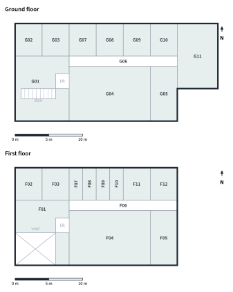

---
authors:
---
# The building

## Layout

The main block is {{length_m}} m long and {{depth_m}} m deep, on a structural grid of
{{bays_x}} × {{bays_y}} bays, each {{bay_x_m}} m by {{bay_y_m}} m. It has {{storeys}} storeys at
{{floor_to_floor_m}} m floor to floor. A single-storey cycle hub, {{annex_w_m}} m by
{{annex_d_m}} m, is attached at the east end under a green roof. The gross internal area is
{{gia_m2}} m².

The plan follows one simple rule. Rooms that people sit in for hours face south, towards the
sun, the view and the campus. Rooms that need little daylight or produce heat sit in a strip
along the north side: WCs, the plant room, the server room, stores and showers. A corridor
separates the two. This keeps the services close together, which shortens pipes and ducts, and
it puts the warm server room right next to the plant room that uses its heat.

The entrance is a double-height glazed atrium at the south-west corner, with the café, the stair
and the lift. On the first floor the atrium opens into a breakout lounge, so the two floors feel
connected and warm air can rise and escape at high level in summer.

<!-- auto:plans -->

<!-- /auto -->

## Rooms

The building has {{rooms}} rooms plus corridors. Room areas and furniture layouts come from the
3D model, and the same layouts were printed as the furniture trays in our 1:100 model.

<!-- auto:rooms -->
Table: Room schedule (net floor areas from the 3D model)

| Code | Room | Floor | Area (m²) | Use |
| --- | --- | --- | ---: | --- |
| G01 | Entrance Atrium & Cafe | Ground | 57.1 | Double-height glazed entrance facing the campus, cafe and reception counter. |
| G02 | WCs (incl. accessible) | Ground | 15.6 | Accessible WC plus two cubicles; stacked under the first-floor WCs. |
| G03 | Wellbeing & Prayer Room | Ground | 16.8 | Quiet, bookable room for prayer, reflection or a break. |
| G04 | Flexible Teaching Hall | Ground | 90.8 | 48-seat flat-floor teaching space, reconfigurable for events. |
| G05 | Makerspace | Ground | 27.3 | 3D printing, electronics and prototyping benches. |
| G06 | Ground Floor Corridor | Ground | 21.1 | 1.5 m wide accessible corridor linking the atrium to the cycle hub. |
| G07 | Furniture Store | Ground | 16.8 | Store for stacking chairs and event kit next to the hall. |
| G08 | Plant Room | Ground | 16.8 | Water-source heat pump, thermal store, battery, MVHR and rainwater pumps. |
| G09 | Edge Server Room | Ground | 16.8 | Small edge data centre whose waste heat feeds the heat pump and heats the building. |
| G10 | Showers & Changing | Ground | 15.6 | Showers, lockers and changing for people who cycle in. |
| G11 | Cycle Hub | Ground | 50.1 | Secure two-tier cycle parking and e-bike charging under a green roof. |
| F01 | Breakout & Co-working Lounge | First | 39.7 | Informal lounge and co-working around the atrium. |
| F02 | WCs | First | 15.6 | First-floor WCs stacked above the ground-floor WCs. |
| F03 | Kitchenette | First | 16.8 | Tea point with water refill station. |
| F04 | Quiet Study Library | First | 90.8 | 28 silent study seats: window desks, shared tables, book stacks. |
| F05 | Staff Office | First | 27.3 | Office for the hub's staff and student support. |
| F06 | First Floor Corridor | First | 21.1 | Corridor to the study pods, control room and meeting room. |
| F07 | Group Study Pod 1 | First | 8.1 | Bookable 4-person pod with a screen for group work. |
| F08 | Group Study Pod 2 | First | 8.1 | Bookable 4-person pod with a screen for group work. |
| F09 | Group Study Pod 3 | First | 8.1 | Bookable 4-person pod with a screen for group work. |
| F10 | Group Study Pod 4 | First | 8.1 | Bookable 4-person pod with a screen for group work. |
| F11 | Smart Building Control Room | First | 16.8 | Building management system head-end with a live digital-twin dashboard students can see. |
| F12 | Meeting Room | First | 15.6 | 6-person meeting room with video conferencing. |
|  | **Total net area** |  | **621** |  |
<!-- /auto -->

{: style="width:120mm"}

## Designing for the people who use it

**Access for everyone.** The entrance is level, the main corridors are 1.5 m wide and a lift
serves both floors. The ground floor has an accessible WC next to the entrance. These follow the
guidance in Approved Document M for buildings other than dwellings [@adm2015].

**Choice of places to work.** Students can choose a silent library seat, a bookable group pod
with a screen, a lounge, a café table or a teaching hall that can be rearranged for events.
Across the building there are {{seats}} seats.

**Wellbeing.** A quiet wellbeing and prayer room is available to book, every room has fresh air
controlled by CO₂ sensors ([[Fresh air and air quality]]), and the first floor, including the
library, gets soft north light from the sawtooth roof, which does not cause glare on screens.

**Arriving by bike.** People who cycle in get secure parking, lockers, showers and changing rooms
next to the entrance, so arriving by bike is as easy as arriving by car.

!!! contribute "Design Lead: drawings"
    Add the sections and elevations from Fusion 360 (export them as PNG or SVG into
    `Book/images/`) and a short description of how the design developed, with early sketches if
    you have them. One image per line: ``.
