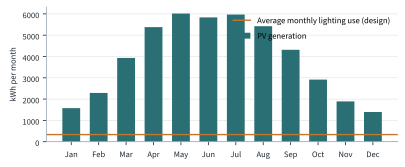
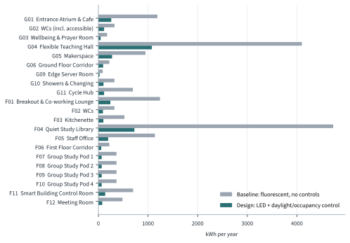

---
authors:
---
# Energy and building services

This section describes each technology in the building, how it works and how big it is. The
numbers come from the design model; where something has not been sized yet, we say so.

## Heat from computers

Every watt of electricity a computer uses ends up as heat. Data centres normally spend more
energy on cooling to get rid of it. European energy-efficiency law now expects larger data
centres to reuse their waste heat where it is feasible [@eu2023_1791], and The Heat Exchange
applies the same idea at the scale of a single building.

The edge server room (G09) holds {{server_racks}} racks with an assumed IT load of {{server_kw}} kW
each. Running all year, that is {{server_it_kwh}} kWh of electricity, and so about
{{server_heat_mwh}} MWh of heat a year. The heat is collected as follows:

1. Each rack has a **rear-door heat exchanger**: a water-cooled coil that takes heat out of the
   air leaving the servers, before it reaches the room.
2. A **coolant distribution unit** circulates that water. It comes back only lukewarm, which is
   too cool to heat a building directly.
3. A **water-source heat pump** in the plant room (G08) uses the warm water as its source and
   raises it to the 45–55 °C needed for low-temperature heating. A heat pump with a warm source
   needs much less electricity than one that takes heat from cold outdoor air.
4. A **thermal store** (an insulated hot-water tank) evens out the difference between when heat
   is produced and when it is needed.

The servers would be used for real computing work, such as the university's teaching
platforms or research jobs, so the heat is a by-product of something useful rather than an
end in itself.

!!! contribute "Engineering or Physics: size the heat pump"
    Estimate the building's heating demand ([[Heat loss]]), then compare it with the server heat
    month by month. Is there more server heat than the building needs? If so, could the surplus
    go to neighbouring campus buildings, or should the server load be smaller? Find a published
    coefficient of performance (COP) for a water-source heat pump and cite it.

## Solar power

The sawtooth roof has {{pv_modules}} solar panels, {{pv_kwp}} kWp in total, on the south-facing
slope of each tooth at {{pv_tilt}}°. We estimated their output with the European Commission's
Photovoltaic Geographical Information System, PVGIS [@pvgis], using its {{pvgis_db}} satellite
weather data for {{pvgis_years}} and the default {{pv_loss_pct}}% allowance for cable, inverter
and dirt losses.

The array should generate about {{pv_yield_kwh}} kWh a year, which is {{pv_specific_yield}} kWh
for each kWp installed. That is about {{pv_vs_lighting}} times what the building's lighting
uses. Output varies strongly with the seasons, from about {{pv_best_month_kwh}} kWh in the best
month to {{pv_worst_month_kwh}} kWh in the worst.

<!-- auto:chart_pv -->

<!-- /auto -->

The carports over the retained parking could carry more panels. They are not counted here,
because their size depends on how much parking the university decides to keep.

## Battery storage

Solar output peaks at midday, but the building is busy into the evening. A battery in the plant
room stores surplus midday electricity for later in the day, so less is exported cheaply and
less is bought back at a higher price. Its size depends on the hourly energy model, so it is
listed in the cost schedule as awaiting a quote.

## Lighting

All lighting is LED. Each 600 × 600 mm panel gives {{led_lumens}} lumens from {{led_watts}} W,
about {{led_lm_per_w}} lumens per watt, compared with about {{baseline_lm_per_w}} lumens per watt for the older fluorescent
fittings we used as a baseline. Every room also has occupancy and daylight sensors
({{light_sensors}} in total) that dim or switch off lights when a room is empty or bright enough.

We sized the lighting in each room with the lumen method, which gives the number of fittings
needed to reach a target light level on the working surface:

> N = (E × A) ÷ (Φ × UF × MF)

where N is the number of fittings, E the target illuminance in lux, A the floor area in m², Φ
the light output of one fitting in lumens, UF the utilisation factor ({{light_uf}}, the share of
light that reaches the working surface) and MF the maintenance factor ({{light_mf}}, allowing for
dirt and ageing). The target levels follow BS EN 12464-1 [@bsen12464]: for example, 500 lux for
study and teaching and 100 lux for corridors. The calculation for the teaching hall is shown
step by step below; [[Lighting schedule]] gives every room.

<!-- auto:lumen_example room=G04 -->
Table: Lumen-method lighting calculation for the Flexible Teaching Hall (G04)

| Step | Working | Result |
| --- | --- | ---: |
| Target illuminance, E | Maintained illuminance in line with BS EN 12464-1 [@bsen12464] | 500 lux |
| Floor area, A | From the 3D model | 90.8 m² |
| Lumens needed | E × A ÷ (UF × MF) = 500 × 90.8 ÷ (0.6 × 0.8) | 94,583 lm |
| Number of panels, N | lumens needed ÷ 4,000 lm per panel = 23.65, rounded up | 24 |
| Installed power | 24 × 32 W, which is 8.5 W per m² of floor | 768 W |
| Hours in use | Timetable assumption for this room | 2,600 h/yr |
| Controls | Daylight dimming 0.6 × occupancy switching 0.9 | 0.54 |
| Design energy | 768 W × 2,600 h × 0.54 ÷ 1000 | 1,078 kWh/yr |
| Baseline energy | 94,583 lm ÷ 60 lm/W × 2,600 h ÷ 1000, no controls | 4,100 kWh/yr |
<!-- /auto -->

Across the building, {{led_panels}} LED panels use about {{lighting_design_kwh}} kWh a year,
against {{lighting_baseline_kwh}} kWh for the fluorescent baseline. That is a
{{lighting_saving_pct}}% saving: {{lighting_saving_kwh}} kWh, about £{{lighting_saving_gbp}} and
{{co2_saving_kg}} kg CO₂e a year, using the current non-domestic electricity price
[@desnz_qep2026] and the UK government's carbon factor for grid electricity [@desnz_ghg2026].

<!-- auto:chart_lighting -->

<!-- /auto -->

## Fresh air and air quality

A mechanical ventilation with heat recovery (MVHR) unit supplies fresh air and extracts stale
air. In winter, a heat exchanger inside the unit passes most of the warmth from the outgoing air
to the incoming air without mixing them, so ventilation does not throw heat away.

{{iaq_sensors}} indoor air quality sensors measure CO₂, temperature and humidity in each occupied
room. CO₂ rises when a room is full, so the fans speed up when people are there and slow down
when they leave, instead of running to a fixed timetable. In summer, the double-height atrium
lets warm air rise and leave through high-level openings, drawing cooler air in at ground level.

!!! contribute "Chemistry or Forensics: air and water quality"
    Explain why CO₂ is used as a sign of stale air, what levels are recommended for classrooms
    (with a source), and which other pollutants matter indoors, for example volatile organic
    compounds from furniture and finishes. How could they be tested?

## Water

Rain falling on the roofs is collected, filtered and stored in a tank, then pumped to flush the
WCs, which have dual-flush cisterns using 4 or 2.6 litres a flush. This reduces the amount of
treated mains water used for flushing. A chilled water refill station in the first-floor
kitchenette encourages reusable bottles instead of single-use plastic.

## Smart building control room

All of these systems report to a building management system (BMS). Instead of hiding it in a
cupboard, its head-end sits in a glass-fronted control room (F11) with a live dashboard that
shows students how much energy the building is generating and using, where the heat is coming
from, and the air quality in each room. The same data could feed the online digital twin, so
students can see the building working from anywhere.

!!! contribute "Computing: the control system"
    Describe how the sensors, BMS and dashboard would connect: which data each sensor sends, how
    often, and the rules the system follows (for example, dim the lights when daylight exceeds the
    target level). A simple flow diagram would help.

## The energy balance so far

<!-- auto:energy_balance -->
Table: Annual energy flows modelled so far, priced at 24.5 p/kWh [@desnz_qep2026] with grid carbon at 0.131 kgCO₂e/kWh [@desnz_ghg2026]

| Flow | kWh/yr | £/yr | tCO₂e/yr | Basis |
| --- | ---: | ---: | ---: | --- |
| Roof PV generation | 46,924 | £11,496 | 6.1 | 49 kWp, 25° south, 14% system losses [@pvgis] |
| Lighting, as designed | 4,021 | £985 | 0.5 | LED with daylight and occupancy control |
| Lighting, baseline (for comparison) | 18,923 | £4,636 | 2.5 | Fluorescent at 60 lm/W, no controls |
| Other equipment | 2,340 | £573 | 0.3 | Catalogue power × hours × use factor |
| Server IT load (all of it becomes heat) | 105,120 | £25,754 | 13.8 | 4 racks × 3 kW × 8,760 h |
| Space heating, hot water and ventilation fans | *to be modelled* |  |  | Energy model: see [[Limitations and next steps]] |
<!-- /auto -->

The table shows the most important finding so far. The solar panels comfortably cover the
lighting and the other equipment, but the server room uses about {{server_vs_pv}} times as much
electricity as the roof can generate. Whether the building is net zero therefore depends on how it is
counted. If the servers are treated as a computing service that the university needs anyway,
and their heat is a free by-product, the building itself may well be net zero. If their
electricity is counted against the building, it is not, unless the server load is reduced or
renewable electricity is bought for it.

We have not yet calculated the heating demand, so this is a hypothesis to test rather than a
claim. [[Limitations and next steps]] explains the energy model that would settle it.
