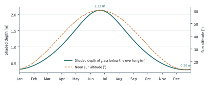

---
authors:
---
# Form, daylight and shading

The cheapest energy is the energy a building never needs. This section looks at how the shape
of the building, the size of its windows and the depth of its overhang reduce its heating,
cooling and lighting needs before any technology is added.

## A compact shape

Heat escapes through a building's outer surfaces, so for a given amount of space, the less
surface area there is, the less heat is lost. A useful measure is the surface area to volume
ratio (SA:V): the area of the envelope (walls, roof and ground floor) divided by the heated
volume inside it.

The Heat Exchange encloses {{volume_m3}} m³ inside {{envelope_m2}} m² of envelope, an SA:V of
{{sa_v}} m⁻¹. For comparison, a cube is the most compact practical shape: a cube with the same
volume would have sides of {{cube_side_m}} m and an SA:V of {{sa_v_cube}} m⁻¹ (six faces of area
s², divided by s³, gives 6 ÷ s). The design is close to that ideal, while still being shallow
enough for daylight to reach the middle of each floor, which a cube would not be.

## Windows where they help

Windows let in daylight and useful winter sun, but they lose heat in winter and can overheat a
room in summer. The window-to-wall ratio (WWR), the share of each wall that is glazed, was
therefore varied with orientation:

Table: Glazing by orientation, measured from the 3D model

| Facing | Glazed area | Window-to-wall ratio | Reasoning |
| --- | ---: | ---: | --- |
| South | {{glazing_s_m2}} m² | {{wwr_s}}% | Low winter sun is welcome; high summer sun is blocked by the overhang |
| West | {{glazing_w_m2}} m² | {{wwr_w}}% | Glazed atrium and café facing the campus approach |
| East | {{glazing_e_m2}} m² | {{wwr_e}}% | Morning light to the makerspace; the cycle hub covers part of this wall |
| North | {{glazing_n_m2}} m² | {{wwr_n}}% | Steady, glare-free light, but no solar gain, so kept small |

The west façade is the weak point. Low afternoon sun in summer comes in almost horizontally, so
an overhang cannot block it, and the atrium could overheat on warm afternoons.

!!! contribute "Design Lead: fix or justify the west façade"
    Either reduce the west glazing, add vertical fins or external blinds, or show that the
    atrium's stack ventilation removes the heat. Explain the choice with a sketch.

## Shade that follows the seasons

The first-floor slab and the roof both project {{overhang_m}} m beyond the south face, forming an
overhang above each row of south windows. The depth was chosen from the height of the sun.

At solar noon, the sun's altitude is 90° − φ + δ, where φ is the latitude ({{lat}}° N) and δ is
the solar declination, which varies from +23.4° at the June solstice to −23.4° at the December
solstice. So the noon sun is {{sun_june}}° above the horizon in June but only {{sun_december}}° in
December. The depth of glass shaded below an overhang of projection P is P × tan(altitude):
{{shade_june}} m in June, which covers most of the height of the windows, but only
{{shade_december}} m in December, so the winter sun still reaches deep into the rooms and helps to
heat them.

<!-- auto:chart_shading -->

<!-- /auto -->

## Daylight from the roof

The roof is a sawtooth: a row of ridges, each with a sloping south face covered in solar
panels and a vertical, glazed north face. North light comes from the sky rather than
directly from the sun, so it is soft and even, does not cause glare on screens and does not
overheat the rooms below. It brings daylight into the middle of the first floor, which is too
far from the outside walls to be lit by ordinary windows. Daylight sensors dim the electric
lights whenever it is bright enough ([[Lighting]]).

## Heat loss

!!! contribute "Engineering or Physics: heat loss and heating demand"
    Estimate how fast the building loses heat. For each element (walls, roof, floor, windows),
    the heat loss rate is Q = U × A × ΔT, where U is its U-value in W/m²K, A its area and ΔT the
    temperature difference between inside and outside. Add a ventilation term for the fresh
    air, reduced by the MVHR heat recovery. Multiply by the number of hours and the average
    temperature difference over a heating season to get the annual heating demand, and compare
    it with the server heat in [[Heat from computers]]. A Python graph of monthly demand
    against server heat would make a strong figure.
