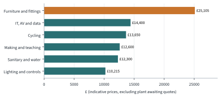

---
authors:
---
# Cost analysis

## How the costs were built up

The fit-out was costed from the bottom up. Our 3D model places every chair, desk, light fitting
and sensor in every room, and the build script counts them and multiplies each count by a unit
price from our catalogue (`Costing/catalogue.csv`). Light fittings are counted from the lumen
method ([[Lighting]]), occupancy sensors at one per 40 m² and air-quality sensors at one per
60 m² of occupied room. The full item list is in [[Itemised fit-out schedule]].

This means the costs always match the design. If a room is rearranged or a price is updated,
the next build recalculates every total in this section.

!!! warning "These are indicative prices"
    The unit prices are realistic estimates, not quotes. Each catalogue line has a `source` and
    `cost_status` column so that the team can replace estimates with real supplier prices, with
    the web address and date for the reference list.

## Fit-out cost

The priced items come to £{{fitout_gbp}}, about £{{fitout_per_m2}} per m² of floor area.

<!-- auto:costs_by_category -->
Table: Fit-out cost by category

| Category | Lines | Priced cost | Share | Awaiting quote |
| --- | ---: | ---: | ---: | --- |
| Furniture and fittings | 40 | £25,105 | 28% |  |
| IT, AV and data | 10 | £14,400 | 16% | Coolant distribution unit |
| Cycling | 4 | £13,650 | 15% |  |
| Making and teaching | 5 | £12,600 | 14% |  |
| Sanitary and water | 7 | £12,300 | 14% |  |
| Lighting and controls | 63 | £10,215 | 12% |  |
| Plant and energy | 5 | £0 | 0% | Battery storage, MVHR unit, Rainwater pump set, Thermal store, Water-source heat pump |
| **Total** | **134** | **£88,270** | **100%** |  |
<!-- /auto -->

<!-- auto:chart_costs -->

<!-- /auto -->

The remaining {{unpriced_count}} items still need a quote, because their size depends on the
energy model: the {{unpriced_items}}. These are the expensive plant items, so the true total
will be significantly higher than the priced subtotal.

<!-- auto:costs_by_room -->
Table: Fit-out cost and running cost by room (indicative prices)

| Code | Room | Fit-out | Awaiting quote | Running £/yr |
| --- | --- | ---: | ---: | ---: |
| G01 | Entrance Atrium & Cafe | £5,140 |  | £94 |
| G02 | WCs (incl. accessible) | £2,850 |  | £29 |
| G03 | Wellbeing & Prayer Room | £1,450 |  | £12 |
| G04 | Flexible Teaching Hall | £10,240 |  | £342 |
| G05 | Makerspace | £9,530 |  | £152 |
| G06 | Ground Floor Corridor | £150 |  | £24 |
| G07 | Furniture Store | £905 |  | £1 |
| G08 | Plant Room | £150 | 5 | £1 |
| G09 | Edge Server Room | £5,085 | 1 | £25,760 |
| G10 | Showers & Changing | £3,850 |  | £26 |
| G11 | Cycle Hub | £12,755 |  | £127 |
| F01 | Breakout & Co-working Lounge | £3,660 |  | £60 |
| F02 | WCs | £2,850 |  | £23 |
| F03 | Kitchenette | £5,425 |  | £62 |
| F04 | Quiet Study Library | £10,230 |  | £180 |
| F05 | Staff Office | £2,210 |  | £49 |
| F06 | First Floor Corridor | £150 |  | £15 |
| F07 | Group Study Pod 1 | £1,405 |  | £43 |
| F08 | Group Study Pod 2 | £1,405 |  | £43 |
| F09 | Group Study Pod 3 | £1,405 |  | £43 |
| F10 | Group Study Pod 4 | £1,405 |  | £43 |
| F11 | Smart Building Control Room | £3,795 |  | £147 |
| F12 | Meeting Room | £2,225 |  | £37 |
|  | **Total** | **£88,270** | **6** | **£27,313** |
<!-- /auto -->

## Running costs

Electricity is priced at {{elec_p_per_kwh}} p/kWh, the average price paid by non-domestic
consumers including the Climate Change Levy in the second quarter of 2026 [@desnz_qep2026].
Carbon is counted at {{grid_kgco2e}} kgCO₂e per kWh, the government's 2026 conversion factor for
UK grid electricity [@desnz_ghg2026].

At these rates, the efficient lighting alone saves about £{{lighting_saving_gbp}} and
{{co2_saving_kg}} kg CO₂e every year compared with the fluorescent baseline. The largest running
cost by far is the server room, which is why its heat must be put to use
([[The energy balance so far]]). The solar panels offset part of it: their
{{pv_yield_kwh}} kWh a year would cost about £{{pv_value_gbp}} to buy from the grid.

## Construction cost

!!! contribute "Cost & Resource Coordinator: construction cost"
    Find a published construction cost per m² for a university or education building (for
    example from BCIS or a quantity surveyor's cost guide) and multiply it by the {{gia_m2}} m²
    floor area. Add a premium for the CLT structure and the renewable plant if your source
    suggests one, and cite it. Then add the fit-out above to give a total project cost, and
    compare it with the budget in [[A hypothetical budget]].

!!! contribute "Cost & Resource Coordinator: payback"
    Pick one technology, such as the LED lighting or the solar panels, and work out its simple
    payback period: extra cost ÷ annual saving. Is it worth it over the equipment's lifetime?

## The cost of our models

The printed models are cheap by comparison. All {{print_jobs}} print jobs together use about
{{print_grams}} g of PLA filament and {{print_hours}} hours of printer time, about £{{print_gbp}} in
material ([[How we made it]]).
