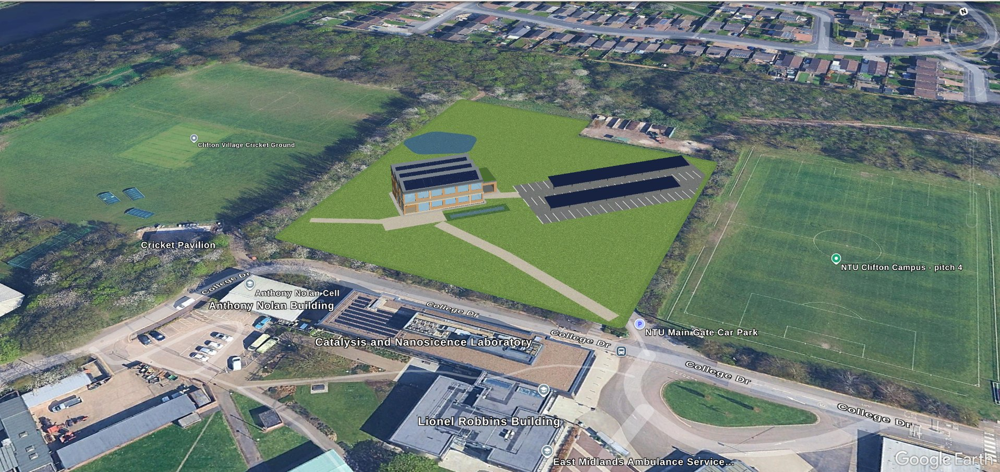
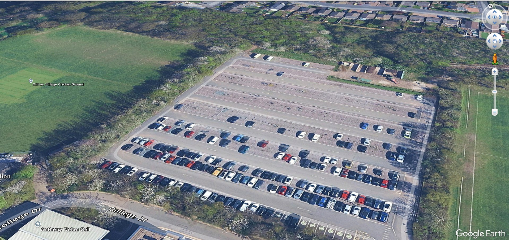

---
authors:
---
# Introduction and site

## The brief and design aims

The project brief asks teams to design a sustainable work or living space that addresses one or
more of the United Nations Sustainable Development Goals, to integrate a variety of sustainable
technologies, and to present the design at a poster-display event [@ntu_brief]. Required outputs
are technical drawings, a physical poster, and this Design Outline, with research supported by
Harvard referencing [@ntu_brief].

Our response is guided by three linked aims:

1. **Reduce operational energy** through efficient fabric, lighting and controls.
2. **Generate and recover energy** on site with roof photovoltaics and waste-heat recovery from
   an edge server room.
3. **Serve students** in a hospitable building that offers quiet study, teaching, making,
   socialising and wellbeing spaces, set in an expanded green landscape.

## Location

The proposal sits on College Drive, Clifton, Nottingham NG11 8NS, on the existing Students’ Car
Park. The building’s south-west corner is at approximately 52.9135° N, 1.1839° W (British
National Grid 454976 E, 335433 N). We chose the site for the large green space around it, the
relatively flat ground, and the chance to expand campus ecosystems rather than cut into them.
Groundworks would be limited compared with a steep or densely built plot; under the plan the car
park becomes meadow, paths, a pond and outdoor amenity space, with the new building settled in
that landscape.

{: style="width:145mm"}

The proposal is intended to sit comfortably with the surrounding campus, which is already strong
in landscape quality. NTU’s campuses have been recognised with the Green Flag Award for the
management of green space [@ntu_greenflag2026].

## Existing condition and proposal

At present the site is a hardstanding car park, with a rough boundary of hedges, set back from
the main campus approach behind a barrier. The intention is to replace most of that surface with
a carefully developed green space and to place the new building within it.

{: style="width:145mm"}

The existing car park is widely disliked because students and staff pay £2 a day to park. That
revenue can be weighed against electricity value from the roof array. Using PVGIS, the 49 kWp
south-facing array at 25° is estimated to generate about 46,924 kWh/yr at this latitude [@pvgis].
After lighting and other non-IT equipment (about 6,400 kWh/yr in the design schedule), roughly
40,500 kWh/yr remains. Valued at the current non-domestic electricity price of 24.5 p/kWh
[@desnz_qep2026], that is about **£9,900/yr** of avoided purchase (or a lower figure if exported
under a feed-in tariff). By comparison, if about 120 spaces were used on average at 55% occupancy
over 220 weekdays at £2/day, parking income would be about **£29,000/yr**. The PV alone does not
fully replace that income, so the case for the project also rests on landscape, student facilities
and encouraging sustainable travel—not only on selling power. A smaller, discounted or free car
park could sit elsewhere on campus under solar canopies, while bus routes from campus to the city
centre and the Rivergreen tram stop support arrival without a car.

Arrival at The Heat Exchange is designed around walk and cycle paths from the main road, with a
secure cycle hub, showers and changing on the east end of the building.

Table: Site facts

| Item | Existing | Proposed |
| --- | --- | --- |
| Primary land use | Student / staff car park | Student learning hub and landscape |
| Approximate plot area | about 10,200 m² (proposal plot from the site model) | Same plot; building footprint about 400 m² |
| Parking / cycle provision | Surface parking; some EV use with NTU ID | Cycle hub (40 spaces), e-bike charging; reduced parking elsewhere |
| Surface water | Hardstanding; limited soakaway | Soft landscape, pond / rain garden, semi-permeable paths |
