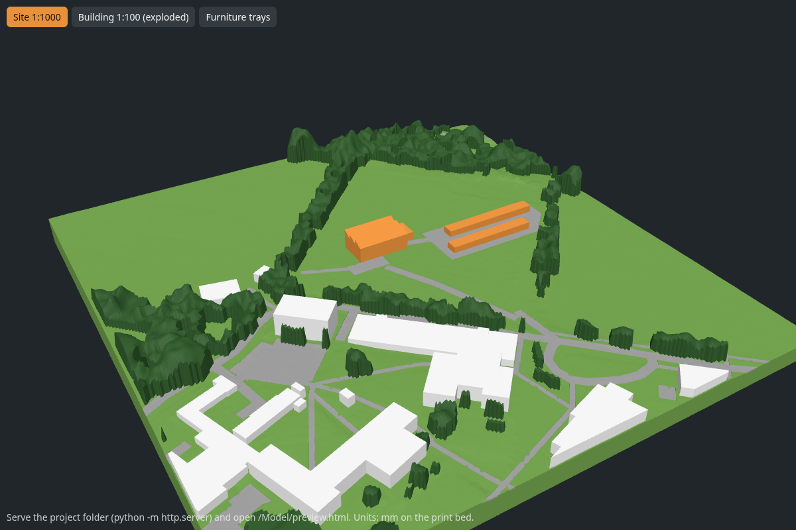
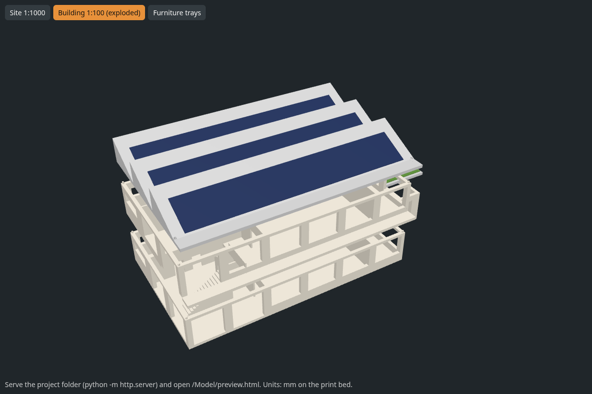
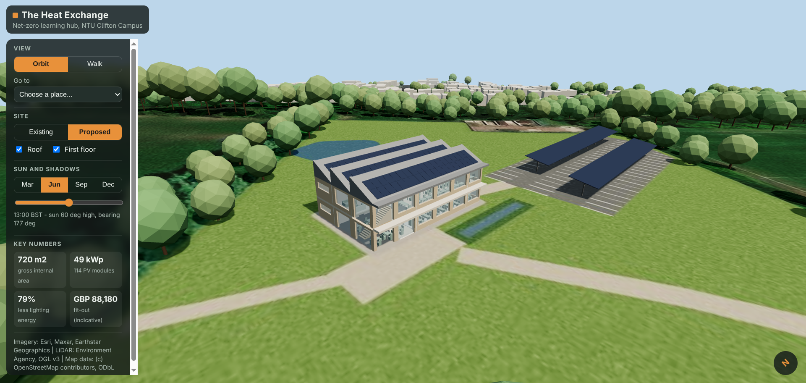

# The Heat Exchange - NTU Clifton Campus

A two-storey, net-zero learning hub on the Students' Car Park at NTU Clifton (OSM way 29348021).
Waste heat from an on-site edge server room feeds a water-source heat pump. A north-light
sawtooth roof carries 49 kWp of PV and lets daylight into the first floor. Fit-out uses LED
lighting with daylight and occupancy control.

Everything is generated from code. Change a number in `src/config.py`, run one command, and
the print files, cost estimate, room schedule, web twin and Google Earth model all update together.

For an explanation of the source model, generated outputs and safe ways to change them, see the
[project guide](docs/PROJECT_GUIDE.md).

To add reusable sofas, screens or site props without editing Python, use the
[placeable-assets guide](docs/PLACEABLE_ASSETS.md). To add to the laser-engraved poster wall,
use the [laser wall guide](docs/LASER_WALL.md). To write a section of the Design Outline, use the
[Design Outline guide](docs/DESIGN_OUTLINE.md).

| Output | Where |
|---|---|
| **Design Outline (A4 PDF with citations, costs and SDGs)** | `Book/The_Heat_Exchange_Design_Outline.pdf` (written in `Book/chapters/`) |
| **Print-ready files (just copy to the printer)** | `Model/bambu/` (see its README) |
| Real slicer time, grams and cost | `Model/bambu/slice_report.md` |
| Raw STLs: 1:1000 site, 1:100 building, furniture trays | `Model/print/` |
| Room-by-room fit-out schedule (every light, chair, sensor) | `Costing/items.csv` (prices from `Costing/catalogue.csv`) |
| Building metrics (areas, glazing ratios, PV, overhang shading) | `Design/exports/building_metrics.json` |
| Google Earth Pro model | `Design/exports/heat_exchange_google_earth.kmz` |
| Walkable web twin | `Web-Twin/` |
| Renders for the poster | `Design/renders/` |



## 1. Rebuild everything

```bash
python3 -m venv ~/.venvs/heat-exchange          # keep the venv OUTSIDE the repo (Cursor indexing)
~/.venvs/heat-exchange/bin/pip install -r requirements.txt
~/.venvs/heat-exchange/bin/python src/build_all.py
```

This takes about 30 s. Site data (OpenStreetMap, Environment Agency 1 m LiDAR, aerial imagery) is
downloaded once into `Site/raw/` and reused after that. Delete a file there to re-download it.

Coordinates: the origin is the building's south-west corner at BNG (454976, 335433), which is
lat 52.91352, lon -1.18391. The finished floor level is 55.45 m AOD. x points east, y points
north (grid north, 0.65 deg east of true north) and z points up. Units are metres.

## 2. The physical model (the main demonstration)

**How to print it: see [`Model/bambu/README.md`](Model/bambu/README.md).** That folder already
contains print-ready files sliced by Bambu Studio for NTU's Bambu Lab printers: the X1C in the 3D
Printing Studio and the X1E (with AMS) in the RISE laboratory. Copy the matching folder to a
microSD card and press print. No software is needed on a university laptop.

The whole model prints on Bambu FDM printers in PLA: about 1.1 kg, about 33 h of printing, and
**about GBP 21** at GBP 20/kg (the real slicer figures are in `Model/bambu/slice_report.md`).
The Formlabs resin printer is not needed. Its software (PreForm) has no Linux version, and the
furniture prints fine on a standard 0.4 mm nozzle at 0.12 mm layers. The resin-ready STLs in
`Model/print/trays_sla/` are still there if a technician offers. **Ask the NTU print service what
they actually charge** and update `PLA_GBP_PER_KG` in `src/config.py`.



What the parts are:

- **Site 1:1000** (230 mm square):
  - The terrain is real LiDAR ground level, and tree and building heights are LiDAR surface minus ground.
  - Roads are 0.6 mm inlays.
  - There are 4 colours if the printer has an AMS (Bambu's automatic filament changer), plus a
    one-colour version to paint by hand.
  - A grey rim round the edge has a 3.5 mm slot that holds the four engraved plywood poster
    walls (see the [laser wall guide](docs/LASER_WALL.md)). The slot width follows
    `WALL_PLY_MM` in `src/config.py`, so measure the ply before printing.
- **Building 1:100:**
  - Ground floor, first floor and roof lift off each other on 1.8 mm locating pegs (with 0.4 mm hole clearance).
  - The cycle hub has a green roof.
  - The solar panels are three flat dark-blue strips that glue into pockets in the roof. Printing them
    as a coloured skin on the slope would mean hundreds of filament swaps.
  - Everything prints flat side down with no supports.
- **Furniture trays 1:100:** each room is a 0.5 mm floor plate with its furniture fused on. Drop
  the tray into the room when you lift the floor above off, dollhouse style.

The raw STLs are in `Model/print/`. To preview them in a browser, run `python3 -m http.server`
in this folder and open <http://localhost:8000/Model/preview.html>. To re-slice after changing
the design, run `python src/bambu.py`. It needs Bambu Studio from Flathub:
`flatpak install --user flathub com.bambulab.BambuStudio`.

### Assembly for the poster event

Place the site model next to the building. The orange block on the site model is the same
building at 1:1000. Stack the ground floor, first floor and roof on their pegs, and put the cycle
hub at the east end. Lift the roof and first floor off to show the furniture trays and the
stair or atrium void. Drop the four poster walls into the site model's rim slot, engraved face
out, in label order (south, east, north, west); lift any one out to show the model inside.

## 3. Web twin and QR code



The web twin is plain static files: three.js loaded from a CDN, with no build step.

- **Run locally:** `python3 -m http.server 8000 -d Web-Twin`, then open <http://localhost:8000>.
- **Controls:**
  - *Orbit*: drag, scroll, and click a room to see its details.
  - *Walk*: WASD or arrow keys, drag to look, Shift to run. Phones get a left-hand joystick.
  - *Go to*: preset viewpoints.
  - *Existing / Proposed*: switches between today's aerial image and the proposed scheme.
  - *Sun*: date and time controls drive real sun positions and shadows at this latitude.
  - *Room panel*: lighting design compared with a fluorescent baseline, plus the itemised fit-out list.
- **Live:** <https://aiden12343.github.io/heat-exchange-twin/> (repo `Aiden12343/heat-exchange-twin`,
  which holds only the contents of `Web-Twin/`).
- **Redeploy after a rebuild:**
  ```bash
  git clone https://github.com/Aiden12343/heat-exchange-twin.git /tmp/hx && rsync -a --delete --exclude .git --exclude README.md --exclude .nojekyll Web-Twin/ /tmp/hx/
  cd /tmp/hx && git add -A && git commit -m "Update twin" && git push
  ```
- **QR for the poster:** `python src/make_qr.py https://<user>.github.io/<repo>/` writes
  `Poster/web_twin_qr.svg` (use the SVG so it stays sharp at A2) and a PNG. Print it at least
  40 mm square and test it from across a table.
- **Laser-engraved poster walls:** four removable plywood walls that stand in a slot round the
  site model, with the poster (and the QR code) engraved into them. Teammates add cards in
  `Poster/laser_wall.json` without code; see the [laser wall guide](docs/LASER_WALL.md).

If you add `?debug` to the URL, the page exposes `window.twin` for scripted testing.

## 4. Google Earth

Open `Design/exports/heat_exchange_google_earth.kmz` in **Google Earth Pro** (it runs on
Linux: File > Open). The model is placed at the real location and rotated for grid convergence.
The proposed landscape (meadow, pond, paths, retained parking) is draped over Google's 3D campus,
so it replaces the car park. Google can't cut its own scenery away, so the odd parked van at the
plot edge shows through as a bump. For a clean architectural-model look, untick
**Layers > 3D Buildings** and tick the hidden "massing" and "trees" folders in the KMZ instead.
If an old copy is in Places, delete it first. Google Earth on the web does not display 3D COLLADA
models.

## 5. Porting to Fusion 360

The Python generator is the source of truth, and Fusion is used for presentation drawings.

1. Insert > Insert Mesh, choose the `Model/print/building/*.stl` files, and set units to **mm**.
   The parts are at 1:100. Scale by 100 about the origin to get full size in metres.
2. For editable geometry, rebuild using sketches and dimensions from `src/config.py` and
   `src/building.py`:
   - 6 x 4.0 m bays by 3 x 4.8 m bays;
   - 3.6 m floor to floor, 300 mm slabs;
   - 360 mm external walls and 150 mm partitions;
   - 1.2 m south overhang and 25 deg sawtooth;
   - window positions from the `OPENINGS` table.
   Mesh to BRep conversion is only practical for small parts such as the trays.
3. Use the Fusion model for plans, sections and elevations on the poster. If you change the
   design, change `config.py` too so the numbers stay consistent.

## 6. What still needs doing (team jobs)

Every price in `Costing/catalogue.csv` is **indicative**. The `cost_status` and `source` columns
show what needs checking. For the Design Outline (Harvard referencing):

- [ ] Replace each catalogue price with a real supplier price, including the URL and access date.
      Plant items (heat pump, PV, batteries, MVHR) need a quote or a published GBP/kW benchmark.
- [x] Electricity price and carbon factor: GBP 0.245/kWh (DESNZ Quarterly Energy Prices, Sept
      2026, non-domestic average incl. CCL) and 0.131 kgCO2e/kWh (DESNZ GHG conversion factors
      2026). Both are cited in the Design Outline.
- [ ] Construction cost: GBP/m2 for an education building from BCIS or RICS, applied to 720 m2 GIA.
- [ ] Energy model:
      - fabric heat loss (choose U-values);
      - space heating demand;
      - how much of that the server waste heat covers (each 3 kW rack gives roughly 26 MWh/yr of heat);
      - [x] **PVGIS** yield for 49 kWp at 25 deg facing south: about 46.9 MWh/yr (cached in
        `Design/exports/pvgis.json`, refreshed automatically if the PV layout changes);
      - the annual net balance. The servers use about 2.2 times what the PV generates, so the
        net-zero claim depends on this model.
      Plot the results with Python graphs, which the brief encourages for computing students.
- [ ] The west facade has a 0.45 window-to-wall ratio, which is an afternoon overheating risk.
      Either reduce it or justify it, for example with vertical fins or the atrium stack ventilation.
- [ ] Design Outline: the starter draft in `Book/` already covers every section, including the
      SDG mapping, costs and references. Each role fills in its dashed "To write" boxes and adds
      names to `Book/book.json` (see the [Design Outline guide](docs/DESIGN_OUTLINE.md)).
- [ ] A2 poster, using the renders in `Design/renders/` and the QR code.

## Data credits

- Map data (c) OpenStreetMap contributors, ODbL.
- LiDAR (c) Environment Agency, Open Government Licence v3.
- Imagery: Esri, Maxar, Earthstar Geographics (displayed with attribution for non-commercial,
  educational use).
