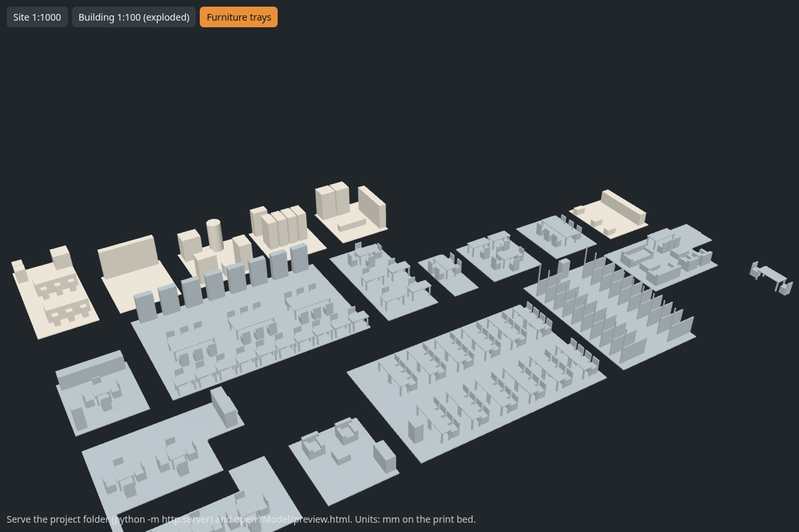

# The Heat Exchange - NTU Clifton Campus

A two-storey, net-zero learning hub on the Students' Car Park at NTU Clifton (OSM way 29348021).
Waste heat from an on-site edge server room feeds a water-source heat pump. A north-light
sawtooth roof carries 49 kWp of PV and lets daylight into the first floor. Fit-out uses LED
lighting with daylight and occupancy control.

Everything is generated from code. Change a number in `src/config.py`, run one command, and
the print files, cost estimate, room schedule, web twin and Google Earth model all update together.

| Output | Where |
|---|---|
| 1:1000 site model (5 colour bodies) | `Model/print/site/` |
| 1:100 lift-off building (ground floor, first floor, roof + PV, cycle hub) | `Model/print/building/` |
| 1:100 furniture trays, SLA and FDM | `Model/print/trays_sla/`, `Model/print/trays_fdm/` |
| Print cost and time estimate | `Model/print/print_cost_estimate.md` |
| Room-by-room fit-out schedule (every light, chair, sensor) | `Costing/items.csv` (prices from `Costing/catalogue.csv`) |
| Building metrics (areas, glazing ratios, PV, overhang shading) | `Design/exports/building_metrics.json` |
| Google Earth Pro model | `Design/exports/heat_exchange_google_earth.kmz` |
| Walkable web twin | `Web-Twin/` |
| Renders for the poster | `Design/renders/` |


## 1. Rebuild everything

```bash
python3 -m venv ~/.venvs/heat-exchange          # keep the venv OUTSIDE the repo (Cursor indexing)
~/.venvs/heat-exchange/bin/pip install -r requirements.txt
~/.venvs/heat-exchange/bin/python src/build_all.py
```

This takes about 30 s. Site data (OpenStreetMap, Environment Agency 1 m LiDAR, aerial imagery) is
downloaded once into `Site/raw/` and reused after that. Delete a file there to re-download it.

Coordinates: the origin is the building's south-west corner at BNG (454976, 335433), which is
lat 52.91352, lon -1.18391. The finished floor level is 55.45 m AOD. x points east, y points
north (grid north, 0.65 deg east of true north) and z points up. Units are metres.

## 2. The physical model (the main demonstration)

Total material estimate is **about GBP 32** against a GBP 40 budget. The breakdown is in
`Model/print/print_cost_estimate.md`. The assumptions are PLA at GBP 20/kg and resin at GBP 160/L.
**Ask the NTU print service what they actually charge** (some labs charge per gram, some are free
for coursework) and update the prices in `src/config.py`.


### 2.1 Site model 1:1000 (Bambu Lab, one plate, about 16 h)

1. In Bambu Studio, select **all five** `site_1to1000_[1-5]_*.stl` files and import them together.
   When it asks *"Load these files as a single object with multiple parts?"*, answer **Yes**.
   The parts are already aligned to each other. Do not move them individually.
2. In the Objects list, assign a filament to each part: terrain green, roads grey, existing
   buildings white, trees dark green, proposal orange. A single AMS has 4 slots, so if you only
   have one, give roads and existing buildings the same light grey.
3. Use a 0.2 mm layer height, 15% infill, no supports, and turn on *Flush into object's infill*
   to cut purge waste. The estimate does **not** include colour-change purge waste. Expect
   roughly another 50-150 g, so check the gram figure Bambu Studio shows after slicing.
4. If no AMS is available, print `site_1to1000_single_colour.stl` in white and paint it by hand.

The terrain is real LiDAR ground level. Tree canopy and building heights come from LiDAR
surface minus ground. Roads are 0.6 mm inlays flush with the terrain.

### 2.2 Building 1:100 (Bambu Lab, about 38 h in total, can split over several printers)

| File | Colour | Notes |
|---|---|---|
| `building_1to100_1_ground_floor.stl` | white or beige | Slab, walls, stair and partitions. Locating pegs on top |
| `building_1to100_2_first_floor.stl` | white or beige | Peg holes underneath, pegs on top |
| `building_1to100_3_roof.stl` + `_3_roof_pv_dark_blue.stl` | grey + dark blue | Import both together as one object with 2 parts, as in 2.1 |
| `building_1to100_4_cycle_hub.stl` | white or beige | Sits against the east end |
| `building_1to100_5_cycle_hub_roof.stl` + `_green_roof.stl` | grey + green | Two parts, as above |

Print every part the way it was exported (flat side down), with 0.2 mm layers, 15% infill and
**no supports**. Window heads bridge 30-40 mm, which Bambu printers handle. The pegs are 1.8 mm
and the holes have 0.4 mm clearance. If the fit is too tight, change `HOLE_CLEARANCE_MM` in
`config.py` and rebuild.

### 2.3 Furniture trays 1:100

Each room has a 0.5 mm floor plate with its furniture fused on. Drop the tray into the room
when you lift the floor above off, dollhouse style.



- `trays_sla/` (14 rooms, about 77 ml resin, about GBP 12) is the fine furniture: chairs, desks,
  sofas and bike racks. Use PreForm with Grey resin and 0.1 mm layers. Lay the trays flat. If the
  printer offers *print directly on build platform*, use it, because it saves the support resin.
- `trays_fdm/` (7 rooms, under GBP 1) holds blocky items such as WCs, plant, server racks and
  shelving. Print them on the Bambu with 0.12 mm layers.

To preview the files before printing, run `python3 -m http.server` in this folder and open
<http://localhost:8000/Model/preview.html>.

### 2.4 Assembly for the poster event

Place the site model next to the building. The orange block on the site model is the same
building at 1:1000. Stack the ground floor, first floor and roof on their pegs, and put the cycle
hub at the east end. Lift the roof and first floor off to show the furniture trays and the
stair or atrium void.

## 3. Web twin and QR code


The web twin is plain static files: three.js loaded from a CDN, with no build step.

- **Run locally:** `python3 -m http.server 8000 -d Web-Twin`, then open <http://localhost:8000>.
- **Controls:**
  - *Orbit*: drag, scroll, and click a room to see its details.
  - *Walk*: WASD or arrow keys, drag to look, Shift to run. Phones get a left-hand joystick.
  - *Go to*: preset viewpoints.
  - *Existing / Proposed*: switches between today's aerial image and the proposed scheme.
  - *Sun*: date and time controls drive real sun positions and shadows at this latitude.
  - *Room panel*: lighting design compared with a fluorescent baseline, plus the itemised fit-out list.
- **Live:** <https://aiden12343.github.io/heat-exchange-twin/> (repo `Aiden12343/heat-exchange-twin`,
  which holds only the contents of `Web-Twin/`).
- **Redeploy after a rebuild:**
  ```bash
  git clone https://github.com/Aiden12343/heat-exchange-twin.git /tmp/hx && rsync -a --delete --exclude .git --exclude README.md --exclude .nojekyll Web-Twin/ /tmp/hx/
  cd /tmp/hx && git add -A && git commit -m "Update twin" && git push
  ```
- **QR for the poster:** `python src/make_qr.py https://<user>.github.io/<repo>/` writes
  `Poster/web_twin_qr.svg` (use the SVG so it stays sharp at A2) and a PNG. Print it at least
  40 mm square and test it from across a table.

If you add `?debug` to the URL, the page exposes `window.twin` for scripted testing.

## 4. Google Earth

Open `Design/exports/heat_exchange_google_earth.kmz` in **Google Earth Pro** (it runs on
Linux: File > Open). The model is placed at the real location and rotated for grid convergence.
Google Earth's own 3D campus will show the existing car park underneath it. Google Earth on the
web does not display 3D COLLADA models.

## 5. Porting to Fusion 360

The Python generator is the source of truth, and Fusion is used for presentation drawings.

1. Insert > Insert Mesh, choose the `Model/print/building/*.stl` files, and set units to **mm**.
   The parts are at 1:100. Scale by 100 about the origin to get full size in metres.
2. For editable geometry, rebuild using sketches and dimensions from `src/config.py` and
   `src/building.py`:
   - 6 x 4.0 m bays by 3 x 4.8 m bays;
   - 3.6 m floor to floor, 300 mm slabs;
   - 360 mm external walls and 150 mm partitions;
   - 1.2 m south overhang and 25 deg sawtooth;
   - window positions from the `OPENINGS` table.
   Mesh to BRep conversion is only practical for small parts such as the trays.
3. Use the Fusion model for plans, sections and elevations on the poster. If you change the
   design, change `config.py` too so the numbers stay consistent.

## 6. What still needs doing (team jobs)

Every price in `Costing/catalogue.csv` is **indicative**. The `cost_status` and `source` columns
show what needs checking. For the Design Outline (Harvard referencing):

- [ ] Replace each catalogue price with a real supplier price, including the URL and access date.
      Plant items (heat pump, PV, batteries, MVHR) need a quote or a published GBP/kW benchmark.
- [ ] Electricity price (GBP 0.25/kWh) and carbon factor (0.177 kgCO2e/kWh): cite the current
      Ofgem cap or a non-domestic tariff, and the **DESNZ GHG conversion factors** for this year.
- [ ] Construction cost: GBP/m2 for an education building from BCIS or RICS, applied to 720 m2 GIA.
- [ ] Energy model:
      - fabric heat loss (choose U-values);
      - space heating demand;
      - how much of that the server waste heat covers (each 3 kW rack gives roughly 26 MWh/yr of heat);
      - **PVGIS** yield for 49 kWp at 25 deg facing south at this location;
      - the annual net balance.
      Plot the results with Python graphs, which the brief encourages for computing students.
- [ ] The west facade has a 0.45 window-to-wall ratio, which is an afternoon overheating risk.
      Either reduce it or justify it, for example with vertical fins or the atrium stack ventilation.
- [ ] SDG write-up: primary 7, 9, 12 and 13; secondary 4 and 11.
- [ ] A4 Design Outline and A2 poster, using the renders in `Design/renders/` and the QR code.

## Data credits

- Map data (c) OpenStreetMap contributors, ODbL.
- LiDAR (c) Environment Agency, Open Government Licence v3.
- Imagery: Esri, Maxar, Earthstar Geographics (displayed with attribution for non-commercial,
  educational use).
